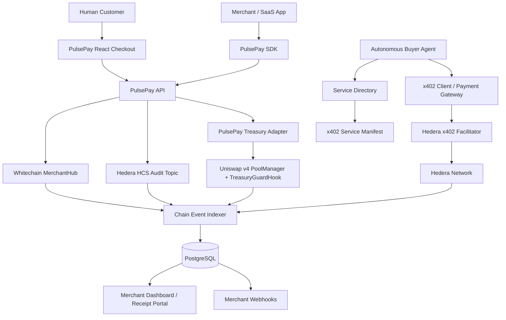

# PulsePay — Product Requirements Document (PRD)

> **Working title:** PulsePay  
> **Package:** `@pulsepay/sdk`  
> **Product category:** Business payments, subscription billing, agentic commerce and onchain treasury tooling  
> **Hackathon:** ETHGlobal Mumbai 2026  
> **Primary target tracks:** Whitechain — Operate · Stablecoin Payments for Business; Hedera — AI Agents That Pay: x402 on Hedera; Uniswap Foundation — Build with Uniswap  
> **Optional bonus:** Hedera — “No Solidity Allowed”: Build with Hedera SDKs  
> **Document status:** Build-ready product and technical specification  
> **Version:** 1.0 — 5 November 2026

---

## 1. Executive Summary

### 1.1 The idea

**PulsePay is a drop-in payment and financial-operations SDK for businesses that need to serve both people and autonomous AI agents.**

A SaaS company, online store, API provider or digital service can integrate PulsePay to:

1. **Accept stablecoin payments from people** through checkout pages, payment links and invoices on Whitechain.
2. **Accept payment in any token via Uniswap ("Pay With Any Token")**, allowing customers to pay with ETH, USDC, or other ERC-20 assets while the merchant always receives the exact USDT requested.
3. **Run recurring subscriptions** with customer-authorized token pulls, renewal handling and an obvious cancel-anytime control.
4. **Issue full or partial refunds** from a merchant dashboard, with a receipt the customer can independently verify.
5. **Sell APIs and tools to AI agents** using x402 on Hedera, so an agent can discover a service, receive a price quote, authorize a payment and access the service without a human completing checkout.
6. **Control the money AI agents spend** through per-request limits, daily budgets, merchant allowlists and an emergency stop.
7. **Keep an auditable business ledger** that combines payment, refund, subscription, agent-spend and treasury events.
8. **Manage a separate onchain treasury position through Uniswap v4**, including swaps, liquidity provision and merchant-defined risk controls enforced by a custom hook.

PulsePay is not three unrelated demos joined by a dashboard. It is one business-finance SDK with three chain-specific execution adapters:

- **Whitechain is the human billing and merchant-receivables rail.**
- **Hedera is the machine-to-machine payment and agent-spending rail.**
- **Uniswap is the universal token-conversion ("Pay With Any Token") and treasury liquidity rail.**

The SDK presents one merchant experience and one normalized transaction history while preserving each network's settlement rules.

### 1.2 One-line pitch

> **PulsePay gives businesses one SDK to accept payments in any token via Uniswap, bill customers on Whitechain, get paid by AI agents, issue verifiable refunds and manage onchain treasury operations.**

### 1.3 The core demonstration

A fictional SaaS company called **Acme Studio** sells a $20/month Pro plan and provides a paid data API.

- A human customer subscribes to Pro; holding WETH instead of USDT, they use **Pay With Any Token**, routing through Uniswap so Acme receives exact USDT settled on the merchant hub.
- The merchant issues a $5 partial refund from the merchant dashboard. The customer opens a receipt page and verifies the original payment and refund on the Whitechain explorer.
- An AI research agent discovers Acme's paid API, receives an x402 payment requirement, pays in HTS USDC on Hedera through a facilitator, and receives the API result without a human approving the request.
- The merchant dashboard records the agent spend in an HCS audit topic.
- The merchant opens Treasury and uses Uniswap v4 on a supported v4 network to swap a test asset and manage a liquidity position through a custom business-policy hook.

That sequence tells one coherent story: **a business can sell to humans and agents, handle what happens after payment, and operate its treasury using onchain infrastructure.**

---

## 2. Track Strategy and Prize Alignment

The three target tracks have different judging expectations. PulsePay must demonstrate the specific integration each track asks for; a shared logo, a shared dashboard or a generic wallet connection is not enough.

| Track                                                   | Prize listed on ETHGlobal Mumbai | PulsePay's job for the track                                                                                                                                                 | Must-show proof                                                                                                                                                                                                                                                   |
| ------------------------------------------------------- | -------------------------------: | ---------------------------------------------------------------------------------------------------------------------------------------------------------------------------- | ----------------------------------------------------------------------------------------------------------------------------------------------------------------------------------------------------------------------------------------------------------------- |
| Whitechain — Operate · Stablecoin Payments for Business |                           $5,000 | Merchant checkout, invoices, subscriptions, one-click partial/full refunds and customer-verifiable receipts                                                                  | A real payment in the official Whitechain Sepolia USDT; verified Whitechain contract; merchant and customer views; drop-in SDK                                                                                                                                    |
| Hedera — AI Agents That Pay: x402 on Hedera             |                           $6,500 | Agent discovers a paid service and completes a paid request autonomously through x402 on Hedera                                                                              | At least one x402-protected endpoint; one end-to-end payment with no human approval; Hedera transaction ID and HashScan link; spending controls and HCS audit                                                                                                     |
| Uniswap Foundation — Build with Uniswap                 |                          $10,000 | Universal "Pay With Any Token" checkout via Uniswap swap routing, plus a meaningful Uniswap v4 business treasury integration (swaps/liquidity with custom TreasuryGuardHook) | Real checkout demo paying with an alternative token (e.g., WETH) swapped seamlessly into invoice USDT; actual v4 pool interaction, deployed hook, swap/liquidity transaction evidence, source code clearly identified, `FEEDBACK.md` and feedback form submission |

**Core prize-pool total across these three targets: $21,500.** These are prize pools, not guaranteed winnings.

### 2.1 Optional Hedera bonus

The current ETHGlobal Mumbai page also lists **“No Solidity Allowed: Build with Hedera SDKs” for $2,000 across up to two teams**. PulsePay is compatible with this bonus because the Hedera adapter can use native Hedera services and the TypeScript SDK without deploying a Solidity contract on Hedera.

To pursue it, the Hedera portion must:

- Use the Hedera JavaScript/TypeScript or Python SDK.
- Use at least two native Hedera services, such as HTS and HCS.
- Avoid deploying any Solidity smart contract on Hedera.
- Include its own README setup/usage coverage and a demo of five minutes or less.

This is an optional additional target. Do not let it delay the three core track requirements.

### 2.2 What judges need to see—not just hear

| Judge question                   | Evidence PulsePay should show                                                                                                                                                      |
| -------------------------------- | ---------------------------------------------------------------------------------------------------------------------------------------------------------------------------------- |
| Is this a real business product? | A separate demo store integrates the SDK; a merchant can create an invoice, collect payment, manage subscriptions and issue refunds                                                |
| Does Whitechain actually matter? | Official Whitechain USDT settles the main checkout; the receipt and contract state are verifiable on Whitechain                                                                    |
| Is the Hedera agent autonomous?  | A running agent discovers the endpoint, handles the 402 response, signs the payment payload, gets facilitator settlement and receives the protected resource without a human click |
| Is Uniswap genuinely integrated? | Customer checkout can pay with any token auto-swapped to invoice USDT via Uniswap; real v4 treasury pool with deployed hook callback enforcing business policy                     |
| Is the product coherent?         | All three flows appear in one merchant ledger with chain, asset, amount, status, transaction link and event type                                                                   |
| Is it complete?                  | The README, public repository, feedback files, explorer/HashScan links, setup steps and demo video are all present                                                                 |

---

## 3. Problem Statement

Modern businesses increasingly sell digital products, subscriptions and APIs. Their financial operations are fragmented across separate systems.

### Problem 1 — Human checkout and agent payments are disconnected

**What happens today**

Traditional checkout experiences are designed for people. They expect a browser, a form, a login, a card entry or a manual wallet interaction. AI agents consume resources programmatically and cannot reliably complete those human-centric workflows.

At the same time, an API provider may want to charge a tiny amount per request, per tool call or per unit of compute. A traditional subscription or API key is often too coarse for this interaction.

**PulsePay solution**

- A human visiting a product page receives a conventional checkout or subscription component.
- An AI agent calling a protected API receives an HTTP `402 Payment Required` response containing machine-readable payment requirements.
- The agent selects an accepted payment option, signs the payment payload under its policy, and retries the request.
- A Hedera x402 facilitator verifies and settles the payment; the service returns the requested resource only after the payment flow succeeds.

**Outcome:** One business can sell to both humans and software agents without building two unrelated billing products.

### Problem 2 — Crypto refunds are awkward and hard to verify

**What happens today**

A normal token transfer is final. A merchant cannot simply reverse it like a card authorization. A manual refund requires the merchant to locate the original payment, calculate the amount, enter the recipient address and send a second transfer. Customers may struggle to prove that a refund was issued or understand how much was returned.

**PulsePay solution**

- Every Whitechain payment is linked to an invoice/order ID.
- The contract stores the original customer, merchant, amount paid and cumulative amount refunded.
- A merchant can issue a full or partial refund from the dashboard.
- The contract checks merchant authorization, refund bounds and available refund liquidity before transferring USDT to the original customer.
- The contract emits a refund event; the customer receipt page reads the payment and refund history and links to the explorer.
- The same lifecycle model is used for Hedera x402 purchases, where a refund is a separate HTS token transfer back to the original payer plus an HCS audit entry.

**Outcome:** Refunds become a first-class business operation rather than an informal wallet transfer.

### Problem 3 — Subscription billing is not designed around transparent user control

**What happens today**

Some crypto subscription experiences require broad token allowances, unclear renewal rules or hidden cancellation flows. Merchants also need to handle failed renewals and keep a reliable billing history.

**PulsePay solution**

- A customer explicitly accepts the subscription price, interval and maximum authorized number/amount of renewals.
- The customer authorizes the billing contract using an EIP-2612 permit only if the official token actually supports it; otherwise the SDK uses a clearly disclosed ERC-20 approval flow.
- A keeper/relayer calls the renewal function when the next billing time arrives. The contract enforces the schedule, active status, cycle cap and payment amount.
- Failed charges are recorded and retried according to a configured grace policy; they do not silently mark the subscription as paid.
- The customer can cancel onchain at any time, which prevents future pulls.
- The merchant can issue a prorated or goodwill refund against an existing payment.

**Outcome:** Recurring billing is transparent, bounded and cancellable.

### Problem 4 — Agent spending is difficult to govern

**What happens today**

An autonomous agent may need multiple external services—OCR, inference, search, translation or data APIs—but the business owner has limited visibility into what the agent buys. Giving an agent an unrestricted wallet is risky.

**PulsePay solution**

- An agent has a configured daily and per-request budget.
- The agent can only pay merchants or domains on an allowlist, unless a policy explicitly permits discovery-based purchases.
- The buyer checks the quoted amount before signing.
- Large payments can require human approval; small payments below a configured threshold can execute autonomously.
- A replay-protection and idempotency layer prevents accidental duplicate payment attempts.
- Each successful payment is indexed and written to a Hedera Consensus Service topic.

**Outcome:** Agents can pay for real work while remaining inside the business's spending policy.

### Problem 5 — Business treasury operations are disconnected from billing data

**What happens today**

A business may accept stablecoins in one place, swap assets in another and provide liquidity through a separate interface. It can be difficult to connect a treasury action to the business policy that authorized it.

**PulsePay solution**

- PulsePay provides a Uniswap v4 treasury adapter on a network where Uniswap v4 is deployed.
- A merchant can quote and execute supported token swaps and manage a v4 liquidity position.
- A custom v4 hook enforces onchain treasury rules such as pause state and maximum swap size, and emits verifiable events.
- The unified dashboard records the treasury action alongside the merchant's other financial events.

**Important network boundary:** Whitechain Sepolia and Uniswap's v4 testnet deployment are different networks. The hackathon MVP must not claim that Whitechain revenue is automatically swept into a Uniswap pool. The Uniswap module manages assets already deposited on its own supported network. A future bridge/cross-chain messaging adapter could connect those balances, but that is outside the MVP.

### Problem 6 — Single-currency checkout friction ("I want to pay, but I hold a different token")

**What happens today**

Merchants prefer to invoice and settle in stablecoins like USDT to avoid price volatility. However, customers frequently hold different tokens in their Web3 wallets—such as ETH, WETH, USDC, or project tokens. Forcing the customer to leave the checkout flow, find a decentralized exchange, execute a swap, return, and then pay leads to high cart abandonment and friction.

**PulsePay solution**

- PulsePay embeds a **"Pay With Any Token"** flow powered by Uniswap's Universal Router / swap routing into the checkout experience.
- When a customer connects their wallet to pay an invoice, PulsePay reads the customer's available token balances.
- If the customer does not have enough invoice currency (e.g., USDT), PulsePay queries Uniswap for real-time swap quotes from alternative tokens (e.g., WETH -> USDT).
- The customer authorizes a single checkout action: Uniswap executes the swap to the exact invoice amount, and the output USDT is routed directly into the merchant's payment contract.
- The merchant receives the exact stablecoin requested, while the customer pays with whatever asset they prefer.

**Outcome:** Frictionless universal checkout conversion without forcing merchants to accept volatile asset risk.

---

## 4. Product Goals and Non-Goals

### 4.1 Goals

1. Ship a genuinely reusable TypeScript SDK, not a one-off demo frontend.
2. Make a separate demo business integrate a basic checkout in approximately 20 lines.
3. Demonstrate the entire Whitechain payment lifecycle: invoice, payment, refund, receipt and at least one subscription lifecycle action.
4. Enable "Pay With Any Token" checkout conversion powered by Uniswap, allowing users to pay with alternative assets seamlessly converted to invoice USDT.
5. Demonstrate at least one fully settled Hedera x402 payment initiated by an autonomous agent.
6. Add meaningful agent spending controls and an HCS audit trail.
7. Demonstrate a real Uniswap v4 integration, including a custom hook enforcing business treasury policies (`TreasuryGuardHook`) or a clearly verifiable v4 stack integration.
8. Keep all chain-specific details behind adapters while showing a unified merchant ledger.
9. Make every major transaction independently verifiable through the relevant explorer or HashScan.

### 4.2 Non-goals for the hackathon MVP

- Fiat on/off ramps or conversion into a local currency.
- A bridge from Whitechain to Unichain, Base or another v4 network.
- A promise of fixed or risk-free yield.
- A generic replacement for Stripe, Shopify or a full accounting platform.
- A new stablecoin.
- Payroll, escrow or revenue-splitting as the main product.
- A new x402 facilitator unless the approved facilitators cannot support the target flow.
- Automatic chargebacks or reversal of a settled blockchain transaction.
- Full production compliance, custody or institutional treasury management.
- Deploying Solidity on Hedera for the optional “No Solidity Allowed” bonus.

---

## 5. Target Users and Jobs to Be Done

| User                    | Needs                                                                    | PulsePay experience                                               |
| ----------------------- | ------------------------------------------------------------------------ | ----------------------------------------------------------------- |
| SaaS founder / merchant | Sell plans, invoice customers, get paid and manage cancellations/refunds | Merchant dashboard, checkout SDK, subscription manager and export |
| Customer / subscriber   | Pay, view receipt, know renewal status and cancel without confusion      | Checkout, customer portal and public receipt verifier             |
| API provider            | Charge for usage without issuing API keys or handling manual invoices    | x402 gateway middleware and service manifest                      |
| Autonomous buyer agent  | Discover services, compare prices and pay safely                         | Agent directory client, x402 client and budget policy engine      |
| Business operator / CFO | Control spending and reconcile transactions                              | Agent policies, event ledger, HCS audit and CSV export            |
| Treasury manager        | Swap approved assets and manage LP exposure                              | Uniswap v4 treasury screen and hook-enforced rules                |

---

## 6. Product Experience and Main User Journeys

### 6.1 Journey A — Human customer pays an invoice on Whitechain

1. Merchant creates an invoice in PulsePay with amount, currency, description, due date and optional customer reference.
2. PulsePay returns a hosted checkout URL and an embeddable checkout component.
3. Customer opens checkout, connects a wallet and switches to Whitechain Sepolia.
4. SDK reads the invoice and verifies the merchant, amount, token address and invoice status.
5. Customer approves the payment contract if necessary, then submits the payment in the official Whitechain Sepolia USDT.
6. PulsePay waits for the configured confirmation policy and indexes the payment event.
7. The merchant sees the invoice as paid; the customer receives a receipt URL and transaction link.
8. A webhook is sent to the merchant's application.

**Acceptance criteria**

- Payment uses the official USDT address specified by the Whitechain challenge.
- An order/invoice cannot be paid twice.
- The contract event includes a stable invoice ID and the relevant parties.
- The merchant's view and customer's view show the same settlement status.
- The README includes the real transaction explorer link.

### 6.1b Journey A2 — Customer pays an invoice with any token via Uniswap ("Pay With Any Token")

1. Merchant creates an invoice requesting 20 USDT.
2. Customer opens checkout and connects a wallet, but holds an alternative asset (e.g. WETH or USDC) rather than USDT.
3. The checkout UI queries Uniswap's swap routing / Trading API in real time to fetch quotes for converting customer assets into exactly 20 USDT.
4. The customer chooses "Pay with WETH" (e.g., quote shows 0.0078 WETH, including estimated gas and slippage).
5. Customer submits the checkout transaction. Uniswap routes and executes the swap, and the resulting 20 USDT is deposited directly to the merchant hub contract to fulfill the invoice.
6. The contract records the payment as fully settled; the merchant receives USDT without handling volatile token exposure.
7. The customer receipt displays both the original asset paid (0.0078 WETH), the Uniswap swap transaction link, and the settled USDT invoice receipt.

**Acceptance criteria**

- Real-time Uniswap quote displays expected input amount and slippage bounds.
- Merchant hub contract receives the exact required USDT invoice amount.
- Invoice status advances to `PAID` identically to a direct USDT payment.
- The customer receipt captures the token swap route and explorer transaction references.

### 6.2 Journey B — Subscription signup, renewal and cancellation on Whitechain

1. Merchant creates a plan with price, billing interval, grace period and maximum authorized cycles.
2. Customer reviews the interval, amount and authorization cap.
3. Customer authorizes the subscription using permit when supported, or a normal token approval otherwise.
4. The contract collects the first cycle's USDT and records the subscription.
5. The backend renewal worker monitors `nextChargeAt`.
6. When a renewal is due, the worker calls `chargeRenewal()`. The contract independently checks that the subscription is active, due and below its cycle cap before pulling the authorized amount.
7. If the payment succeeds, a new payment record is created and `nextChargeAt` advances.
8. If it fails, the backend records the failure and applies the retry/grace policy.
9. Customer can cancel. The contract flips `active` to `false`, preventing all future pulls.

**Important:** A blockchain does not wake itself up at a future billing date. The renewal function needs a transaction sender such as a keeper, relayer or merchant backend worker. The contract—not the worker—must enforce the due date, active state and charge limits.

### 6.3 Journey C — Merchant issues a partial refund on Whitechain

1. Merchant opens a paid order in the dashboard.
2. Dashboard shows original payment, cumulative refunds, remaining refundable balance and available merchant refund reserve.
3. Merchant enters a partial or full refund amount and a reason.
4. The SDK previews the amount and checks the known reserve/available balance.
5. Merchant confirms the refund transaction.
6. Contract verifies that the caller is the merchant, the order exists, the refund amount is positive, the cumulative refund does not exceed the original payment, and sufficient USDT is held.
7. USDT is transferred to the original customer. Contract state and refund event are updated.
8. Customer receipt page changes to `PARTIALLY_REFUNDED` or `FULLY_REFUNDED`, and displays the refund transaction link.

**Refund reserve model**

- A configurable percentage of each payment is earmarked as a merchant refund reserve; the example default is 20%.
- Remaining funds are merchant-withdrawable only under the contract's balance accounting.
- A refund may draw from the reserve and, where policy allows, still-held merchant proceeds.
- If the merchant already withdrew funds and the reserve is insufficient, the refund must not pretend to succeed. The UI asks the merchant to top up the refund reserve or available balance.
- Do not claim that Uniswap liquidity can be pulled atomically from another chain to cover this refund.

### 6.4 Journey D — AI agent discovers and pays for an API using Hedera x402

1. Merchant publishes a paid service in the PulsePay service directory and exposes a machine-readable manifest at `/.well-known/x402.json`.
2. Agent queries the directory using service type, price ceiling, supported network and token.
3. Agent selects the merchant endpoint and calls it normally.
4. Resource server responds with HTTP `402 Payment Required` and standard x402 payment requirements.
5. Agent checks the requirements against its policy: network, token, destination, amount, per-call cap, daily budget and merchant allowlist.
6. Agent constructs and signs the Hedera x402 payment payload. It does not ask a human to approve a payment within the pre-authorized budget.
7. Resource server verifies the payment payload through a facilitator listed by Hedera and requests settlement.
8. Facilitator submits the payment and sponsors the network fee according to the Hedera x402 flow.
9. Resource server returns the paid resource only after successful payment handling.
10. PulsePay stores the transaction ID, service, agent, amount, token, timestamp and result; it writes a corresponding event to the merchant's HCS audit topic.
11. Dashboard and receipt page show the payment and HashScan link.

Use the standard x402 protocol headers and SDK implementation, not invented `X-Payment-Required` / `X-Payment` headers. Current x402 flows use `PAYMENT-REQUIRED`, `PAYMENT-SIGNATURE` and `PAYMENT-RESPONSE` conventions.

### 6.5 Journey E — Merchant refunds a Hedera x402 purchase

1. Merchant opens an x402 purchase in PulsePay.
2. Dashboard shows payer account, original transaction, amount, token and service.
3. Merchant chooses a partial or full refund and enters a reason.
4. Backend checks that the refund has not already been processed and that the merchant holds sufficient HTS token balance.
5. Merchant submits a separate HTS token transfer back to the original agent account.
6. PulsePay writes the original payment reference, refund transaction ID, amount and reason to HCS.
7. Customer/agent receipt page shows both the original settlement and the refund.

A refund is **not an x402 reversal primitive**. It is a new, separately settled token transfer with a linked audit record.

### 6.6 Journey F — Business agent buys a third-party service within a budget

1. Merchant enables the Procurement Agent and configures its daily budget, maximum request spend and allowed vendors.
2. Agent discovers a vendor service and reads its price manifest.
3. Agent requests the service. If it receives a 402 response, it compares the amount with its remaining budget and vendor rules.
4. If the payment is allowed, the agent pays using x402; if it exceeds a human-approval threshold, it pauses and requests approval.
5. The agent records the cost and result in the spending ledger and HCS audit topic.

This is a Hedera extra-credit capability. The MVP may use a deterministic policy engine; LLM-based reasoning is optional and must never be the only enforcement layer.

### 6.7 Journey G — Merchant manages treasury with Uniswap v4

1. Merchant selects the configured Uniswap v4 network in the Treasury screen.
2. Merchant connects a wallet and sees supported pool and token metadata.
3. Merchant obtains a quote through the Uniswap API/SDK or approved v4 routing path.
4. Merchant swaps an approved amount or adds liquidity to a configured v4 pool.
5. The custom `TreasuryGuardHook` enforces the pool's merchant-defined controls, such as paused state and maximum swap size.
6. `afterSwap` emits a business treasury event containing the pool and swap delta context.
7. Merchant sees the swap transaction, liquidity position and available onchain evidence in PulsePay.

**Network boundary:** Whitechain Sepolia (chain ID 1874) and Unichain Sepolia (chain ID 1301) are separate networks. The MVP does not move Whitechain USDT into the Uniswap pool. Treasury assets must already be on the Uniswap-supported network.

---

## 7. Functional Requirements

Priority definitions:

- **P0 — Must ship:** Required for the three core track submissions or for the core story to work.
- **P1 — Strong extra credit:** Meaningful scoring improvement after P0 works.
- **P2 — Future / stretch:** Defer unless the core demo is stable.

### 7.1 Merchant onboarding and configuration

| ID     | Requirement                                                                           | Priority | Acceptance criteria                                       |
| ------ | ------------------------------------------------------------------------------------- | -------: | --------------------------------------------------------- |
| MER-01 | Merchant can connect an EVM wallet                                                    |       P0 | Wallet address is linked to merchant workspace            |
| MER-02 | Merchant can configure a display name, payout address and webhook URL                 |       P0 | Configuration appears in dashboard and API                |
| MER-03 | Merchant can enable Whitechain checkout and provide a verified contract configuration |       P0 | Wrong chain/token/contract configuration is rejected      |
| MER-04 | Merchant can publish at least one paid agent service                                  |       P0 | Service is returned by the directory and manifest         |
| MER-05 | Merchant can connect a Hedera account and create/select an HCS audit topic            |       P0 | Topic ID is visible in workspace                          |
| MER-06 | Merchant can configure a Uniswap v4 treasury network and token pair                   |       P1 | Treasury view displays network and pool configuration     |
| MER-07 | Merchant can configure a refund reserve target                                        |       P1 | Reserve percentage is visible and applied by the contract |

### 7.2 Whitechain checkout, invoices and payment links

| ID    | Requirement                                                                         | Priority | Acceptance criteria                                                     |
| ----- | ----------------------------------------------------------------------------------- | -------: | ----------------------------------------------------------------------- |
| WH-01 | Merchant can create a one-time invoice                                              |       P0 | Invoice has unique ID, amount, token, merchant, due date and status     |
| WH-02 | Merchant can generate a shareable payment link                                      |       P0 | A separate app can open the hosted checkout                             |
| WH-03 | Customer can pay in official Whitechain Sepolia USDT                                |       P0 | Real payment settles at the official challenge token address            |
| WH-04 | Contract prevents duplicate payment                                                 |       P0 | Second call for same invoice reverts                                    |
| WH-05 | Contract emits an order/payment event                                               |       P0 | Indexer creates one payment record per actual event                     |
| WH-06 | Merchant can view paid, unpaid, expired and refunded invoices                       |       P0 | Dashboard status matches contract state                                 |
| WH-07 | Merchant can configure order metadata and receive a webhook                         |       P1 | Webhook is delivered with signature and retry record                    |
| WH-08 | Customer can view a receipt without trusting the merchant's database                |       P0 | Receipt reads or verifies onchain state and links to explorer           |
| WH-09 | Customer can pay invoice with alternative tokens via Uniswap ("Pay With Any Token") |       P0 | Real-time quote shows input amount; Uniswap swaps to exact invoice USDT |

### 7.3 Whitechain subscriptions and renewals

| ID     | Requirement                                          | Priority | Acceptance criteria                                                      |
| ------ | ---------------------------------------------------- | -------: | ------------------------------------------------------------------------ |
| SUB-01 | Merchant can create a plan with amount and interval  |       P0 | Plan can be selected in checkout                                         |
| SUB-02 | Customer can authorize recurring payment             |       P0 | Contract stores amount, interval, next charge time and authorization cap |
| SUB-03 | Contract can charge a due renewal                    |       P0 | Due, active and authorization limits are checked onchain                 |
| SUB-04 | Customer can cancel anytime                          |       P0 | Cancellation sets `active=false`; future renewal reverts                 |
| SUB-05 | Renewal worker can discover due subscriptions        |       P0 | Worker calls only due subscriptions and records tx result                |
| SUB-06 | Failed renewal is visible and retryable              |       P1 | Failed charge is not marked paid; retry state is explicit                |
| SUB-07 | Permit is used when the token supports EIP-2612      |       P1 | Capability is verified; fallback is a normal capped approval             |
| SUB-08 | Customer can see next billing date and past renewals |       P0 | UI matches contract state and indexed events                             |

### 7.4 Whitechain refunds and receipt verification

| ID     | Requirement                                              | Priority | Acceptance criteria                                                                |
| ------ | -------------------------------------------------------- | -------: | ---------------------------------------------------------------------------------- |
| REF-01 | Merchant can issue a partial refund                      |       P0 | Refund amount is positive and does not exceed remaining refundable amount          |
| REF-02 | Merchant can issue a full refund                         |       P0 | Payment is marked fully refunded                                                   |
| REF-03 | Refund goes to the original payer                        |       P0 | Contract uses stored customer address, not a merchant-entered recipient            |
| REF-04 | Contract tracks cumulative refunded amount               |       P0 | Repeated refunds cannot exceed original payment                                    |
| REF-05 | Refund reserve and available balance are enforced        |       P0 | Insufficient balance reverts and UI explains how to top up                         |
| REF-06 | Merchant enters refund reason                            |       P1 | Reason is included in event and receipt                                            |
| REF-07 | Customer can verify the refund record                    |       P0 | Receipt shows original payment, refund amount, cumulative refund and explorer link |
| REF-08 | Merchant can issue refund for an agent's Hedera purchase |       P1 | Separate HTS transfer returns funds to original agent; HCS records both tx IDs     |

### 7.5 Hedera x402 service monetization and discovery

| ID     | Requirement                                                                            | Priority | Acceptance criteria                                                   |
| ------ | -------------------------------------------------------------------------------------- | -------: | --------------------------------------------------------------------- |
| HED-01 | Merchant can register a paid API service                                               |       P0 | Service includes URL, description, price, token, network and merchant |
| HED-02 | Service has machine-readable x402 manifest                                             |       P0 | `/.well-known/x402.json` returns valid JSON                           |
| HED-03 | A discovery client can list and retrieve services                                      |       P0 | Agent finds endpoint using a service category or ID                   |
| HED-04 | At least one endpoint is x402-protected                                                |       P0 | Unpaid request receives HTTP 402 with payment requirements            |
| HED-05 | Hedera x402 payment settles through a listed facilitator or self-run facilitator       |       P0 | A real Hedera testnet/mainnet transaction ID is returned              |
| HED-06 | Agent pays without a human approving the individual request                            |       P0 | Demo shows the client automatically paying within configured policy   |
| HED-07 | Paid endpoint returns its protected response only after payment flow succeeds          |       P0 | No unpaid response leak                                               |
| HED-08 | Agent can use HTS USDC or another accepted HTS asset                                   |       P1 | Asset and decimals are read from configuration/requirements           |
| HED-09 | Service has HCS-14 agent identity or another supported identity/reputation integration |       P1 | Identity is resolvable and shown in the demo                          |
| HED-10 | Agent can purchase another agent's service                                             |       P1 | One agent acts as buyer; another service acts as seller               |

### 7.6 Hedera spending controls and audit

| ID    | Requirement                                              | Priority | Acceptance criteria                                                   |
| ----- | -------------------------------------------------------- | -------: | --------------------------------------------------------------------- |
| AG-01 | Agent has a maximum spend per request                    |       P0 | Request above cap is blocked before signing                           |
| AG-02 | Agent has a daily budget                                 |       P0 | Spending above remaining budget is blocked                            |
| AG-03 | Agent can be restricted to allowlisted merchants/domains |       P0 | Unknown merchant is rejected or escalated                             |
| AG-04 | Merchant can set human approval threshold                |       P1 | Agent pauses above threshold and shows approval request               |
| AG-05 | Agent payment is idempotent/replay-protected             |       P0 | Duplicate request/payment ID does not fulfill twice                   |
| AG-06 | Successful agent spend is recorded in an HCS topic       |       P0 | HCS sequence/transaction reference is stored                          |
| AG-07 | Failed or rejected spend is logged in the app ledger     |       P1 | Dashboard distinguishes rejected from settled                         |
| AG-08 | HCS audit record can be queried and verified             |       P0 | Dashboard links topic and message/transaction evidence                |
| AG-09 | Merchant can export audit and payment records as CSV     |       P1 | CSV contains chain, token, amount, status, time, tx ID and event type |

### 7.7 Uniswap — Pay With Any Token and v4 Treasury

| ID         | Requirement                                                          | Priority | Acceptance criteria                                                            |
| ---------- | -------------------------------------------------------------------- | -------: | ------------------------------------------------------------------------------ |
| UNI-PAY-01 | Real-time quote for paying an invoice with alternative ERC-20 tokens |       P0 | Quote accurately reflects input token amount, price impact and slippage bounds |
| UNI-PAY-02 | Execute swap-and-pay routing through Uniswap                         |       P0 | Swaps customer token to exact invoice USDT and settles invoice                 |
| UNI-01     | Treasury adapter connects to an officially supported v4 testnet      |       P0 | Config references the official deployment addresses for that network           |
| UNI-02     | Merchant can query a swap quote                                      |       P0 | Quote includes input, output, slippage and route/network context               |
| UNI-03     | Merchant can execute a real Uniswap v4 swap                          |       P0 | Transaction is confirmed and linked in the dashboard                           |
| UNI-04     | Merchant can add and remove liquidity from a v4 position             |       P1 | Position Manager interaction is verifiable                                     |
| UNI-05     | A custom v4 hook is deployed and attached to a pool                  |       P0 | Pool key references the hook address                                           |
| UNI-06     | Hook enforces emergency pause and maximum swap size                  |       P0 | Oversized/paused swap reverts                                                  |
| UNI-07     | Hook emits a treasury event after a swap                             |       P0 | Event includes pool and observed swap context                                  |
| UNI-08     | Merchant can configure policy within safe bounds                     |       P1 | Only authorized owner/role can update settings                                 |
| UNI-09     | Dashboard displays liquidity position and fee-related information    |       P1 | Values are labeled as estimates/current position data, not guaranteed yield    |
| UNI-10     | Treasury operations appear in unified activity ledger                |       P0 | Swap/liquidity events have chain, tx ID and status                             |

### 7.8 Unified ledger, receipts and exports

| ID     | Requirement                                                                           | Priority | Acceptance criteria                                                      |
| ------ | ------------------------------------------------------------------------------------- | -------: | ------------------------------------------------------------------------ |
| LED-01 | All chain events map to one normalized activity model                                 |       P0 | Whitechain, Hedera and Uniswap activities use the same display structure |
| LED-02 | Each record stores network, asset, amount, sender, recipient, status and tx reference |       P0 | Missing chain-specific fields are nullable, not fabricated               |
| LED-03 | Settled status is based on chain/facilitator evidence                                 |       P0 | Client-side "success" alone never settles a record                       |
| LED-04 | Merchant can filter activity by chain, type and status                                |       P1 | Filters work across all adapters                                         |
| LED-05 | Merchant can export CSV                                                               |       P1 | CSV is deterministic, properly escaped and exportable                    |
| LED-06 | Webhook delivery is signed, retried and idempotent                                    |       P1 | Merchant can replay a failed webhook safely                              |

---

## 8. SDK Product Surface

### 8.1 Package layout

The SDK should be modular so an EVM-only merchant does not need to install Hedera packages and an agent API provider does not need React components.

Proposed package structure:

```text
@pulsepay/sdk
@pulsepay/react
@pulsepay/server
@pulsepay/hedera
@pulsepay/uniswap
```

### 8.2 Proposed SDK API

These are target API names for the implementation. Keep the public API smaller than the internal architecture.

```ts
import { createPulsePay } from "@pulsepay/sdk";

const pulsepay = createPulsePay({
  merchantId: process.env.PULSEPAY_MERCHANT_ID!,
  whitechain: {
    chainId: 1874,
    rpcUrl: process.env.WHITECHAIN_RPC_URL!,
    contractAddress: process.env.PULSEPAY_WHITECHAIN_CONTRACT!,
    usdtAddress: "0xcedfB56113143d55b2358b8CFbB0dEB5Ad2f55a7",
  },
  hedera: {
    network: "testnet",
    facilitatorUrl: process.env.HEDERA_X402_FACILITATOR!,
    auditTopicId: process.env.HEDERA_AUDIT_TOPIC_ID!,
  },
});
```

Core methods:

```ts
pulsepay.invoices.create(...)
pulsepay.invoices.get(...)
pulsepay.checkout.createLink(...)
pulsepay.checkout.quotePayWithToken(...)
pulsepay.checkout.payWithToken(...)
pulsepay.subscriptions.create(...)
pulsepay.subscriptions.cancel(...)
pulsepay.subscriptions.renewDue(...)
pulsepay.refunds.issue(...)
pulsepay.receipts.verify(...)
pulsepay.agents.publishService(...)
pulsepay.agents.discover(...)
pulsepay.agents.pay(...)
pulsepay.agents.setBudget(...)
pulsepay.audit.write(...)
pulsepay.audit.exportCsv(...)
pulsepay.treasury.quoteSwap(...)
pulsepay.treasury.executeSwap(...)
pulsepay.treasury.addLiquidity(...)
pulsepay.treasury.removeLiquidity(...)
```

### 8.3 React integration

A merchant should be able to add the customer checkout in roughly 20 lines. The merchant console is a separate protected route, not embedded into a public checkout page.

```tsx
import { PulsePayProvider, PulsePayCheckout } from "@pulsepay/react";

export default function CheckoutPage() {
  return (
    <PulsePayProvider config={pulsePayConfig}>
      <PulsePayCheckout invoiceId="inv_123" enablePayWithAnyToken />
    </PulsePayProvider>
  );
}
```

Merchant route:

```tsx
import { PulsePayProvider, MerchantBillingDashboard } from "@pulsepay/react";

export default function MerchantPage() {
  return (
    <PulsePayProvider config={pulsePayConfig}>
      <MerchantBillingDashboard
        enableRefunds
        enableSubscriptions
        enableReceiptLookup
      />
    </PulsePayProvider>
  );
}
```

### 8.4 Server integration for x402

The server integration wraps `@x402/core` with `@x402/hedera/exact/server` (`ExactHederaScheme`) and the Hedera facilitator. Do not hand-roll a fake payment proof or hardcode a successful transaction response.

Target usage:

```ts
import { HTTPFacilitatorClient, x402ResourceServer } from "@x402/core/server";
import { ExactHederaScheme } from "@x402/hedera/exact/server";

const facilitator = new HTTPFacilitatorClient({
  url: process.env.HEDERA_X402_FACILITATOR_URL ?? "http://localhost:4020",
});

const server = new x402ResourceServer(facilitator).register(
  (process.env.HEDERA_NETWORK_X402 ?? "hedera:testnet") as any,
  new ExactHederaScheme(),
);
await server.initialize(); // Retrieves fee-payer account from facilitator /supported

// Service pricing uses native HBAR (asset "0.0.0") denominated strictly in tinybars (1 HBAR = 100,000,000 tinybars)
export const MARKET_DATA_SERVICE_REQUIREMENTS = {
  payTo: process.env.HEDERA_MERCHANT_ACCOUNT_ID!, // e.g. "0.0.1234"
  amount: "50000000",                             // 0.5 HBAR in tinybars
  asset: "0.0.0",                                 // Native HBAR
  network: "hedera:testnet",
};
```

The resource server never stores facilitator private keys; settlement uses an isolated, funded ECDSA fee-payer account on the facilitator. `amount` is expressed in integer tinybars without floating-point conversion errors.

---

## 9. Track-Specific Technical Design

## 9.1 Whitechain — Operate · Stablecoin Payments for Business

### Purpose

Whitechain owns the merchant billing lifecycle: invoices, stablecoin checkout, subscriptions, renewals, refunds and verifiable receipts.

### Required network configuration

| Parameter     | Required value from ETHGlobal track          |
| ------------- | -------------------------------------------- |
| Network       | Whitechain Sepolia                           |
| Chain ID      | `1874`                                       |
| RPC           | `https://rpc.testnet.whitechain.io` (or Ankr: `https://www.ankr.com/rpc/?utm_referral=Whitechain2026`) |
| Explorer      | `https://explorer.testnet.whitechain.io/`    |
| Faucet        | `https://faucet.testnet.whitechain.io/`      |
| Required USDT | `0xcedfB56113143d55b2358b8CFbB0dEB5Ad2f55a7` |

Do not substitute a self-minted token for the required USDT payment.

### Contract: `PulsePayMerchantHub.sol`

One primary contract is sufficient for the hackathon. Separate libraries/contracts can be introduced if testing or auditability requires it.

#### Core state

```solidity
enum InvoiceStatus {
    OPEN,
    PAID,
    EXPIRED,
    CANCELLED
}

enum PaymentStatus {
    PAID,
    PARTIALLY_REFUNDED,
    FULLY_REFUNDED
}

struct Invoice {
    bytes32 invoiceId;
    address merchant;
    address customer;
    uint256 amount;
    uint64 dueAt;
    InvoiceStatus status;
    bytes32 metadataHash;
}

struct Payment {
    bytes32 invoiceId;
    address merchant;
    address customer;
    uint256 amountPaid;
    uint256 amountRefunded;
    uint64 paidAt;
    PaymentStatus status;
}

struct Subscription {
    bytes32 subscriptionId;
    address merchant;
    address subscriber;
    uint256 amountPerCycle;
    uint64 intervalSeconds;
    uint64 nextChargeAt;
    uint32 maxCycles;
    uint32 cyclesCharged;
    bool active;
}
```

#### Required methods

| Method                                       | Responsibility                                                                      |
| -------------------------------------------- | ----------------------------------------------------------------------------------- |
| `createInvoice(...)`                         | Merchant creates a unique invoice                                                   |
| `cancelInvoice(invoiceId)`                   | Merchant cancels an unpaid invoice                                                  |
| `payInvoice(invoiceId)`                      | Customer pays the exact invoice amount in official USDT                             |
| `createSubscription(...)`                    | Customer starts a bounded recurring authorization and pays the first cycle          |
| `chargeRenewal(subscriptionId, renewalId)`   | Keeper/relayer requests a due renewal; contract enforces active, due and cap checks |
| `cancelSubscription(subscriptionId)`         | Subscriber disables future charges                                                  |
| `issueRefund(invoiceId, amount, reasonHash)` | Merchant issues a full or partial refund to the original customer                   |
| `fundRefundReserve(amount)`                  | Merchant adds liquidity to the refund reserve                                       |
| `withdrawAvailable(amount, to)`              | Merchant withdraws only the amount available under contract accounting              |
| `getPayment(invoiceId)`                      | Read receipt state                                                                  |
| `getSubscription(subscriptionId)`            | Read subscription state                                                             |

#### Required events

- `InvoiceCreated`
- `InvoiceCancelled`
- `PaymentSettled`
- `SubscriptionCreated`
- `SubscriptionRenewed`
- `SubscriptionRenewalFailed` (if renewal failures are represented onchain; otherwise record them in the worker ledger)
- `SubscriptionCancelled`
- `RefundIssued`
- `RefundReserveFunded`
- `MerchantWithdrawal`

#### Contract rules

1. The USDT token address is immutable for the target deployment.
2. The contract reads and uses the token's actual `decimals()`; UI formatting must not hardcode a six-decimal assumption.
3. An invoice can only be paid once and only before its expiry.
4. The customer must transfer the exact amount specified by the invoice.
5. A refund must go to the original payer, never an arbitrary recipient supplied by the merchant UI.
6. Cumulative refunds cannot exceed the original amount paid.
7. A refund can only execute when the contract has enough USDT in the appropriate reserve/available accounting buckets.
8. A subscription renewal must satisfy `active == true`, `block.timestamp >= nextChargeAt`, and the authorized cycle cap.
9. Cancellation immediately prevents any future renewal.
10. The renewal worker is a transaction submitter, not the authority. The contract is the final enforcement layer.
11. Use `SafeERC20`, `ReentrancyGuard`, access control, custom errors and checks-effects-interactions.
12. Use a unique renewal payment ID to prevent the same cycle from being charged twice.

### Subscription authorization details

- Attempt EIP-2612 only after checking that the deployed official USDT contract exposes and correctly implements the required permit interface.
- If permit is unsupported, use a clear ERC-20 approval transaction.
- Do not request an unlimited allowance by default. Prefer a bounded allowance/cycle cap and show the user what they are authorizing.
- The app must show interval, amount per cycle, maximum cycles or spending cap, next charge date and cancellation action.
- Failed pulls must not advance a successful payment record. Retry logic must be explicit and bounded.

### Refund reserve policy

For the demo, configure a default reserve percentage (for example, 20%) and make it visible in the merchant dashboard.

- Incoming payments are accounted into `refundReserve` and `merchantAvailable`.
- Merchant can withdraw only `merchantAvailable`.
- Refund consumes reserve first and can consume still-held merchantAvailable only if the contract's accounting permits it.
- Merchant can top up the reserve.
- If reserve plus still-held proceeds are insufficient, the refund reverts with a clear error. The dashboard must not show a pending refund as completed.

This gives the judge a real, testable reserve-backed refund flow without pretending that a separate Uniswap pool can atomically fund a Whitechain refund.

### Whitechain integration checklist

- [ ] Deploy the contract to Whitechain Sepolia (chain ID `1874`).
- [ ] Verify the deployed contract on the Whitechain explorer.
- [ ] Confirm the configured USDT address is the exact track token.
- [ ] Make at least one real USDT payment through the primary demo flow.
- [ ] Link the real transaction in README.
- [ ] Show merchant and customer views.
- [ ] Demonstrate a refund and customer-verifiable record.
- [ ] Demonstrate at least one subscription lifecycle operation: signup, renewal or cancel.
- [ ] Add a clear README explanation of why onchain stablecoin settlement on Whitechain is useful for this business flow and what a conventional payment rail would not provide in the same way.
- [ ] Commit continuously during the hackathon.
- [ ] Add `WHITECHAIN_FEEDBACK.md`.
- [ ] Record a 2–4 minute demo video.

---

## 9.2 Hedera — AI Agents That Pay: x402 on Hedera & Hedera Agent Kit v4

### Purpose

Hedera owns machine-to-machine monetization, autonomous policy-controlled agent spending, and immutable consensus audit logging. The entire Hedera integration uses **100% native Hedera services and SDKs (zero Solidity on Hedera)**, qualifying directly for the *"No Solidity Allowed"* bonus track while providing enterprise-grade agent guardrails.

### Architecture

Three primary roles participate:

1. **Resource server / merchant:** Exposes paid APIs or services protected by `@x402/core` + `@x402/hedera/exact/server` (`ExactHederaScheme`). Unpaid requests receive standard HTTP `402 Payment Required` challenges.
2. **Buyer agent / client:** An autonomous agent powered by `@hashgraph/hedera-agent-kit` (v4) and `@hashgraph/hedera-agent-kit-langchain`. Equipped with `PulsePayHederaPlugin` (`x402_pay_tool`, `discover_services_tool`, `issue_refund_tool`) with deterministic spend guardrails via `PulsePaySpendLimitPolicy` (`AbstractPolicy`).
3. **Hedera Facilitator:** Separate HTTP service (`GET /health`, `GET /supported`, `POST /verify`, `POST /settle`). Verifies partially signed client transfers, sponsors transaction submission fees using an isolated ECDSA fee-payer account (`FACILITATOR_ACCOUNT_ID` + `FACILITATOR_PRIVATE_KEY`), and returns consensus settlement receipts.

> **Security Boundary:** The resource server never holds facilitator private keys. The agent client only signs transfers up to the service quote; network fees are co-signed and submitted by the facilitator.

### Discovery design

PulsePay adds a service directory and a machine-readable service manifest. The directory is the discovery layer; x402 is the payment protocol.

Proposed endpoints:

| Endpoint                            | Purpose                                                        |
| ----------------------------------- | -------------------------------------------------------------- |
| `GET /v1/agent/services`            | Search available paid services by category, price and network  |
| `GET /v1/agent/services/:serviceId` | Read full service metadata                                     |
| `GET /.well-known/x402.json`        | Merchant's machine-readable payment/service manifest           |
| `POST /v1/services/:serviceId/*`    | Protected service route; returns x402 402 response when unpaid |
| `GET /v1/agent/receipts/:paymentId` | Read payment, refund and HCS audit references                  |

Manifest example:

```json
{
  "name": "Acme Market Data",
  "description": "Pay-per-request market-data API for AI agents",
  "version": "1.0.0",
  "serviceId": "market-data-basic",
  "protocol": "x402",
  "network": "hedera:testnet",
  "asset": "0.0.0",
  "price": "50000000",
  "unit": "request",
  "endpoint": "https://api.example.com/v1/services/market-data-basic/query",
  "agentIdentity": "uaid:aid:...",
  "auditTopicId": "0.0.123456"
}
```

> **Pricing Convention:** In Hedera x402 `ExactHederaScheme`, `asset: "0.0.0"` represents native HBAR. `price` is strictly denominated in **tinybars** as a stringified integer (`1 HBAR = 100,000,000 tinybars`; `50,000,000` = 0.5 HBAR). Floating-point amounts are prohibited to prevent rounding discrepancies.

### x402 Request and Settlement Flow

1. **Unpaid probe:** Buyer calls protected endpoint `POST /v1/services/:id/query`.
2. **HTTP 402 challenge:** Resource server returns HTTP 402 with `PAYMENT-REQUIRED` header containing `payTo` (Hedera AccountId string, e.g. `0.0.1234`), `amount` (in tinybars), `asset` (`0.0.0`), and `network` (`hedera:testnet`).
3. **Policy verification:** The agent's `PulsePaySpendLimitPolicy` intercepts the payload. If the price exceeds the per-call cap, exceeds remaining daily budget, or the merchant account is not allowlisted, the policy throws deterministically before signing.
4. **Signature creation:** If approved, the agent signs an HBAR debit transaction payload using its ECDSA key via `x402HTTPClient`.
5. **Authenticated retry:** The agent retries the request with `PAYMENT-SIGNATURE` header.
6. **Facilitator settlement:** Resource server submits payload to facilitator `/verify` and `/settle`. The facilitator co-signs as network fee payer and submits to Hedera consensus.
7. **Resource response:** Upon verified onchain settlement, resource server returns the protected API payload with `PAYMENT-RESPONSE` header containing the Hedera transaction ID.
8. **HCS audit hook:** The agent's `PulsePayHcsAuditHook` fires at Stage 7 of `BaseTool`, submitting a structured consensus audit log to the merchant's HCS topic.

### Hedera Agent Kit v4 Plugin & Tool Architecture

Tools are encapsulated in a custom plugin `PulsePayHederaPlugin` extending `BaseTool` from `@hashgraph/hedera-agent-kit`:

```typescript
import { BaseTool, Context } from '@hashgraph/hedera-agent-kit';
import { z } from 'zod';

export class X402PayTool extends BaseTool {
  method = 'x402_pay_tool';
  name = 'x402 Pay';
  description = 'Autonomously discovers HTTP 402 requirements, validates budget, signs HBAR payment, and consumes paid API';

  parameters = z.object({
    serviceUrl: z.string().url().describe('Protected service endpoint URL'),
    payload: z.record(z.any()).optional().describe('Query payload'),
    maxBudgetTinybars: z.string().optional().describe('Maximum budget in tinybars for this call'),
  });

  async normalizeParams(params: any, context: Context, client: any) {
    // Normalization & parameter resolution (Stage 2)
    return { ...params, maxBudgetTinybars: BigInt(params.maxBudgetTinybars ?? '100000000') };
  }

  async coreAction(normalised: any, context: Context, client: any) {
    // Probe service, parse 402 challenge, build payment transaction (Stage 4)
    return await executeX402PaymentProbe(normalised);
  }

  async secondaryAction(request: any, client: any, context: Context) {
    // Submit signed payload to facilitator, verify settlement, return unboxed data (Stage 6)
    return await executeX402Settlement(request, client);
  }
}
```

### Spending Policy Engine (`AbstractPolicy`)

Deterministic spend guardrails are enforced by extending `AbstractPolicy` from `@hashgraph/hedera-agent-kit`:

```typescript
import { AbstractPolicy, PostParamsNormalizationParams } from '@hashgraph/hedera-agent-kit';

export class PulsePaySpendLimitPolicy extends AbstractPolicy {
  name = 'PulsePaySpendLimitPolicy';
  description = 'Blocks agent payments exceeding tinybar caps or daily budgets';
  relevantTools = ['x402_pay_tool', 'transfer_hbar'];

  private spentTodayTinybars: bigint = 0n;

  constructor(
    private maxPerRequestTinybars: bigint,
    private dailyBudgetTinybars: bigint,
    private allowedMerchantAccountIds: string[],
  ) {
    super();
  }

  protected shouldBlockPostParamsNormalization(
    params: PostParamsNormalizationParams,
    method: string,
  ): boolean {
    if (!this.relevantTools.includes(method)) return false;
    const p = params.normalisedParams as { maxBudgetTinybars?: bigint; merchantAccountId?: string };
    const cost = p.maxBudgetTinybars ?? 0n;

    if (cost > this.maxPerRequestTinybars) {
      throw new Error(`[PulsePay Policy] Cost ${cost} tinybars exceeds per-call cap of ${this.maxPerRequestTinybars} tinybars`);
    }
    if (this.spentTodayTinybars + cost > this.dailyBudgetTinybars) {
      throw new Error(`[PulsePay Policy] Cost ${cost} tinybars exceeds daily budget`);
    }
    this.spentTodayTinybars += cost;
    return false;
  }
}
```

### HCS Consensus Audit Hook (`AbstractHook`)

Non-blocking consensus audit logs are submitted automatically via `PulsePayHcsAuditHook` extending `AbstractHook` (or using built-in `HcsAuditTrailHook` from `@hashgraph/hedera-agent-kit/hooks`):

```typescript
import { AbstractHook, PostSecondaryActionParams } from '@hashgraph/hedera-agent-kit';
import { TopicMessageSubmitTransaction, TopicId } from '@hiero-ledger/sdk';

export class PulsePayHcsAuditHook extends AbstractHook {
  name = 'PulsePayHcsAuditHook';
  relevantTools = ['x402_pay_tool', 'issue_refund_tool'];

  constructor(private auditTopicId: string) {
    super();
  }

  async postToolExecutionHook(params: PostSecondaryActionParams, method: string) {
    if (!this.relevantTools.includes(method)) return;
    const res = params.toolResult as any;
    if (!res?.txId) return;

    const message = {
      schemaVersion: '1.0.0',
      eventType: method === 'x402_pay_tool' ? 'AGENT_PAYMENT_SETTLED' : 'AGENT_REFUND_SETTLED',
      txId: res.txId,
      amountTinybars: res.amountTinybars,
      merchantAccountId: res.merchantAccountId,
      timestamp: Date.now(),
    };

    new TopicMessageSubmitTransaction()
      .setTopicId(TopicId.fromString(this.auditTopicId))
      .setMessage(JSON.stringify(message))
      .execute(params.client)
      .catch((err) => console.error('[HCS Hook Error]', err));
  }
}
```

### Hedera Refund Handling

x402 is non-reversible; refunds are executed as native HBAR transfers (`TransferTransaction` in `@hiero-ledger/sdk`) from the merchant back to the buyer account:

1. Merchant selects original payment in PulsePay dashboard.
2. `issue_refund_tool` verifies original settlement txId and merchant HBAR balance.
3. Submits native `TransferTransaction` credit buyer, debit merchant.
4. Fires `PulsePayHcsAuditHook` with event `AGENT_REFUND_SETTLED` linking `originalTxId` and `refundTxId`.
5. Public receipt page displays both HashScan transaction links and consensus timestamps.

### Hedera Acceptance Checklist

- [ ] At least one x402-protected endpoint is live on Hedera testnet using `@x402/core` + `@x402/hedera/exact/server`.
- [ ] Payment uses native HBAR (`asset: "0.0.0"`) denominated in integer tinybars.
- [ ] Facilitator verifies ECDSA client signature, co-signs network fees, and settles on Hedera testnet.
- [ ] Buyer agent autonomously completes discovery, payment, and unboxing without human intervention.
- [ ] Deterministic `PulsePaySpendLimitPolicy` blocks payments above per-request cap or daily budget.
- [ ] `PulsePayHcsAuditHook` submits immutable audit message to merchant HCS topic.
- [ ] Real Hedera transaction IDs for settlement and refund are verifiable on HashScan and Mirror Node.
- [ ] Zero Solidity deployed on Hedera (100% native Hedera SDK / Agent Kit v4), cleanly targeting the "No Solidity Allowed" track.

---

## 9.3 Uniswap Foundation — Build with Uniswap

### Purpose

Uniswap powers PulsePay at two foundational layers:

1. **The Checkout Layer ("Pay With Any Token"):** Universal payment conversion allowing buyers to pay invoices with any token in their wallet, routed seamlessly through Uniswap into the merchant's requested stablecoin.
2. **The Treasury Layer:** Active business treasury token conversion, liquidity management, and risk-policy enforcement via a custom Uniswap v4 hook.

It must be a real integration with Uniswap protocol infrastructure, not merely a link to the Uniswap website or an unused hook contract.

### 9.3.1 Universal Checkout: "Pay With Any Token"

Merchants want predictable revenue in stablecoins (e.g., USDT), but customers frequently hold other assets such as ETH, WETH, USDC, or ecosystem tokens. PulsePay incorporates Uniswap's swap routing into the checkout SDK:

1. **Token Discovery:** When a customer opens checkout, the SDK reads available tokens in the connected wallet.
2. **Real-time Routing Quote:** If the customer selects a non-USDT asset (e.g. WETH), the SDK queries Uniswap (via Trading API or Universal Router) for the exact input amount required to yield the specified invoice USDT amount, factoring in slippage tolerance.
3. **Atomic Execution:** The customer executes the payment. Uniswap routes the swap, and the exact output USDT is transferred directly into the merchant hub payment contract to settle the invoice.
4. **Transparent Audit:** The resulting customer receipt logs both the input asset paid, the Uniswap swap transaction reference, and the settled USDT invoice.

### 9.3.2 Product module: PulsePay Treasury

The merchant treasury module provides:

1. **Swap quote:** Retrieve a quote for an approved token pair using the Uniswap API/SDK.
2. **Swap execution:** Execute a real swap through an official Uniswap router path.
3. **Liquidity provisioning:** Add or remove liquidity from a v4 pool.
4. **Pool visibility:** Read pool, price, token and position information.
5. **Policy enforcement:** Use a custom hook to enforce merchant-defined trading controls.
6. **Unified event history:** Record the treasury transaction in the same normalized PulsePay ledger.

### Custom hook: `TreasuryGuardHook.sol`

The hook exists to protect a business treasury pool, not to promise yield or magically transfer money between chains.

#### MVP hook behaviour

| Hook feature      | Behaviour                                                                                                |
| ----------------- | -------------------------------------------------------------------------------------------------------- |
| Emergency pause   | Authorized merchant/guardian can pause swaps for the attached pool                                       |
| Maximum swap size | `beforeSwap` rejects a trade above the configured maximum input size                                     |
| Fee policy        | Pool uses a merchant-configured, bounded fee policy; any dynamic fee override must follow v4's fee rules |
| Swap event        | `afterSwap` emits pool ID and swap delta/context for the audit indexer                                   |
| Access control    | Only the configured treasury owner/role can update pause state and limits                                |

Potential P1 enhancements:

- A volatility-aware fee band using a trustworthy onchain reference.
- Pool allowlisting and per-token exposure caps.
- Position range alerts and rebalancing recommendations.

Do not implement a fee discount by trusting an arbitrary wallet address supplied in `hookData`. Hook data is user-supplied context, not proof of identity. If a privileged fee class is needed, require a cryptographically verifiable authorization or onchain allowlist.

### Hook implementation requirements

- Build from the official Uniswap v4 template and matching `v4-core` / `v4-periphery` versions.
- Select the exact hook permissions required.
- Mine a valid hook deployment address using `HookMiner`; v4 hook permissions are encoded in the low bits of the hook address.
- Deploy the hook to the selected network and verify its source.
- Initialize a pool whose `PoolKey` references the deployed hook.
- Perform at least one swap that invokes the hook.
- Prove both a successful allowed swap and a rejected swap (for example, above the configured max size or while paused).
- Keep slippage bounds and price-impact controls in the swapper.
- Do not rely on hook callback events as proof that a treasury has earned a particular amount of yield; read actual position/pool state.

### Liquidity and treasury risk

- Liquidity provision can incur impermanent loss and inventory exposure.
- Pool fees are variable and depend on swaps and the position's range.
- A displayed APY or projected return must be clearly labeled as an estimate, not a guarantee.
- The merchant must explicitly approve deposits, swaps and liquidity changes.
- The hackathon MVP must not auto-invest all merchant revenue.

### Cross-chain boundary

Whitechain Sepolia (`1874`) and Unichain Sepolia (`1301`) are different chains. A v4 hook deployed on Unichain cannot read a Whitechain contract's state synchronously and cannot pull Whitechain USDT into its pool.

Therefore:

- The MVP's Uniswap treasury position is funded with tokens on the Uniswap deployment network.
- Whitechain payment and refund balances remain on Whitechain.
- A future bridge or cross-chain messaging layer may move approved treasury allocations, but it must include finality, message verification, failure handling and bridge-risk controls.
- Do not advertise the draft's automatic 80/20 Whitechain-to-Uniswap sweep as implemented.

### Uniswap acceptance checklist

- [ ] "Pay With Any Token" checkout demonstration routing swap through Uniswap to settle invoice in exact USDT.
- [ ] Public repository includes the hook source and relevant tests.
- [ ] Hook permissions and address-mining script are documented.
- [ ] Hook is deployed to a network with an official v4 PoolManager.
- [ ] A v4 pool is initialized with the hook.
- [ ] At least one real v4 swap is executed.
- [ ] A configured hook rule is shown working (success and rejection path).
- [ ] Preferably add/remove a real liquidity position.
- [ ] README points directly to hook source, deployment and relevant lines of code.
- [ ] `FEEDBACK.md` is committed.
- [ ] Uniswap Developer Feedback Form is completed and includes the `FEEDBACK.md` link.

---

## 10. Unified Architecture

### 10.1 High-level architecture



### 10.2 Main components

| Component                 | Responsibility                                                                 | Suggested technology                               |
| ------------------------- | ------------------------------------------------------------------------------ | -------------------------------------------------- |
| Merchant dashboard        | Invoices, subscriptions, refunds, agents, treasury, activity and exports       | Next.js + React + TypeScript                       |
| Customer checkout/receipt | Wallet checkout, subscription consent, receipt and cancellation                | React SDK + wagmi/viem                             |
| PulsePay API              | Merchant configuration, invoices, plans, receipts, webhooks and dashboard data | Hono or lightweight Node.js API                    |
| Whitechain adapter        | EVM contract reads/writes and event indexing                                   | viem + Solidity + Foundry                          |
| Renewal worker            | Executes only due subscription renewals                                        | Node worker with PostgreSQL job lock               |
| Hedera x402 server        | Protects merchant endpoints and delegates verification/settlement              | Hedera-supported x402 packages/facilitator         |
| Buyer agent               | Discovers services, evaluates quote and signs payments within policy           | TypeScript worker                                  |
| Hedera audit adapter      | Writes and queries HCS evidence                                                | `@hashgraph/sdk` and Mirror Node                   |
| Uniswap adapter           | Quotes/swaps and v4 liquidity management                                       | Uniswap API/SDK, Universal Router, PositionManager |
| TreasuryGuardHook         | Pool-specific merchant policy enforcement                                      | Solidity + Uniswap v4                              |
| Event indexer             | Normalizes chain events and facilitator settlement results                     | viem, Hedera Mirror Node REST                      |
| Database                  | Merchant state, offchain metadata, retries and normalized activity             | PostgreSQL + Drizzle ORM                           |
| Webhook worker            | Signs, retries and records merchant event delivery                             | Node worker + Postgres outbox                      |

### 10.3 Architecture principles

1. **Chain is the settlement source of truth.** The database indexes and organizes events; it does not invent successful payments.
2. **Adapters isolate network-specific behaviour.** No component assumes all chains share addresses, decimals, finality or transaction formats.
3. **No fabricated success states.** A UI only marks an action settled after the relevant chain/facilitator evidence is obtained.
4. **No secret keys in the browser.** Browser wallets sign customer transactions; server/agent keys are isolated from client bundles and stored in a secure signer for anything beyond local testnet demos.
5. **No cross-chain atomicity assumptions.** Cross-chain transfers are future asynchronous workflows with explicit failure handling.
6. **Business policy is deterministic.** An LLM can recommend or discover; smart contracts and code enforce spending/refund/treasury limits.

---

## 11. Data Model

The database is an index and operational layer. Onchain contract state and network transaction records remain authoritative for settlement.

### 11.1 Core tables

| Table                    | Important fields                                                                                                                  |
| ------------------------ | --------------------------------------------------------------------------------------------------------------------------------- |
| `merchants`              | `id`, `ownerAddress`, `name`, `createdAt`, `status`                                                                               |
| `merchant_chain_configs` | `merchantId`, `chainKey`, `chainId`, `rpcUrl`, `contractAddress`, `tokenAddress`, `enabled`                                       |
| `invoices`               | `id`, `merchantId`, `invoiceHash`, `amountUnits`, `tokenAddress`, `dueAt`, `status`, `metadataJson`                               |
| `payments`               | `id`, `merchantId`, `invoiceId`, `chainKey`, `chainId`, `assetId`, `amountUnits`, `payer`, `payee`, `txHash`, `status`, `paidAt`  |
| `refunds`                | `id`, `paymentId`, `amountUnits`, `reason`, `txHash`, `status`, `createdAt`                                                       |
| `plans`                  | `id`, `merchantId`, `amountUnits`, `assetId`, `intervalSeconds`, `graceSeconds`, `maxCycles`, `active`                            |
| `subscriptions`          | `id`, `planId`, `subscriber`, `merchant`, `nextChargeAt`, `cyclesCharged`, `status`, `lastFailure`                                |
| `agent_services`         | `id`, `merchantId`, `serviceName`, `endpoint`, `description`, `network`, `assetId`, `priceUnits`, `manifestJson`, `agentIdentity` |
| `agents`                 | `id`, `merchantId`, `agentAccountId`, `identity`, `status`, `createdAt`                                                           |
| `agent_spend_policies`   | `agentId`, `dailyBudgetUnits`, `maxPerRequestUnits`, `merchantAllowlist`, `humanApprovalThreshold`, `enabled`                     |
| `agent_spends`           | `id`, `agentId`, `serviceId`, `amountUnits`, `assetId`, `network`, `txId`, `requestId`, `status`, `createdAt`                     |
| `audit_events`           | `id`, `merchantId`, `eventType`, `chainKey`, `txId`, `hcsTopicId`, `hcsSequenceNumber`, `payloadHash`, `createdAt`                |
| `treasury_positions`     | `id`, `merchantId`, `chainId`, `poolId`, `hookAddress`, `token0`, `token1`, `positionId`, `status`                                |
| `treasury_transactions`  | `id`, `merchantId`, `chainId`, `txHash`, `type`, `assetIn`, `amountIn`, `assetOut`, `amountOut`, `status`                         |
| `webhook_deliveries`     | `id`, `merchantId`, `eventId`, `url`, `attempts`, `status`, `lastAttemptAt`                                                       |

### 11.2 Data rules

- Store token amounts as integer base units (`bigint`/numeric), never JavaScript floating-point numbers.
- Store chain identifiers in a canonical string/number representation and include the network name.
- Persist both internal IDs and chain transaction IDs.
- Store timestamps in UTC; display in the merchant's locale.
- Keep only the minimum customer information required for receipts and merchant operations.
- Never store seed phrases, private keys or raw signing secrets in these tables.
- Store the full event payload only when it contains no secrets or personal data; otherwise store a hash and a sanitized projection.

---

## 12. API Design

The API surface below is a target contract. It can be simplified during the hackathon, but the flow and permission checks must remain.

| Method | Route                                  | Purpose                                |
| ------ | -------------------------------------- | -------------------------------------- |
| `POST` | `/v1/merchants`                        | Create merchant workspace              |
| `GET`  | `/v1/merchants/me`                     | Read merchant settings                 |
| `POST` | `/v1/invoices`                         | Create invoice                         |
| `GET`  | `/v1/invoices/:invoiceId`              | Read invoice                           |
| `POST` | `/v1/invoices/:invoiceId/payment-link` | Create hosted checkout link            |
| `GET`  | `/v1/receipts/:paymentId`              | Read/verify customer receipt           |
| `POST` | `/v1/plans`                            | Create subscription plan               |
| `POST` | `/v1/subscriptions`                    | Create subscription                    |
| `POST` | `/v1/subscriptions/:id/cancel`         | Request onchain cancellation           |
| `POST` | `/v1/refunds`                          | Issue refund                           |
| `GET`  | `/v1/activity`                         | Unified activity feed                  |
| `GET`  | `/v1/activity/export.csv`              | Accountant CSV export                  |
| `GET`  | `/v1/agent/services`                   | Discover available paid services       |
| `GET`  | `/v1/agent/services/:id`               | Read service manifest                  |
| `GET`  | `/.well-known/x402.json`               | Publish merchant x402 service metadata |
| `POST` | `/v1/agent/spend-policy`               | Update agent spend policy              |
| `GET`  | `/v1/agent/spends`                     | Read agent spend history               |
| `POST` | `/v1/treasury/quote`                   | Get Uniswap quote                      |
| `POST` | `/v1/treasury/swap`                    | Build/execute treasury swap            |
| `POST` | `/v1/treasury/liquidity`               | Add/remove v4 liquidity                |
| `POST` | `/v1/webhooks/replay/:deliveryId`      | Replay failed webhook                  |

### 12.1 Webhook events

- `invoice.created`
- `invoice.paid`
- `subscription.created`
- `subscription.renewed`
- `subscription.renewal_failed`
- `subscription.cancelled`
- `payment.refunded`
- `agent.payment.settled`
- `agent.payment.refunded`
- `treasury.swap.settled`
- `treasury.liquidity.updated`

Every webhook must include an event ID and timestamp, be signed with a merchant-specific secret, and be safe to retry.

---

## 13. Security, Reliability and Trust Requirements

### 13.1 Smart-contract security

- Use OpenZeppelin `SafeERC20`, `ReentrancyGuard` and access-control patterns.
- Apply checks-effects-interactions.
- Verify all amount arithmetic and token decimals.
- Prevent duplicate invoices, payments, renewals and refunds.
- Restrict refunds to the merchant assigned to the payment.
- Refund only the original payer.
- Enforce cumulative refund limits.
- Add a pause/emergency stop where appropriate.
- Never treat an offchain database flag as authorization for an onchain transfer.
- Include unit, fuzz and invariant tests for the critical financial functions.

### 13.2 Agent security

- Agent must have a hard per-request and daily spending limit.
- The agent must validate `network`, `asset`, `payTo`, `amount` and quote expiry from x402 requirements.
- Use the facilitator's verify/settle APIs or supported SDK, not a locally fabricated payment proof.
- Add request IDs and idempotency keys to avoid duplicate fulfillment.
- Store agent private keys in an isolated signer process or secret manager, not in frontend code or logs.
- Add an emergency disable switch.
- Require explicit human approval above the configured threshold.
- Do not trust a merchant's manifest as proof that a payment has settled.
- Verify the returned settlement information against the network/mirror node as appropriate.

### 13.3 Hedera audit security

- HCS messages contain evidence and references, not secrets.
- Restrict topic submit permissions where possible.
- Store HCS topic and sequence/transaction references in the database.
- Use Mirror Node queries to independently confirm entries.
- Make the dashboard distinguish an HCS write failure from a token transfer success.
- If the chain payment succeeds but HCS write fails, mark the audit record as pending/retryable; never claim that the payment failed or silently drop the log.

### 13.4 Uniswap treasury security

- Confirm network and official deployment addresses before transaction construction.
- Use `amountOutMinimum`, deadline/expiry and slippage limits.
- Apply max swap input and pause controls in the hook.
- Only authorized treasury owners can update policy.
- Hook address permissions must match implemented callbacks.
- Mine a correct hook address with the v4 HookMiner process.
- Test both permitted and rejected swap paths.
- Make impermanent-loss and liquidity risks visible.
- Never auto-deploy a merchant's entire balance into a pool.

### 13.5 Backend and web security

- Authenticate merchant dashboard routes.
- Use role-based access for refunds, treasury changes and exports.
- Sign webhooks and support replay without duplicate processing.
- Rate-limit invoice creation, service discovery and receipt endpoints.
- Validate all request schemas.
- Keep private RPC keys and facilitator credentials server-side.
- Log security events without exposing private data.

---

## 14. UX Requirements

### 14.1 Design direction

The product should feel like a polished financial operations dashboard, not a generic Web3 hackathon template.

**Visual principles**

- Clean, restrained, professional interface.
- Neutral surfaces and clear typography.
- No gradients, glows or decorative blockchain visuals.
- Use one consistent status system: Pending, Paid, Failed, Partially Refunded, Refunded, Cancelled.
- Clearly distinguish testnet balances and test tokens from real money.
- Keep transaction IDs copyable and explorer links one click away.
- Avoid hiding important subscription and refund terms behind tooltips.

### 14.2 Required screens

| Screen               | Main content                                                                                           |
| -------------------- | ------------------------------------------------------------------------------------------------------ |
| Merchant overview    | Total collected, pending invoices, active subscriptions, refunds, agent spend and treasury positions   |
| Checkout             | Business name, amount, USDT token, network, wallet state, payment status and receipt                   |
| Invoices             | Create invoice, payment link, due date, status and transaction                                         |
| Subscriptions        | Plans, active subscribers, next charge, cycles, failure state and cancellation                         |
| Refund detail        | Original payment, refundable amount, reserve availability, amount input, reason and confirmation       |
| Customer receipt     | Original payment, cumulative refunds, subscription state and explorer links                            |
| Agent services       | Service listing, price, token, network, endpoint and manifest                                          |
| Agent spend controls | Daily budget, per-request maximum, merchant allowlist, approval threshold and kill switch              |
| Agent activity       | Requests, 402 quotes, payments, rejections, transaction IDs and HCS references                         |
| Treasury             | Network, pool, token pair, quote, swap action, liquidity position, hook policy and transaction history |
| Audit/export         | HCS topic, audit entries, chain filters and CSV export                                                 |

### 14.3 UX states

Every payment interaction must handle:

- Wallet not connected.
- Wrong network.
- Insufficient token balance.
- Token not associated (Hedera).
- Approval required.
- User rejected signature.
- Transaction submitted/pending.
- Transaction reverted.
- Facilitator verification failed.
- Settlement pending.
- Refund reserve insufficient.
- Subscription renewal failed.
- Hook policy rejected the swap.
- Network/RPC unavailable.

Never present “Paid” simply because a transaction was submitted.

---

## 15. Recommended Repository and Technical Stack

### 15.1 Monorepo

Use `pnpm` workspaces with Turborepo or a similarly simple monorepo setup. Keep the repository buildable throughout the event.

```text
pulsepay/
├── apps/
│   ├── dashboard/                 # Next.js merchant dashboard
│   ├── demo-store/                # Separate sample SaaS app using the React SDK
│   ├── api/                       # PulsePay HTTP API and x402 resource server
│   └── agent-worker/              # Autonomous buyer/procurement agent
│
├── packages/
│   ├── sdk-core/                  # Shared types, config, errors and client
│   ├── sdk-react/                 # Checkout, receipts and merchant UI components
│   ├── sdk-server/                # Server middleware, webhooks and service gateway
│   ├── adapter-whitechain/        # Whitechain viem client and event reader
│   ├── adapter-hedera/            # Hedera x402, HTS and HCS integration
│   ├── adapter-uniswap/           # Uniswap API, v4 routing and position adapter
│   ├── db/                        # Drizzle schema and migrations
│   └── shared/                    # Schemas, validators and formatting
│
├── contracts/
│   ├── whitechain/
│   │   ├── src/PulsePayMerchantHub.sol
│   │   ├── script/Deploy.s.sol
│   │   └── test/
│   └── uniswap-v4/
│       ├── src/TreasuryGuardHook.sol
│       ├── script/DeployHook.s.sol
│       └── test/
│
├── docs/
│   ├── ARCHITECTURE.md
│   ├── TRACK_ALIGNMENT.md
│   └── DEMO_SCRIPT.md
│
├── WHITECHAIN_FEEDBACK.md
├── FEEDBACK.md
├── README.md
├── pnpm-workspace.yaml
└── turbo.json
```

### 15.2 Recommended stack

| Layer                | Choice                                        | Why                                                 |
| -------------------- | --------------------------------------------- | --------------------------------------------------- |
| Language             | TypeScript                                    | Shared language across frontend, backend and agents |
| Frontend             | Next.js + React                               | Dashboard, hosted checkout and receipt routes       |
| Styling              | Tailwind CSS + a restrained component system  | Fast implementation without visual clutter          |
| EVM client           | viem                                          | Typed EVM reads, writes, logs and receipts          |
| Wallet connection    | wagmi / injected wallet connectors            | Customer and merchant wallet interactions           |
| Whitechain contracts | Solidity + Foundry                            | Deployment, tests, verification and fuzzing         |
| Hedera               | `@hashgraph/hedera-agent-kit` (^4.0.0) + `@hiero-ledger/sdk` (^2.81.0) + `@hashgraph/hedera-agent-kit-langchain` (^1.0.0) | HCS, native HBAR transfers, BaseTool plugins, policies and hooks |
| x402                 | `@x402/core` + `@x402/hedera` (ExactHederaScheme) | Standardized Hedera x402 HTTP challenge & settlement |
| Uniswap              | Uniswap API/SDK + v4 core/periphery           | Quotes, swaps, positions and hook integration       |
| Database             | PostgreSQL + Drizzle ORM                      | Normalized events and merchant operations           |
| Background jobs      | Node worker + Postgres job/outbox tables      | Renewal processing, webhooks and indexing           |
| Validation           | Zod                                           | Runtime validation for configs, APIs and manifests  |
| Tests                | Vitest + Foundry                              | Backend/unit tests and Solidity tests               |
| Deployment           | Vercel/Node hosting + hosted Postgres         | Minimize infrastructure overhead                    |

Avoid adding Kubernetes, multiple databases or a complex message broker for the hackathon. Use one Postgres database and a small worker.

### 15.3 Environment variables

Keep secrets in local `.env` files and deployment secret stores. Commit `.env.example` with placeholders only.

```env
DATABASE_URL=
PULSEPAY_APP_URL=
PULSEPAY_API_SECRET=

WHITECHAIN_CHAIN_ID=1874
WHITECHAIN_RPC_URL=https://rpc.testnet.whitechain.io
WHITECHAIN_EXPLORER_URL=https://explorer.testnet.whitechain.io
WHITECHAIN_USDT_ADDRESS=0xcedfB56113143d55b2358b8CFbB0dEB5Ad2f55a7
WHITECHAIN_MERCHANT_HUB=

HEDERA_NETWORK=testnet
HEDERA_NETWORK_X402=hedera:testnet
HEDERA_OPERATOR_ID=
HEDERA_OPERATOR_KEY=
HEDERA_MERCHANT_ACCOUNT_ID=
HEDERA_BUYER_ACCOUNT_ID=
HEDERA_BUYER_KEY=
HEDERA_AUDIT_TOPIC_ID=
HEDERA_X402_FACILITATOR_URL=http://localhost:4020
FACILITATOR_ACCOUNT_ID=
FACILITATOR_PRIVATE_KEY=

UNISWAP_CHAIN_ID=1301
UNISWAP_RPC_URL=
UNISWAP_POOL_MANAGER=
UNISWAP_POSITION_MANAGER=
UNISWAP_UNIVERSAL_ROUTER=
UNISWAP_TREASURY_HOOK=
```

---

## 16. Implementation Plan — Sequential Hackathon Build

The order below is intentional. Do not build the full dashboard before proving the three track-critical transactions.

### Phase 0 — Freeze scope and establish the repository

1. Create the public GitHub repository.
2. Add the monorepo, workspace config, linting, formatting and TypeScript config.
3. Add `README.md`, `ARCHITECTURE.md`, `WHITECHAIN_FEEDBACK.md` and `FEEDBACK.md` placeholders immediately.
4. Create `.env.example` files and document required wallets/testnet accounts.
5. Add a small task board with P0/P1/P2 priorities.
6. Push the first working commit and continue committing throughout the hackathon.

**Exit condition:** A public repo exists, the apps/packages build, and the submission files are present.

### Phase 1 — Prove Whitechain network and token access

7. Add Whitechain Sepolia to the development wallet using the event-provided network details.
8. Fund the deployer and customer wallets using the official faucet.
9. Verify the official USDT contract address and query its `decimals()` value.
10. Transfer a small amount of the official test USDT between test accounts to confirm balances and token transfers work.
11. Confirm the explorer shows the transfer.

**Exit condition:** Team can sign and verify an official USDT transfer on Whitechain Sepolia.

### Phase 2 — Build and deploy the Whitechain contract

12. Implement `PulsePayMerchantHub.sol` with invoice payment and payment receipt events first.
13. Add duplicate-payment protection, merchant ownership and safe token transfer handling.
14. Write tests for exact payment, wrong amount, expired invoice and duplicate payment.
15. Deploy to Whitechain Sepolia and verify the contract source.
16. Record contract address, ABI and explorer link in README.

**Exit condition:** Verified contract can accept one official USDT invoice payment.

### Phase 3 — Complete the Whitechain payment/refund journey

17. Build invoice creation in the merchant dashboard.
18. Build customer checkout with wallet and network checks.
19. Integrate contract write and settlement state.
20. Build the merchant payment list.
21. Add partial/full refund method and reserve/available accounting.
22. Build the customer receipt page with original payment and refund links.
23. Execute a real partial refund and verify the customer receives the right amount.

**Exit condition:** Full Whitechain demo path works: invoice → customer payment → merchant refund → customer verification.

### Phase 4 — Add subscriptions

24. Add subscription plan and subscription state to the contract.
25. Test customer authorization, first payment, cycle cap and cancel.
26. Add backend renewal worker with durable due-job selection and database lock.
27. Make the worker call the contract renewal function only when due.
28. Test insufficient allowance/balance, renewal retry and cancel-before-renewal.
29. Add next-charge and renewal history to the dashboard.

**Exit condition:** At least signup + cancel works reliably. A renewal is preferred if time permits.

### Phase 5 — Implement Hedera x402 seller flow & facilitator settlement

30. Configure funded ECDSA operator and merchant Hedera testnet accounts using `@hiero-ledger/sdk`.
31. Verify connection to the Hedera x402 facilitator (`GET /health` and `GET /supported` returns valid fee-payer account).
32. Set up resource server integration with `@x402/core/server` and `@x402/hedera/exact/server` (`ExactHederaScheme`).
33. Create protected endpoint `POST /v1/services/:serviceId/query` priced in native HBAR (`asset: "0.0.0"`) and integer tinybars (e.g. `50000000` = 0.5 HBAR).
34. Verify an unpaid probe returns a compliant HTTP `402 Payment Required` response with `PAYMENT-REQUIRED` headers.
35. Verify client signs the partial HBAR transfer via `x402HTTPClient` and submits with `PAYMENT-SIGNATURE`.
36. Facilitator verifies signature, co-signs network submission fees, and settles the transaction on Hedera testnet.
37. Save verified Hedera transaction ID, HashScan URL, and testnet consensus timestamp.

**Exit condition:** One real x402 payment settles on Hedera testnet and unlocks the protected API response.

### Phase 6 — Add Hedera Agent Kit v4 plugin & deterministic spend policies

38. Implement merchant service registration and `/.well-known/x402.json` manifest endpoint.
39. Add `/v1/agent/services` directory search route.
40. Implement `PulsePayHederaPlugin` implementing `Plugin` from `@hashgraph/hedera-agent-kit`, containing `x402_pay_tool` and `discover_services_tool` extending `BaseTool`.
41. Implement `PulsePaySpendLimitPolicy` extending `AbstractPolicy` to enforce `maxPerRequestTinybars`, cumulative daily budget, and merchant account allowlist deterministically at Stages 1 and 3 before any transaction signing occurs.
42. Add `RejectToolPolicy` to block destructive account or token operations.
43. Instantiate `HederaLangchainToolkit` and demonstrate the buyer agent discovering the service, passing policy checks, and autonomously purchasing the service with zero human clicks.
44. Verify negative policy enforcement: configure a request exceeding the per-call cap or daily budget and assert that the policy throws without broadcasting any transaction.

**Exit condition:** The agent discovers, evaluates, pays and consumes the service autonomously within policy guardrails.

### Phase 7 — Add HCS consensus audit hook and native HBAR refund

45. Create merchant HCS audit topic via `TopicCreateTransaction` in `@hiero-ledger/sdk` with admin/submit keys and memo `"PulsePay Audit Log"`.
46. Implement `PulsePayHcsAuditHook` extending `AbstractHook` to intercept Stage 7 (`postToolExecutionHook`) and asynchronously dispatch structured `AGENT_PAYMENT_SETTLED` events to the topic.
47. Confirm the consensus event sequence and message payload via the Hedera Mirror Node REST API (`/api/v1/topics/{topicId}/messages`).
48. Implement `issue_refund_tool` extending `BaseTool` to execute a native HBAR `TransferTransaction` from merchant to buyer referencing the original settlement transaction ID.
49. Submit `AGENT_REFUND_SETTLED` audit record to HCS and link both original and refund HashScan links on the merchant dashboard and public receipt view.

**Exit condition:** The dashboard displays settled agent payments with independently verifiable HCS consensus evidence and working native refunds. Cleanly satisfies 100% native Hedera operation for the "No Solidity Allowed" bonus track.

### Phase 8 — Build the Uniswap v4 integration

50. Select the test network after checking the official Uniswap v4 deployment list; use Unichain Sepolia if convenient.
51. Configure its official PoolManager and PositionManager addresses.
52. Start from the matching Uniswap v4 Foundry template/version.
53. Implement `TreasuryGuardHook.sol` with pause, maximum swap size and swap event.
54. Write tests for allowed and rejected swaps.
55. Mine a valid hook address for the selected hook permissions.
56. Deploy and verify the hook.
57. Create/initialize a v4 pool with the hook attached.
58. Execute a real swap that invokes the hook.
59. Demonstrate one rejected swap because of a policy limit or pause.
60. Add the transaction and event to the PulsePay activity ledger.
61. If time remains, add/remove liquidity using the PositionManager.

**Exit condition:** Real Uniswap v4 pool + deployed hook + a passing and blocked transaction are demonstrable.

### Phase 9 — Unified ledger, CSV and polish

62. Normalize Whitechain, Hedera and Uniswap transactions into one activity table.
63. Add chain/network, token, amount, status, timestamp and transaction links.
64. Add HCS topic/message references.
65. Add CSV export with correct base-unit formatting.
66. Add signed webhooks for invoice paid, refund and subscription events.
67. Test every loading, pending, rejected and failed state.
68. Polish dashboard spacing, typography, status indicators and responsive layout.

**Exit condition:** Merchant can understand the complete financial lifecycle from one activity feed.

### Phase 10 — Submission hardening

69. Re-run contract tests and frontend/backend smoke tests from a clean clone.
70. Verify Whitechain contract on the explorer.
71. Confirm a real required USDT payment and add its explorer link.
72. Confirm a real Hedera x402 payment and add the HashScan link.
73. Confirm Uniswap hook and pool addresses and point README directly to source files/lines.
74. Complete `WHITECHAIN_FEEDBACK.md`.
75. Complete `FEEDBACK.md` and submit the Uniswap Developer Feedback Form with its link.
76. Update README with setup, architecture, limitations, transaction evidence and demo video.
77. Record one 2–4 minute video that shows the Whitechain customer and merchant views and the wider agent/treasury story. Keep it under five minutes for Hedera.
78. Tag a release commit and freeze the demo environment.

**Exit condition:** Every track has independently verifiable evidence.

---

## 17. Test Plan

### 17.1 Whitechain contract tests

- Invoice creation by merchant.
- Non-merchant cannot create/manage another merchant's invoice.
- Correct USDT payment succeeds.
- Wrong token/amount fails.
- Expired invoice cannot be paid.
- Invoice cannot be paid twice.
- Refund to original payer succeeds.
- Refund to arbitrary address is impossible.
- Refund amount cannot exceed remaining refundable amount.
- Insufficient reserve/available balance reverts.
- Subscription first payment succeeds.
- Renewal before due time fails.
- Renewal after cancellation fails.
- Renewal above cycle cap fails.
- Repeated renewal ID fails.
- Reentrancy and token transfer failures are handled.

### 17.2 Hedera x402 tests

- Unpaid request returns 402 with valid requirements.
- Unsupported network/asset is rejected.
- Invalid payer signature is rejected by facilitator.
- Amount mismatch is rejected.
- Expired quote is rejected.
- Agent above per-request cap does not sign.
- Agent above daily budget does not sign.
- Non-allowlisted merchant is rejected or escalated.
- Valid agent payment is settled.
- Protected resource is only returned after the payment flow succeeds.
- Duplicate request is not fulfilled twice.
- HCS audit message includes the correct settlement transaction ID.
- Failed HCS write is retried and is visible as an audit-pending state.

### 17.3 Uniswap v4 tests

- Hook permissions match the deployed hook address.
- Pool is initialized with the intended hook address.
- Swap under max size succeeds.
- Swap above max size reverts.
- Paused pool rejects swap.
- Only authorized owner can update hook policy.
- `afterSwap` event is emitted for a successful swap.
- Router enforces `amountOutMinimum` / slippage bounds.
- Liquidity addition/removal uses the correct PositionManager and pool.

### 17.4 End-to-end smoke tests

- Customer can pay a Whitechain invoice and receive a receipt.
- Merchant can issue a Whitechain partial refund and customer can verify it.
- Customer can cancel a subscription and the next renewal does not execute.
- Agent can discover a Hedera service and pay one x402 request with no human approval.
- Merchant can verify agent spend in HCS.
- Merchant can execute a Uniswap v4 swap and see the event in the activity feed.
- CSV export includes all three chain types without confusing token units.

---

## 18. Demo Plan

Aim for **3 minutes 45 seconds**. This keeps the main video inside Whitechain's 2–4 minute window and Hedera's five-minute limit.

| Time      | Screen                           | What to demonstrate                                                                                                  | Track      |
| --------- | -------------------------------- | -------------------------------------------------------------------------------------------------------------------- | ---------- |
| 0:00–0:20 | Product landing / dashboard      | “One SDK for customer billing and agentic commerce”                                                                  | All        |
| 0:20–1:10 | Customer checkout                | Subscribe/pay $20 in official Whitechain USDT; show transaction status and explorer                                  | Whitechain |
| 1:10–1:50 | Merchant + customer receipt      | Issue $5 partial refund; show refund tx and customer-verifiable receipt                                              | Whitechain |
| 1:50–2:20 | Subscription view                | Show active plan, next charge and cancel-anytime control                                                             | Whitechain |
| 2:20–3:10 | Agent API / terminal + dashboard | Agent discovers service, gets 402, evaluates budget policy, signs and settles x402 payment in native HBAR (tinybars), receives response; open HashScan link | Hedera     |
| 3:10–3:30 | HCS audit                        | Show the agent-spend audit entry and transaction reference                                                           | Hedera     |
| 3:30–3:45 | Treasury                         | Show real Uniswap v4 swap, hook policy event and the transaction link                                                | Uniswap    |

### Demo recording rules

- Use a seeded demo merchant, invoice and agent account so the UI is ready.
- Do not hide the actual payment flow behind a simulated success screen.
- Keep terminal logs visible only long enough to establish the agent's autonomous flow.
- Show explorer/HashScan links opening, not only transaction IDs pasted into a UI.
- Use testnet tokens only and label them as such.
- Record a backup screen capture of each confirmed transaction in case network latency interrupts the live run.

---

## 19. Submission Checklist by Track

### 19.1 Whitechain submission

- [ ] Public GitHub repository.
- [ ] Steady commit history during the hackathon.
- [ ] README includes setup, architecture and current limitations.
- [ ] `PulsePayMerchantHub` deployed on Whitechain Sepolia chain ID `1874`.
- [ ] Contract source verified on Whitechain explorer.
- [ ] At least one payment in the official USDT token address used in the main flow.
- [ ] README links directly to that real explorer transaction.
- [ ] README explains why onchain stablecoin settlement on Whitechain fits this business case and what a conventional payment rail does not provide in the same way.
- [ ] Demo shows both merchant and paying customer.
- [ ] Demo is 2–4 minutes.
- [ ] `WHITECHAIN_FEEDBACK.md` contains honest build feedback.

### 19.2 Hedera submission

- [ ] At least one Hedera x402-protected endpoint that settles on Hedera testnet/mainnet through a listed facilitator (or self-run).
- [ ] Autonomous buyer agent discovers the endpoint and completes at least one paid request end to end with zero human approval.
- [ ] Public GitHub repo with README covering setup, architecture, and payment flow, including the Hedera transaction ID of at least one settled payment.
- [ ] Demo video of five minutes or less showing payment settling and linking directly to HashScan.
- [ ] **Extra Points Achieved:**
  - [ ] Spending controls for agents: budgets, per-merchant limits, allowlists via `PulsePaySpendLimitPolicy` extending `AbstractPolicy`.
  - [ ] Tamper-evident HCS topic audit log for agent spending via `PulsePayHcsAuditHook` extending `AbstractHook`.
  - [ ] Built with official Hedera Agent Kit v4 (`@hashgraph/hedera-agent-kit`) using `BaseTool` plugins.
  - [ ] Research/comparison agent logic comparing pricing across registered directory services before purchase.
  - [ ] Native HBAR (`asset: "0.0.0"`) and HTS token support.
  - [ ] 100% Native Hedera services (HTS + HCS, Zero Solidity on Hedera), qualifying for the "No Solidity Allowed" track.

### 19.3 Uniswap Foundation submission

- [ ] Public open-source repository.
- [ ] README points directly to relevant Uniswap contracts and source lines.
- [ ] Actual Uniswap stack integration is used in the product.
- [ ] v4 hook source, tests, deployment and pool configuration are easy to find.
- [ ] Real swap or liquidity interaction is demonstrated.
- [ ] `FEEDBACK.md` is present in the repo.
- [ ] Uniswap Developer Feedback Form is completed.
- [ ] Feedback form contains the link to `FEEDBACK.md`.

### 19.4 Optional Hedera “No Solidity Allowed” bonus

- [ ] Hedera module contains no Solidity contracts.
- [ ] At least two native Hedera services are used, such as HTS and HCS.
- [ ] README covers setup and usage.
- [ ] Demo is five minutes or less.
- [ ] Consider Mirror Node integration, key management and HCS audit as extra proof.

---

## 20. Risks and Mitigations

| Risk                                           | Why it matters                                                                   | Mitigation                                                                                            |
| ---------------------------------------------- | -------------------------------------------------------------------------------- | ----------------------------------------------------------------------------------------------------- |
| Official Whitechain USDT lacks EIP-2612 permit | Subscription flow may not support permit-based approval                          | Detect permit support; use a clear bounded ERC-20 approval fallback; document actual behaviour        |
| Token decimals differ from assumptions         | Wrong displayed amount or transfer amount                                        | Query `decimals()` and represent values in integer base units                                         |
| Renewal worker misses a billing time           | Smart contracts do not execute themselves                                        | Use a persistent worker, due-job scan, retries and contract-side due checks                           |
| Refund reserve is too small                    | Refund call could fail after merchant withdrawal                                 | Show reserve, allow top-up, enforce balance and never claim guaranteed refunds                        |
| Hedera facilitator package or service changes  | x402 demo may fail                                                               | Pin package version, run an early end-to-end payment, keep a second approved facilitator/config ready |
| Agent signs an unsafe or excessive payment     | Could drain agent funds                                                          | Deterministic budget/policy checks, allowlists, approval threshold and isolated signer                |
| x402 endpoint uses custom/non-standard headers | Client or facilitator incompatibility                                            | Use the current x402 SDK/spec and Hedera-compatible exact scheme                                      |
| HCS write fails after payment                  | Payment and audit status may diverge                                             | Durable retry/outbox; show payment settled but audit pending                                          |
| v4 hook deployed to invalid address            | Hook callbacks may not execute or deployment may fail                            | Use HookMiner and assert permission bits before deployment                                            |
| Arbitrary `hookData` is mistaken for identity  | A caller could spoof a privileged fee class                                      | Do not trust raw hookData; use a verifiable signature or onchain allowlist                            |
| Cross-chain assumptions break refund flow      | Whitechain contract cannot synchronously pull Uniswap liquidity on another chain | Keep treasury assets separate in MVP; do not claim atomic cross-chain sweep                           |
| Too many features delay proof of core tracks   | Three incomplete integrations score worse than three working proofs              | Build in the stated order; freeze P1/P2 scope until all three P0 demos work                           |

---

## 21. Success Metrics

### Hackathon success metrics

| Metric                           | Target                                                                              |
| -------------------------------- | ----------------------------------------------------------------------------------- |
| Whitechain required payment      | At least 1 real official-USDT payment                                               |
| Whitechain refund                | At least 1 successful partial refund                                                |
| Whitechain customer verification | Receipt shows original payment and refund transaction                               |
| Whitechain subscription          | Signup and cancel work; renewal if time allows                                      |
| Hedera x402                      | At least 1 successfully settled paid API request                                    |
| Agent autonomy                   | No human approval during the normal below-budget payment                            |
| Agent spend control              | One over-budget or disallowed request is blocked                                    |
| HCS evidence                     | At least 1 confirmed agent-spend audit event                                        |
| Uniswap v4                       | At least 1 real swap through a pool with the deployed custom hook                   |
| Hook policy                      | At least 1 allowed and 1 rejected path                                              |
| SDK integration                  | Separate demo app uses the checkout with approximately 20 lines of integration code |
| Repo                             | Public, understandable and continuously updated                                     |
| Feedback                         | Whitechain and Uniswap feedback files completed                                     |

### Product metrics after the hackathon

- Time for a new merchant to integrate the checkout.
- Percentage of invoices paid successfully.
- Subscription renewal success rate.
- Refund completion time.
- Percentage of x402 requests paid autonomously.
- Agent spend blocked by policy.
- Number of paid agent services discoverable through the directory.
- Time to reconcile all chain events into the merchant ledger.

---

## 22. Decisions Locked for the MVP

These decisions prevent the project from drifting during implementation.

1. **Product name:** PulsePay.
2. **Core product:** Reusable SDK and business dashboard, not a standalone wallet.
3. **Whitechain role:** Human checkout, invoice, subscription and refund lifecycle.
4. **Whitechain network:** Sepolia chain ID `1874`.
5. **Whitechain token:** The exact official track USDT address; no self-minted substitute.
6. **Hedera role:** x402 paid service discovery, autonomous buyer agent, budgets and HCS audit.
7. **Hedera payment:** Use a current supported Hedera x402 facilitator and standard protocol implementation.
8. **Uniswap role:** Separate business treasury module using Uniswap v4 on a network with official v4 deployments.
9. **Hook:** `TreasuryGuardHook` enforces actual business rules; it is not a decorative or unused contract.
10. **Cross-chain strategy:** No bridge or automatic Whitechain-to-Uniswap sweep in MVP.
11. **Subscription strategy:** Whitechain contract enforces subscription terms; an offchain keeper submits due renewals.
12. **Scheduled Transactions:** Do not describe them as native recurring cron payments.
13. **Refund strategy:** Refunds are new transfers with original-payment references and verifiable events.
14. **Audit strategy:** Hedera HCS is the tamper-evident audit surface for agent operations; the database is the index.
15. **Implementation priority:** Prove one real qualifying transaction on each track before adding optional features.

---

## 23. Why the Three Integrations Belong Together

A business does not think in terms of three blockchain ecosystems. It thinks in terms of customers, invoices, subscriptions, costs, refunds, vendors and available capital.

PulsePay maps those needs to the network best suited for each part of the workflow:

- **Whitechain handles money coming from customers:** invoices, recurring stablecoin billing and refunds.
- **Hedera handles money moving between software agents and paid services:** machine-readable quotes, autonomous payments, spend controls and audit evidence.
- **Uniswap handles treasury actions:** token swaps and liquidity management under business-defined onchain controls.

The shared SDK, normalized ledger and merchant dashboard make the product coherent. Each chain integration still has its own adapter, transaction format, finality rules and evidence.

This is the product's differentiator: **not just accepting crypto, but giving a business the operational controls around getting paid, paying for services, returning money and managing treasury activity.**

---

## 24. Reference Links

### ETHGlobal Mumbai track pages

- [ETHGlobal Mumbai — official prizes and qualification requirements](https://ethglobal.com/events/mumbai/prizes)
- [Whitechain — Operate · Stablecoin Payments for Business](https://ethglobal.com/events/mumbai/prizes)
- [Hedera — AI Agents That Pay: x402 on Hedera](https://ethglobal.com/events/mumbai/prizes)
- [Hedera — “No Solidity Allowed” bonus](https://ethglobal.com/events/mumbai/prizes)
- [Uniswap Foundation — Build with Uniswap](https://ethglobal.com/events/mumbai/prizes)

### Whitechain

- [Whitechain developer documentation](https://docs.whitechain.io)
- [Whitechain Sepolia RPC](https://rpc.testnet.whitechain.io)
- [Whitechain Sepolia explorer](https://explorer.testnet.whitechain.io/)
- [Whitechain faucet](https://faucet.testnet.whitechain.io/)
- [Whitechain — Start Building guide](https://whitechain.io/blog/start-building-on-whitechain)

### Hedera and x402

- [Hedera x402 documentation](https://docs.hedera.com/solutions/ai/x402)
- [How x402 works on Hedera](https://docs.hedera.com/solutions/ai/x402/how-it-works)
- [Pay with x402 — client and agent setup](https://docs.hedera.com/solutions/ai/x402/pay-with-x402)
- [Merchant integration](https://docs.hedera.com/solutions/ai/x402/merchant-integration)
- [Hedera x402 facilitators](https://docs.hedera.com/solutions/ai/x402/facilitators)
- [Hedera exact scheme](https://docs.hedera.com/solutions/ai/x402/exact-scheme)
- [x402 protocol repository](https://github.com/x402-foundation/x402)
- [Hedera x402 reference implementation](https://github.com/hedera-dev/x402-hedera)
- [Hedera Agent Kit](https://docs.hedera.com/solutions/ai/agent-kit)
- [Hedera Network MCP](https://docs.hedera.com/solutions/ai/hosted-mcp-server)
- [Hedera Scheduled Transactions](https://docs.hedera.com/hedera/core-concepts/scheduled-transaction)
- [HCS-14 Universal Agent ID specification](https://github.com/hiero-ledger/hiero-consensus-specifications/tree/main/docs/standards/hcs-14)

### Uniswap

- [Uniswap developer documentation](https://developers.uniswap.org/docs)
- [Uniswap v4 overview](https://developers.uniswap.org/docs/protocols/v4)
- [Uniswap v4 deployments](https://developers.uniswap.org/docs/protocols/v4/deployments)
- [Uniswap v4 hook concepts](https://developers.uniswap.org/docs/protocols/v4/concepts/hooks)
- [Uniswap v4 hook deployment](https://developers.uniswap.org/docs/protocols/v4/guides/hooks/hook-deployment)
- [Uniswap v4 swap hooks](https://developers.uniswap.org/docs/protocols/v4/guides/hooks/swap-hooks)
- [Uniswap v4 getting started](https://developers.uniswap.org/docs/protocols/v4/guides/getting-started)
- [Uniswap Developer Feedback Form](https://developers.uniswap.org/hackathon-feedback)
- [Uniswap v4 Foundry template](https://github.com/uniswapfoundation/v4-template)

---

## 25. Final Build Recommendation

Build **PulsePay as a narrow, verifiable business-finance SDK**, not as an everything-platform.

The strongest hackathon version is:

1. **Whitechain:** A working merchant checkout with official USDT, one partial refund and a customer-verifiable receipt. Add subscription signup/cancel and a renewal if time allows.
2. **Hedera:** A real x402-protected endpoint plus a buyer agent that discovers it, pays autonomously within a budget and writes an HCS audit entry.
3. **Uniswap:** A real v4 pool with a deployed `TreasuryGuardHook`, a successful swap and a policy-rejected swap. Add liquidity management if the core flow is already stable.

Do not spend the first half of the hackathon building a huge dashboard, multi-chain abstraction framework or cross-chain treasury bridge. First secure the three onchain proofs. Then make the SDK integration clean, the merchant/customer experience polished and the demo easy for a judge to verify.
