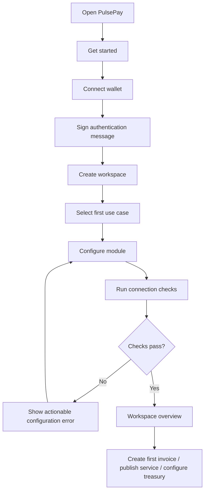
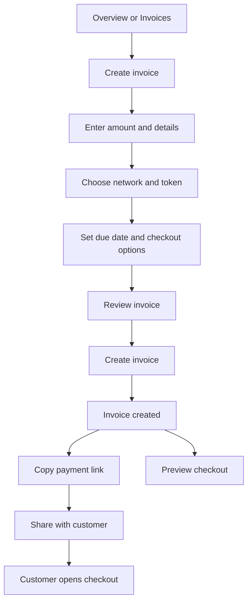
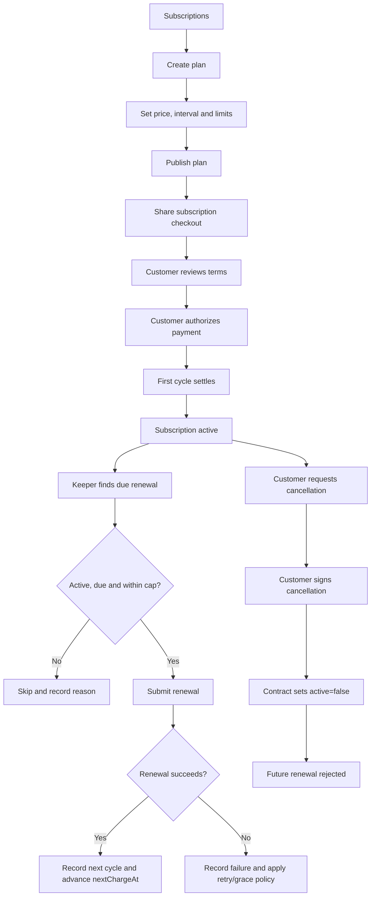
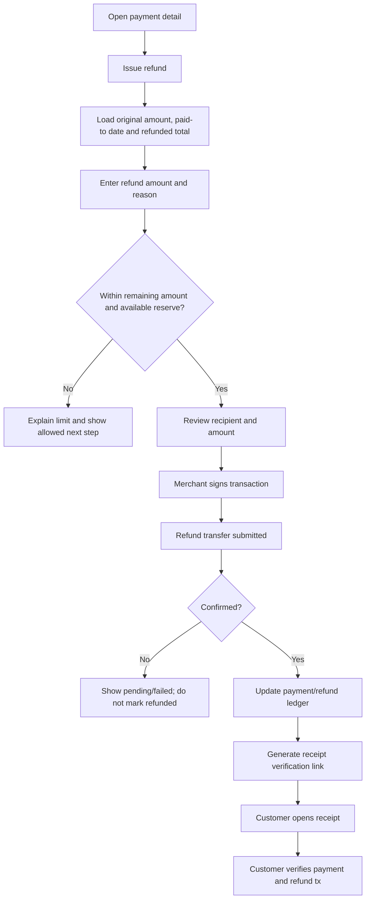
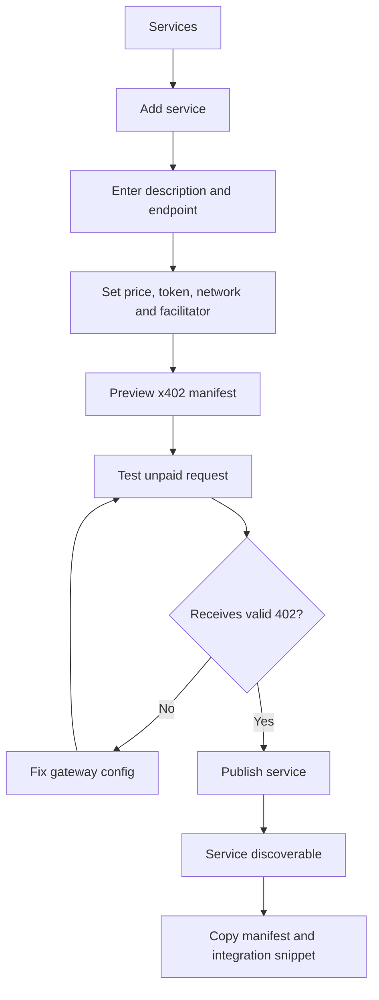
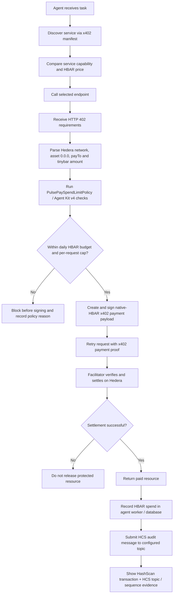
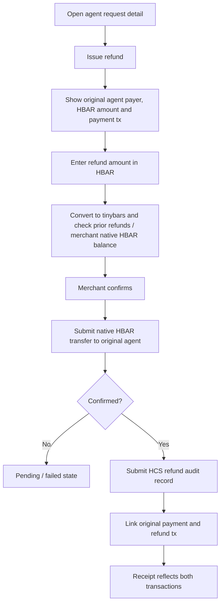

# PulsePay — Product UI, Pages, Content & User Flow Specification

> **Companion document to:** `PulsePay_ETHGlobal_Mumbai_PRD.md`  
> **Product:** PulsePay — business payments, subscriptions, agentic commerce and treasury operations  
> **Audience:** Product, design, frontend, backend and hackathon demo teams  
> **Version:** 1.1  
> **Last updated:** 6 November 2026  
> **Status:** Build-ready UX and information architecture specification

---

## 0. Purpose of This Document

This document defines the complete user-facing product surface for PulsePay. It covers:

- Public marketing website and product pages.
- Merchant onboarding and the authenticated dashboard.
- The dashboard's persistent sidebar, navigation groups and page hierarchy.
- Every dashboard page, including the purpose, page layout, content, components, actions, states and key interactions.
- Customer-facing hosted checkout, invoice, receipt and subscription portal pages.
- The public developer documentation site and SDK/API reference structure.
- Agent-facing discovery and x402 request flows.
- End-to-end user flows for the three hackathon tracks.
- A reusable component inventory, visual design system, responsive behaviour and implementation priorities.

The aim is not to create a large dashboard for the sake of having pages. Every screen should help a user complete a real financial operation, understand its status or verify its evidence.

### 0.1 Product definition

**PulsePay is a drop-in payment and financial-operations SDK for businesses that sell to both people and autonomous AI agents.** It combines:

1. **Whitechain:** human-facing USDT checkout, invoices, subscriptions, renewals, refunds and verifiable receipts.
2. **Hedera:** x402 service monetization, machine-readable service discovery, autonomous agent payments, spending policies and HCS audit records.

The UI must make the three integrations feel like one coherent business product while never implying that assets, state or transactions are shared atomically across chains.

### 0.2 Primary product promise

> **One place to get paid by customers and AI agents, manage recurring revenue and refunds, and operate an onchain treasury—with evidence for every important action.**

### 0.3 Product surfaces

| Surface | Who uses it | Primary purpose | Suggested route prefix |
|---|---|---|---|
| Marketing website (future) | Prospective merchants, developers, hackathon judges | Explain PulsePay and convert visitors into users | Separate domain or future `/marketing` surface; not the current `/` route |
| Merchant dashboard | Business owner, finance operator, developer, admin | Run the seven canonical merchant operations tabs | `/merchant` |
| Customer checkout and portal | Customer or subscriber | Browse the demo storefront, pay, view a receipt or manage a subscription | `/`, `/receipt/:id` (additional portal routes are roadmap) |
| Agent-facing endpoints | Autonomous buyer agents and API clients | Discover services, receive x402 requirements and complete paid requests | `/.well-known/x402.json`, protected x402 endpoint(s) |
| Developer documentation | Integrating engineers | Install and integrate the SDK and APIs | README / examples for MVP; full `/docs/*` portal is roadmap |

### 0.4 UX principles

1. **Business-task-first navigation.** Merchants think in invoices, payments, refunds, subscriptions and costs—not chain names.
2. **Evidence beside the action.** Transaction state, chain, token, explorer link and audit reference should be easy to inspect.
3. **One normalized activity model, chain-specific truth.** The ledger unifies presentation; each chain's own transaction remains the settlement source of truth.
4. **Progressive disclosure.** Default views stay simple. Advanced fields, hook settings, agent policies and raw payloads are available when needed.
5. **Safe financial actions.** Refunds, withdrawals, swaps, liquidity changes and key rotations require explicit review and confirmation.
6. **No fake success.** A submitted transaction is not a settled transaction. The UI distinguishes awaiting signature, submitted, pending, confirmed, failed and indexed/audited states.
7. **Respectful testnet disclosure.** Testnet assets and demo balances are clearly labeled as having no monetary value.
8. **Consistent interaction patterns.** Tables, filters, detail pages, forms, drawers, status labels and confirmation steps behave consistently.

### 0.5 Implementation alignment — canonical ETHGlobal Mumbai MVP

The current repository is a compact, working demo application, not the expanded multi-route product described in some later page concepts. **The seven-tab merchant console in `apps/demo-store` and `packages/sdk-react` is the canonical hackathon MVP.** Design and implementation decisions in this document must preserve that scope.

| Canonical tab in `/merchant` | What belongs inside it | Existing implementation surface / evidence |
|---|---|---|
| **1. Overview** | KPIs, revenue/reserve split, setup state and recent activity | Merchant overview panel
| **2. Sales & Invoices** | Invoice list, create-invoice modal, payment records/details and refund modal | Invoice and payment operations
| **3. Subscriptions** | Active subscriptions, renewal/keeper trigger, next renewal and cancellation state | Subscription operations
| **5. AI Agent Commerce** | x402 endpoint, native HBAR price, per-request cap, daily budget and HCS topic configuration | Hedera adapter and agent worker
| **6. Reserves & Payouts** | Refund reserve pool, available net proceeds and merchant withdrawal | Whitechain `reserveHeldUsdt` accounting
| **7. Developer & Webhooks** | API keys, webhook simulator, CSV export and contract addresses | Developer operations and `/api/export.csv`

The currently implemented application surfaces are:

- `apps/demo-store`: `/` (customer storefront and universal checkout), `/merchant` (seven-tab merchant console), `/receipt/:id` (customer-verifiable receipt), `/api/export.csv` (normalized accountant export) and `/.well-known/x402.json` (machine-readable service manifest).
- `packages/sdk-react`: `<PulsePayCheckout />`, `<Receipt />` and `<MerchantBillingDashboard />` as the drop-in React integration surface.

**Scope rule:** Section 2 (public marketing site) and Section 11 (full docs portal) are future-facing content blueprints, not current app routes. Sections 3–9 describe capabilities to compose inside the seven merchant tabs, drawers and modals. Section 10 describes customer journeys, with `/` and `/receipt/:id` as the current demo surfaces. Do not create a separate route for every conceptual page in this document. The expanded route architecture in Appendix B is explicitly a post-hackathon v2 roadmap, not a P0 requirement.

### 0.6 Track-specific implementation facts that the UI must preserve

- **Whitechain:** use Whitechain Sepolia (chain ID `1874`) and the official challenge USDT contract. Display reserve and net-proceeds figures from the contract/accounting state; the current contract exposes `reserveHeldUsdt`. The configured reserve ratio can be in the 10–20% range, so show the actual configured percentage and amount rather than hard-coding 20%.
- **Hedera:** the current agent payment denomination is **native HBAR**, represented as asset ID `0.0.0`; convert HBAR to tinybars using 100,000,000 tinybars per HBAR. Example display: `0.50 HBAR` = `50,000,000 tinybars`. Do not label this as HTS USDC or another HTS token.
- **Hedera policies:** show the `PulsePaySpendLimitPolicy` limits in HBAR: daily budget and per-request cap. The budget is configured during agent setup (Stage 1) and evaluated again before a payment is signed (Stage 3).
- **Hedera audit:** Stage 7 configures the HCS audit topic. `0.0.789123` is the example topic ID used in the demo configuration; treat it as environment configuration, not a universal hard-coded topic. Show the actual configured topic ID, HCS sequence/message reference and HashScan transaction verification link.

---

# 1. Information Architecture

## 1.1 Top-level sitemap — MVP first, roadmap second

The hackathon application is intentionally small. Use this sitemap as the source of truth for the current build:


### Product architecture after the hackathon

The following capabilities remain useful product concepts, but are **not separate hackathon routes or P0 build requirements**: dedicated customer CRM, separate payment/refund detail routes, standalone service/agent detail routes, a full audit explorer, team RBAC, advanced webhook management, separate API logs, and a multi-page documentation portal. They can be introduced after the core seven-tab console and three required chain journeys are stable.

## 1.2 Canonical merchant dashboard sidebar — seven tabs

The current `/merchant` console has a **seven-item persistent left sidebar**. Keep it flat and task-oriented. Do not add a separate top-level item for every conceptual subpage in this document.

### Sidebar structure


### What belongs in each tab

| Tab | Primary content | Keep as an in-tab interaction |
|---|---|---|
| **Overview** | KPIs, revenue split, reserve status, setup checklist and recent activity | KPI drill-downs and activity detail drawer
| **Sales & Invoices** | Invoice table, payment rows, create-invoice form, paid/pending states and refund actions | Create invoice modal, payment detail drawer, refund modal
| **Subscriptions** | Active plans/subscribers, next renewal, keeper renewal action, failure state and cancellation | Plan editor, subscription detail drawer, cancellation confirmation
| **AI Agent Commerce** | x402 endpoint/manifest, HBAR pricing, agent spend policy, recent requests and HCS audit status | Service configuration, policy editor, request/evidence drawer
| **Reserves & Payouts** | Refund reserve pool, reserve ratio, available net proceeds, withdrawal history and payout action | Withdraw proceeds confirmation and payout detail drawer
| **Developer & Webhooks** | SDK components, API keys, webhook simulator, contract addresses and CSV export | Reveal/rotate key confirmation, webhook test result, export action

### Sidebar behaviour

- Desktop expanded width: approximately **248 px**; collapsed width: approximately **64–72 px**.
- Sidebar stays fixed while the main panel scrolls. The sidebar itself can scroll on short viewports.
- Active tab uses a subtle neutral background and a clear icon/text state. Avoid bright, full-width saturated active pills.
- Keep all seven destinations visible by default; do not nest more groups into the hackathon MVP sidebar.
- Workspace, environment and connected wallet context should be visible in the header, not repeated as navigation items.
- Help/docs and profile actions sit at the bottom, visually separated from the seven product tabs.
- Mobile uses a slide-over drawer or compact bottom navigation; never compress the desktop sidebar into an unusable narrow strip.

### Navigation rules

- Payments, invoices and refunds are grouped in **Sales & Invoices** for the MVP. Refunds are initiated from a payment/invoice context and may also appear in the table's refund filter.
- Subscription plans, active subscriptions, renewal execution and cancellation live in **Subscriptions**.
- Merchant services, buyer-agent spend policy, HBAR activity and HCS evidence live in **AI Agent Commerce**.
- Reserve accounting and withdrawals get a first-class **Reserves & Payouts** tab; do not bury reserve state inside the refund modal.
- API keys, webhook simulation, CSV export and deployed contract addresses live in **Developer & Webhooks**.
- Do not show a feature as an active destination if it is not connected to a working action or meaningful read-only data.

## 1.3 Global application header

Every dashboard page uses the same top header pattern:

| Element | Behaviour |
|---|---|
| Breadcrumb / page location | Shows `Workspace / Section / Page`; current page is not a link |
| Page title | Clear, descriptive title; page subtitle explains what the user can do |
| Environment selector | Visible `Testnet`/`Mainnet` environment selector; default to testnet for the hackathon demo |
| Network context | Displays relevant network when a page is chain-specific; does not imply every chain is active everywhere |
| Search / command menu | Search payments, invoices, customers, services and docs; keyboard shortcut such as `⌘K` / `Ctrl+K` |
| Notifications | Operational alerts such as renewal failures, webhook failures and audit indexing issues |
| Help | Context-aware documentation link |
| User menu | Profile, workspace preferences, theme and sign out |

**Important:** If different modules use different chains, avoid one global chain selector that silently changes every product module. Prefer an environment selector globally and a clearly scoped network selector inside Payments, Agent Commerce and Treasury where appropriate.

## 1.4 Route conventions and implementation map

### Current hackathon routes / endpoints

| Route | Purpose |
|---|---|
| `/merchant` | Single merchant operations console with seven persistent tabs |
| `/receipt/:id` | Customer-verifiable payment/refund receipt |
| `/api/export.csv` | Normalized multi-chain accountant CSV export |
| `/.well-known/x402.json` | Machine-readable x402 service discovery manifest |

The SDK surface is exposed through `packages/sdk-react`: `<PulsePayCheckout />`, `<Receipt />` and `<MerchantBillingDashboard />`.

### Conceptual v2 routes

The route examples used throughout Sections 4–9 (for example `/app/payments/:id`, `/app/agents/activity` and `/app/treasury/hooks`) are **logical screen identifiers**, not instructions to add dozens of routes to the current demo. In the hackathon MVP, implement these as tabs, in-tab panels, drawers or modals under `/merchant`. Convert them into separate routes only when the post-hackathon product requires deep linking, permissions or independent page loading.

# 2. Future Public Marketing Website (Post-Hackathon)

**Scope note:** The current `/` route is the customer storefront/universal checkout in `apps/demo-store`. Do not replace it with a marketing homepage for the hackathon. Build this marketing website later on a separate domain or route group.

The marketing website should explain the product in seconds. It should not try to teach all three chains on the homepage. Lead with the business outcome, then show how the rails fit together.

## 2.1 Global marketing header

**Desktop layout**

- Left: PulsePay wordmark.
- Middle: Product, Solutions, Developers, Docs, Changelog.
- Right: Sign in (quiet button/link) and Get started (primary button).
- Header is compact, white or near-white, with a subtle bottom border.
- Keep the nav to one row. Do not put separate track badges in the header.

**Mobile layout**

- Wordmark left, menu icon right.
- Menu opens a full-height or anchored panel with the same hierarchy.
- Keep the primary CTA obvious without covering page content.

## 2.2 Marketing home page (future standalone domain / marketing route)

### Goal

Explain what PulsePay does and get qualified merchants/developers to start integrating it.

### Recommended page sections

#### Section 1 — Hero

**Headline:**

> Payments for customers. Commerce for agents. Control for your business.

**Supporting copy:**

> PulsePay is a business payments SDK for stablecoin checkout, subscriptions, verifiable refunds and autonomous AI-agent payments—managed from one merchant workspace.

**Primary CTA:** `Start building`  
**Secondary CTA:** `Explore the SDK`


**Hero visual:** Use a clean product screenshot or carefully composed dashboard preview. Show a compact summary with one human payment, one agent payment and one treasury event. Do not use floating coins, 3D chains, glowing orbs or generic AI robot illustrations.

**Components**
- `MarketingHeader`
- `HeroCopy`
- `PrimaryCTA`
- `SecondaryLinkButton`
- `DashboardPreviewFrame`
- `NetworkSupportRow` (logos only if approved assets are available)

#### Section 2 — Problem statement

Title: `Business finance is splitting into two worlds.`

Three columns:

1. **People still need familiar payment flows.** Checkout, invoices, subscriptions and refunds should be easy to understand.
2. **Agents need machine-native payments.** APIs and tools need prices an agent can discover and settle programmatically.
3. **Operators need control and proof.** Budgets, liquidity policies, audit trails and transaction evidence cannot be optional.

#### Section 3 — One product, three connected layers

Three horizontally aligned cards:

| Layer | Card title | Short content | CTA |
|---|---|---|---|
| Whitechain | Get paid by customers | USDT checkout, invoices, subscriptions, refunds and receipts | `Explore payments` |
| Hedera | Let agents pay for services | x402 service discovery, autonomous payments, budgets and HCS audit | `Explore agent commerce` |

Use small network identifiers, but never imply that one chain's funds are automatically moved to another.

#### Section 4 — How PulsePay works

A four-step horizontal or vertical sequence:

1. **Integrate:** Add the SDK to your web app or API server.
2. **Accept:** Collect customer payments or expose an x402-protected service.
3. **Operate:** Manage subscriptions, refunds, agent budgets and treasury operations.
4. **Verify:** Inspect chain transactions, HCS audit references and customer receipts.

#### Section 5 — Product preview

Use tabs or a controlled carousel with three screenshots:

- Merchant dashboard overview.
- Refund detail and verifiable receipt.
- Agent activity and x402 settlement.

Avoid a giant collage of tiny unreadable dashboards. Each preview should have one clear caption.

#### Section 6 — Developer integration

Show a real, concise SDK snippet from the current implementation. Use the package names and methods that actually exist in the repository. Before implementation, do not publish pseudo-code as if it were a stable API.

Example copy:

> Add a customer checkout to your app, then expose your API to agents with x402 middleware.

CTA: `Read the quickstart`.

#### Section 7 — Business use cases

Cards for:
- SaaS and subscription businesses.
- API, data and AI infrastructure providers.
- Digital service marketplaces.

Each card should explain a concrete workflow rather than merely name an industry.

#### Section 8 — Trust and transaction evidence

Show:
- Supported environment labels (testnet while in hackathon mode).
- Contract/source links where deployed.
- Explorer and HashScan references for demo transactions.
- Clear note that testnet tokens have no monetary value.

Do not show security certifications, audits, production uptime claims or customer logos unless they are real and verifiable.

#### Section 9 — Final CTA

Headline: `Build your payment flow once. Operate it with confidence.`

Buttons: `Start building` and `Read the docs`.

#### Section 10 — Footer

Columns:
- Product: Payments, Subscriptions, Agent Commerce, Treasury.
- Developers: Docs, Quickstart, API Reference, GitHub.
- Resources: Changelog, Status (only if real), Feedback.
- Legal: Privacy, Terms (only when actually published).

## 2.3 Product overview (`/product`)

### Goal

Give a more detailed product explanation than the homepage.

**Content order**
1. Product summary and diagram.
2. Shared merchant workspace.
3. Whitechain billing lifecycle.
4. Hedera agent payment lifecycle.
6. Unified activity and audit evidence.
7. SDK integration approach.
8. CTA to docs.

**Components**
- `ProductArchitectureDiagram`
- `FeatureSection`
- `FeatureComparisonTable`
- `IntegrationCodePanel`
- `CTASection`

## 2.4 Product detail pages

### Payments & invoices (`/product/payments`)

Explain invoice creation, payment links, hosted checkout, USDT settlement, webhooks and receipt verification. Show a payment lifecycle: `Created → Opened → Wallet connected → Submitted → Confirmed → Receipt available`.

### Subscriptions & refunds (`/product/subscriptions`)

Explain recurring authorization, renewal worker/keeper, cancellation, renewal failure state, refund reserve and merchant-issued partial/full refunds. Clearly disclose that recurring renewals require an offchain transaction sender and token approval capability.

### Agent commerce (`/product/agent-commerce`)

Explain public service manifests, x402 402 responses, facilitator verification/settlement, autonomous buyer policies and HCS audit. Use a request/response sequence diagram.

### Treasury (`/product/treasury`)


## 2.5 Solutions pages (`/solutions/*`)

Each solutions page follows this template:

- User's current workflow.
- Main operational pain.
- PulsePay workflow.
- Which modules are used.
- Integration example.
- CTA.

Suggested pages:

1. **SaaS businesses:** plans, renewals, failed charges, cancellations and refunds.
2. **API and AI service providers:** paid endpoints, x402 service discovery, per-call pricing and agent receipts.
3. **Finance and operations teams:** agent spend policy, HCS audit, payment reconciliation, export and treasury controls.

## 2.6 Developers landing (`/developers`)

Content blocks:
- Package overview (`@pulsepay/sdk`, `@pulsepay/react`, `@pulsepay/server`, optional chain-specific packages only if they exist).
- Five-minute quickstart.
- Checkout integration.
- x402 server integration.
- Webhooks and event model.
- Supported networks and contract config.
- GitHub repository and example apps.

Primary CTA: `Open documentation`.

## 2.7 Security & Trust (`/security`)

This page must be honest and concise. Include:
- Non-custodial/customer-wallet signing model where applicable.
- No browser exposure of server/agent signing secrets.
- Contract addresses and verified source links when available.
- Agent spend controls and emergency stop.
- HCS audit-log behaviour and limitations.
- Refunds are separate token transfers, not transaction reversals.
- Supported environments and testnet disclaimers.
- Known limitations and not-yet-audited warning.

Do not state that PulsePay is audited, compliant or production-ready unless that is substantiated.

## 2.8 Sign in and Get started

### Sign in (`/login`)

- Wallet connection as primary authentication for the hackathon MVP.
- Optional email sign-in only if implemented and secured.
- Explain supported wallet/network requirements.
- Link to docs and account recovery/help if available.

### Get started (`/signup`)

- Create a workspace.
- Connect owner wallet.
- Choose workspace name.
- Land in a guided setup checklist.

Avoid asking for billing details or company information that the MVP does not use.

---

# 3. Merchant Onboarding

## 3.1 Onboarding goals

A new merchant should reach a useful dashboard quickly. Do not force every chain integration before they can create their first invoice.

### Entry flow


### Onboarding steps

**Step 1 — Connect wallet**
- Show supported wallet connection options.
- Request a signature for authentication, not an onchain transaction.
- Display connected address and copy action.
- Explain that signing in does not grant token spending permission.

**Step 2 — Create workspace**
- Workspace name.
- Workspace URL slug (if hosted checkout uses it).
- Optional logo.
- Default display currency (presentation-only; supported settlement asset remains chain-specific).

**Step 3 — Choose what to set up first**
- `Accept customer payments` (recommended first action).
- `Monetize an API with x402`.
- User can skip and complete later.

**Step 4 — Configure chosen module**
- Whitechain: check network, official USDT address and deployed merchant contract.
- Hedera: connect testnet account, configure facilitator and audit topic.

**Step 5 — Verify setup**
- Show individual checks with actionable failures.
- Do not use a green check until a check has actually passed.
- Each row has `Fix` or `View details`.

**Step 6 — Workspace ready**
- Show dashboard checklist with remaining tasks.
- Offer `Create your first invoice`, `Publish a paid service` and `Open treasury` quick actions.

## 3.2 Setup checklist widget

Place on Overview until completed or dismissed.

Checklist items:
- [ ] Connect merchant wallet.
- [ ] Verify Whitechain contract and official USDT configuration.
- [ ] Create first invoice.
- [ ] Complete a test payment.
- [ ] Set up one subscription plan.
- [ ] Configure Hedera account and HCS audit topic.
- [ ] Publish first x402 service.
- [ ] Complete a paid request with a buyer agent.
- [ ] Execute a test swap.

The checklist should distinguish **required to use a module** from **optional advanced setup**.

---

# 4. Merchant Dashboard — Global Shell and Overview

## 4.1 Dashboard shell


**MVP implementation constraint:** this shell is mounted at `/merchant` and exposes exactly the seven tabs in Section 1.2. The later page sections describe the content and interactions that each tab composes; they do not create a second navigation model.


### Layout anatomy

```text
┌────────────────┬─────────────────────────────────────────────────────────┐
│                │ Breadcrumbs                      Testnet  Search  Help  │
│   SIDEBAR      ├─────────────────────────────────────────────────────────┤
│                │                                                         │
│  Workspace     │ Page title                         Primary action       │
│  switcher      │ Short descriptive subtitle                              │
│                │                                                         │
│  Navigation    │ Main content                                             │
│  groups        │ ┌───────────────────────┐ ┌───────────────────────────┐ │
│                │ │ Summary module        │ │ Secondary module          │ │
│                │ └───────────────────────┘ └───────────────────────────┘ │
│                │                                                         │
│  Help          │ Table / timeline / detailed workflow                    │
│  Profile       │                                                         │
└────────────────┴─────────────────────────────────────────────────────────┘
```

### Main page header standard

Each page should use:
- Breadcrumbs.
- H1 title.
- One sentence explaining the job of the page.
- Primary action on the right (one only where possible).
- Secondary actions grouped into an overflow menu.
- Optional tabs below the title for closely related views.

Avoid a row of five equally prominent buttons. A page should have one obvious next action.

## 4.2 Overview page (`/app/overview`)

### Goal

Give the merchant a quick operational snapshot and show what needs attention. It is not an analytics product with vanity charts.

### Page header

**Title:** Overview  
**Subtitle:** Monitor payments, recurring billing, agent activity and treasury operations.  
**Right controls:** Date range, environment label, `Create invoice` primary button.

### First row — KPI cards

Use four or five cards maximum:

1. **Payments received** — settled payment value for selected period; include asset/network filter or show separate asset totals.
2. **Successful payments** — count and success rate.
3. **Active subscriptions** — count; show renewals due soon as supporting detail.
4. **Agent spend** — amount spent by buyer agents in native HBAR; show the daily budget and per-request cap alongside it.
5. **Refund reserve / net proceeds** — show reserve held and proceeds available for withdrawal as separate figures. Show treasury value only if a reliable valuation source exists; otherwise show configured positions count and token balances instead.

**Rules**
- Show `Testnet` prominently near the KPI group.
- Never sum incomparable tokens into a single USD figure without a trustworthy price source and clear methodology.
- When a value is not available, show `—` with a short explanation, not `0`.
- Use tabular numbers and consistent units.

### Second row — Attention required

A full-width list with up to three high-priority operational notices:
- Subscription renewal failed.
- Webhook delivery failed.
- Agent spend blocked by policy.
- HCS audit message pending.
- Treasury hook paused or a swap rejected.

Every item includes timestamp, severity, one-sentence explanation and a direct action link.

### Third row — Recent activity

A compact activity table with columns:
- Event / description.
- Type.
- Amount and asset.
- Network.
- Status.
- Time.
- Transaction/action.

Default show most recent 8–10 records. `View all activity` links to the Audit Log or Payments depending on chosen product taxonomy. Recommended: link to Audit Log for all event types.

### Fourth row — Module snapshots

Three concise panels:

**Sales & Invoices**
- Open invoices.
- Recent settlements and refund status.
- CTA: `Open Sales & Invoices`.

**AI Agent Commerce**
- x402 endpoint status.
- HBAR spend today vs daily budget and per-request cap.
- HCS audit topic status.
- CTA: `Open AI Agent Commerce`.

- Selected v4 network.
- Pool/hook status and max swap limit.
- Active positions count.

**Reserves & Payouts**
- Refund reserve held and configured reserve ratio.
- Available net proceeds.
- CTA: `View reserves & payouts`.

### Bottom — Setup checklist / Getting started

Visible for newly created workspaces. Collapse after core setup is complete.

### Empty state

Title: `Your workspace is ready for its first transaction.`
Description: `Create an invoice, publish a paid service or connect a treasury pool to start seeing activity here.`
Actions: `Create invoice`, `Set up agent service`, `Configure treasury`.

### Components

- `PageHeader`
- `EnvironmentBanner`
- `MetricCard`
- `AttentionList`
- `ActivityTable`
- `ModuleSummaryCard`
- `ReservePayoutSummary`
- `SetupChecklist`
- `EmptyState`

---

# 5. Sales & Invoices — Payments, Invoices, Refunds and Customer References

**MVP navigation mapping:** all payment, invoice and refund operations in this section belong to the single **Sales & Invoices** sidebar tab. Payment details are drawers/panels; create invoice and refund are modals. A standalone Customers destination/detail route is post-hackathon scope (P1), not an eighth sidebar item.


## 5.1 Payments list (`/app/payments`)

### Goal

Show actual payment records across supported payment rails in one consistent table.

### Header

**Title:** Payments  
**Subtitle:** Track customer and agent payments across connected networks.  
**Primary action:** `Create invoice`  
**Secondary:** `Export CSV`.

### Summary strip

- Settled payments.
- Pending confirmations.
- Failed payments.
- Refunded amount (do not double-count as a new incoming payment).

### Filters

- Date range.
- Status.
- Payment type: invoice, subscription renewal, x402 service, other.
- Asset/token.
- Customer/payer search.
- Amount range.

### Table columns

| Column | Content |
|---|---|
| Payment | Internal payment ID and short description |
| Payer | Customer name or shortened wallet/account ID |
| Amount | Amount + asset; decimals formatted using token metadata |
| Type | Invoice, subscription, x402, etc. |
| Network | Network label + environment |
| Status | Normalized payment status |
| Date | Localized timestamp |
| More | Open details / copy ID |

### Row interaction

Clicking a row opens `/app/payments/:paymentId`. Clicking an explorer icon opens the verified transaction in a new tab. Copy ID should not navigate.

### Payment detail page (`/app/payments/:paymentId`)

**Header**
- Back to Payments.
- Payment ID.
- Status badge.
- Actions: `Issue refund` (if eligible), `Copy receipt link`, overflow.

**Top summary**
- Amount paid.
- Amount refunded.
- Net amount retained (only if accounting logic defines it precisely).
- Paid at.
- Payment type.

**Details panel**
- Payer.
- Merchant.
- Invoice/order reference.
- Network and chain ID.
- Asset contract/token ID.
- Transaction ID/hash.
- Confirmation/indexing status.

**Lifecycle timeline**
- Invoice/payment created.
- Checkout opened (if available).
- Wallet signature requested.
- Transaction submitted.
- Chain confirmation.
- Indexer processed event.
- Receipt issued.
- Refund events, if any.

**Evidence panel**
- Explorer link.
- Contract address/source link.
- Event name and indexed block/transaction reference.
- Hedera HCS topic/sequence link when applicable.

**Related records**
- Related invoice.
- Subscription, if renewal.
- Refund records.
- Customer profile.

### Components

- `DataTable`
- `FilterBar`
- `PaymentStatusBadge`
- `NetworkBadge`
- `TokenAmount`
- `AddressDisplay`
- `TransactionLink`
- `LifecycleTimeline`
- `EvidencePanel`
- `DetailDefinitionList`

## 5.2 Invoices & payment links list (`/app/invoices`)

### Goal

Let merchants create and monitor requests for payment. An invoice is not a settled payment record.

### Header

**Title:** Invoices & payment links  
**Subtitle:** Create a payment request and share a hosted checkout link.  
**Primary action:** `Create invoice`.

### Tabs

- All.
- Draft.
- Open.
- Paid.
- Expired.
- Cancelled.

### Filters

Status, date, customer, asset/network, amount and due date.

### Table columns

- Invoice ID / memo.
- Customer.
- Amount.
- Due date.
- Created date.
- Status.
- Payment link.
- More.

### Invoice create flow (`/app/invoices/new`)

Use a **three-step form** with a persistent summary. Do not put every input on one giant page.

#### Step 1 — Details

Fields:
- Invoice title/description (required).
- Amount (required).
- Settlement token (default official Whitechain Sepolia USDT in testnet mode).
- Due date (optional, recommended).
- Customer reference/email (optional; only collect what is required).
- Internal note/reference (optional).

Validation:
- Amount must be positive and representable in token base units.
- Selected token must be supported on selected network.
- Due date must be in the future if invoice expiry is enforced.

#### Step 2 — Checkout settings

Fields:
- Network (Whitechain Sepolia for the qualifying flow).
- Merchant receiving/settlement contract configuration (read-only once verified, unless admin changes network settings).
- Redirect URL after payment (optional; validate host).
- Webhook event delivery (on/off, default on if merchant configured a webhook endpoint).
- Expiry behaviour.

Show:
- Customer-facing preview link.
- Supported wallet/network note.
- Testnet disclaimer.

#### Step 3 — Review & create

Show a review summary:
- Amount/token.
- Merchant.
- Due date.
- Network.
- Fees (only if known; do not invent).
- Link expiry.

Action: `Create invoice`.

Success state:
- Invoice ID.
- Hosted checkout URL.
- `Copy link`.
- `Open checkout preview`.
- `View invoice`.

### Invoice detail (`/app/invoices/:invoiceId`)

Sections:
1. Header with invoice status and actions: Copy link, Preview checkout, Cancel invoice (only while unpaid/open).
2. Amount and due date summary.
3. Customer and merchant details.
4. Payment link card with copy button.
5. Payment state and linked payment transaction.
6. Event timeline.
7. Webhook delivery state.
8. Metadata / internal reference (collapsible).

Actions must be status-aware. A paid invoice cannot be cancelled as if no payment occurred.

### Components

- `InvoiceTable`
- `InvoiceStatusBadge`
- `StepForm`
- `InvoiceSummaryCard`
- `CopyableURLField`
- `CheckoutPreview`
- `InvoiceTimeline`

## 5.3 Subscriptions (`/app/subscriptions`)

### Goal

Manage customer subscription records, upcoming renewals, failed charges and cancellations.

### Header

**Title:** Subscriptions  
**Subtitle:** Manage plans, recurring authorizations and renewal activity.  
**Primary action:** `Create plan`.

### Tabs

- Subscribers (default).
- Plans.
- Renewals / Billing events.

### Subscriber table columns

- Subscriber.
- Plan.
- Amount per cycle.
- Billing interval.
- Next charge.
- Cycles charged / max cycles (when capped).
- Status.
- Actions.

### Plans tab

Plan table columns:
- Plan name.
- Price.
- Interval.
- Active subscribers.
- Grace period.
- Authorization cap.
- Status.

Actions: Create plan, edit plan details that do not alter active customer authorizations, archive/deactivate plan.

### Create plan drawer/page

Fields:
- Plan name.
- Description.
- Amount + token.
- Billing interval: monthly, weekly, yearly or custom supported interval.
- Maximum authorized cycles (if required by contract policy).
- Grace period / retry policy (offchain configuration).
- Plan visibility (published/draft).

A clear info note must explain that renewals are submitted by a keeper/relayer and are subject to token authorization and network availability.

### Subscription detail (`/app/subscriptions/:subscriptionId`)

Sections:
- Subscriber and merchant.
- Plan and billing terms.
- Amount per cycle and token.
- Next billing time.
- Cycles charged and authorization cap.
- Current onchain active state.
- Cancellation status.
- Renewal history.
- Failed renewal attempts and retry schedule.
- Related payments and refunds.
- Contract, chain and transaction evidence.

Merchant actions:
- Cancel subscription (with confirmation and reason where collected).
- Open related payment.
- Issue refund for a prior payment from the payment detail or refund flow.

Do not let merchants silently modify the amount/interval of an existing customer authorization. Create a new plan or require explicit customer reauthorization.

### Customer cancellation

The customer-facing portal must provide a prominent `Cancel subscription` action. It should not be hidden in a kebab menu or multiple confirmation pages.

Cancellation confirmation explains:
- Whether access ends immediately or at the end of the paid period (this product must implement and disclose one policy).
- Whether another renewal is prevented immediately.
- That already settled payments are not automatically refunded.

### Components

- `SubscriptionTable`
- `PlanCard` (use sparingly; tables are better for many plans)
- `PlanForm`
- `BillingIntervalSelect`
- `RenewalStatusBadge`
- `SubscriptionTimeline`
- `CancelSubscriptionDialog`
- `RetryPolicyPanel`

## 5.4 Refunds (`/app/refunds`)

### Goal

Give the merchant a dedicated place to review and issue refunds with strong safeguards.

### Header

**Title:** Refunds  
**Subtitle:** Review refund history and return funds to the original payer.  
**Primary action:** Contextual—`Issue refund` should normally start from a payment detail. A global refund button may search for a payment first.

### Tabs

- All refunds.
- Pending.
- Succeeded.
- Failed.

### Summary strip

- Refund total this period.
- Pending refund count.
- Successful refund count.

### Table columns

- Refund ID.
- Original payment.
- Customer / payer.
- Amount.
- Reason.
- Network.
- Status.
- Created at.

### Refund initiation flow

Start from a paid payment detail or invoice detail.

#### Refund dialog — Step 1: Enter refund details

Display immutable original-payment details:
- Original amount.
- Already refunded.
- Remaining refundable amount.
- Original payer.
- Asset/network.

Inputs:
- Refund amount.
- Reason (select or text; keep reason optional only if contract/event design allows it).

System-calculated:
- Remaining amount after refund.
- Reserve balance / available refund liquidity.

#### Step 2: Review

Show a clear confirmation summary. State:
- Recipient is the original payer and cannot be changed.
- This is a new onchain transfer, not reversal of the original transfer.
- Transaction fee / network fee only if accurately available.
- Refund is irreversible after settlement.

Action: `Confirm refund`.

#### Step 3: Transaction state

States:
- Awaiting wallet signature.
- Submitted.
- Pending confirmation.
- Confirmed.
- Failed / reverted.

After confirmed:
- Show refund ID and explorer link.
- Refresh payment's cumulative refunded amount.
- Make customer receipt available with the refund event.

### Insufficient reserve state

Do not show a fake refund CTA. Explain the reserve/available balance is insufficient and provide the action permitted by the contract, such as funding the refund reserve. If the product has no safe top-up action implemented, disable the refund action and explain why.

### Refund detail (`/app/refunds/:refundId`)

- Refund status.
- Amount and token.
- Original payment ID.
- Recipient (original payer).
- Reason.
- Transaction ID and explorer link.
- Time and event timeline.
- Related customer receipt.

### Components

- `RefundTable`
- `RefundDialog`
- `RefundAmountInput`
- `RefundabilitySummary`
- `ReserveBalanceIndicator`
- `IrreversibleActionConfirmation`
- `RefundTimeline`

## 5.5 Customers (`/app/customers`)

### Goal

Provide a lightweight customer directory assembled from invoice/payment/subscription records. Do not turn this into a full CRM.

### List page

Header: `Customers` / `View customers associated with invoices, payments and subscriptions.`

Table columns:
- Customer display label.
- Wallet/account.
- Number of payments.
- Total paid (per asset; do not add unlike assets).
- Active subscription count.
- Last activity.

Search by display label, wallet address or customer reference.

### Customer detail (`/app/customers/:customerId`)

Sections:
- Customer identity/reference.
- Wallet/account identifiers.
- Payments.
- Invoices.
- Subscriptions.
- Refunds.
- Receipts and explorer links.

Privacy rules:
- Avoid collecting home address, phone number or other unnecessary PII.
- Use a wallet address or merchant-provided reference as the default identifier.
- Show only data the merchant is authorized to see.

---

## 5.6 Reserves & Payouts (`/merchant` → Reserves & Payouts tab)

### Goal

Give the merchant a dedicated view of refund liquidity and withdrawable proceeds. This is a first-class console tab because the Whitechain contract tracks `reserveHeldUsdt`; it must not be hidden inside the refund modal.

### Header

**Title:** Reserves & Payouts  
**Subtitle:** Track funds held for refunds and withdraw proceeds available to the merchant.  
**Primary action:** `Withdraw proceeds`.

### Summary cards

1. **Refund reserve pool** — current `reserveHeldUsdt` amount in USDT.
2. **Configured reserve ratio** — actual configured percentage of gross invoice volume (the implementation may configure 10–20%; never hard-code a 20% label).
3. **Available net proceeds** — amount the contract/accounting state currently permits the merchant to withdraw.
4. **Withdrawn to date** — cumulative confirmed withdrawals, if this value is indexed and available.

### Solvency status

Show a neutral `Reserve status` panel with the measured reserve amount, outstanding refundable exposure and the calculation timestamp/block. A `100% Solvent` status may be shown only when the application can compute and validate the actual reserve coverage rule from authoritative contract data. Otherwise use `Reserve configured` or `Coverage data unavailable`; never display a decorative solvency badge.

### Reserve and payout breakdown

- Gross invoice volume.
- Refund reserve held.
- Net proceeds available.
- Pending withdrawals, if supported.
- Confirmed withdrawals and transaction links.

Show the current configured split. The reported contract model retains 10–20% of gross invoice volume in the refund reserve and makes the remaining 80–90% available for merchant withdrawal. The UI must read the live configured/accounted values rather than calculate a fixed split from a hard-coded percentage.

### Withdraw proceeds flow

1. Merchant selects `Withdraw proceeds`.
2. Dialog displays the maximum withdrawable amount, asset, network, destination wallet and remaining reserve after withdrawal.
3. Merchant enters an amount or chooses `Withdraw available`.
4. Validation prevents withdrawal above available net proceeds and protects the reserve requirement.
5. Review step explains that withdrawal is an onchain transfer and shows the recipient and network.
6. Merchant signs; UI shows `Awaiting signature`, `Submitted`, `Pending`, `Confirmed` or `Failed`.
7. After confirmation, refresh net proceeds and show the transaction explorer link.

### Empty / blocked states

- `No proceeds available yet` when confirmed payments have not produced a withdrawable balance.
- `Withdrawal unavailable` when contract state, reserve constraints or signer permissions prevent withdrawal. Explain the exact reason.
- Do not allow a withdrawal that would consume the refund reserve or violate the contract's own withdrawal checks.

### Components

- `ReserveBalanceCard`
- `ReserveRatioIndicator`
- `SolvencyCoveragePanel`
- `NetProceedsCard`
- `PayoutHistoryTable`
- `WithdrawProceedsDialog`
- `WithdrawalReviewPanel`
- `TransactionEvidenceLink`

# 6. AI Agent Commerce — Services, Spend Policies and Activity

## 6.1 AI Agent Commerce overview

This is one of the seven canonical merchant tabs. Keep the first view focused on the configured x402 endpoint, native HBAR pricing, spend policy, recent agent requests and HCS audit status. A separate Agent Commerce landing route is not required.

**At-a-glance content:**
- x402 endpoint and `/.well-known/x402.json` manifest status.
- Native HBAR price per request, displayed in HBAR and tinybars.
- Daily HBAR budget, HBAR spent today and per-request HBAR cap.
- Agent policy status (allowed/blocked/paused).
- Configured HCS topic ID and latest audit sequence/reference.

**Hedera configuration stages:** Stage 1 captures the daily budget and per-request cap in HBAR when configuring the agent. Stage 3 repeats the deterministic policy check immediately before the payment payload is signed. Stage 7 configures the HCS audit topic; show the environment's configured topic (demo example `0.0.789123`) and the most recent message/sequence reference.

## 6.2 Services and x402 endpoint (`/merchant` → AI Agent Commerce)

### Goal

Let API providers publish and manage paid services that agents can discover and pay for through x402.

### Header

**Title:** Services  
**Subtitle:** Publish paid API endpoints that autonomous agents can discover and access.  
**Primary action:** `Add service`.

### Top information panel

Show the merchant's discovery endpoint:

`https://{merchant-domain}/.well-known/x402.json`

Actions: Copy URL, View JSON, Run discovery check.

### Service table columns

- Service name.
- Endpoint/method.
- Category.
- Price in HBAR (human-readable) and tinybars (atomic value).
- Native asset ID `0.0.0`.
- Hedera network.
- Status (Draft, Published, Paused, Error).
- Successful paid requests.
- Last request.
- More.

### Create service flow (`/app/agents/services/new`)

**Step 1 — Service details**
- Name.
- Description.
- Category (for example: data, inference, OCR, translation, compute).
- HTTP method and endpoint path.
- Resource server URL.
- Optional public landing page.

**Step 2 — Payment terms**
- Network: configured Hedera testnet (or another network only when the adapter supports it).
- Asset: native HBAR, identifier `0.0.0` (not an HTS token).
- Price in HBAR; show the exact tinybar value calculated by the backend. Example: `0.50 HBAR` = `50,000,000 tinybars`.
- Facilitator: configured Hedera x402-compatible facilitator.
- Quote expiry / validity where supported.
- Optional request rate limits.

Use integer-safe conversion. Never parse or store HBAR amounts through floating-point arithmetic for settlement.

**Step 3 — Access and service behaviour**
- Request/response format.
- Whether a free health-check endpoint exists.
- Rate limit.
- Idempotency behaviour.
- Refund policy description (informational; does not imply x402 itself reverses payments).

**Step 4 — Review and publish**
- Manifest preview.
- x402 endpoint test.
- `Publish service`.

The service should not be published until required payment and endpoint settings validate.

### Service detail (`/app/agents/services/:serviceId`)

Tabs:
- Overview.
- Integration.
- Activity.
- Settings.

**Overview content**
- Service summary.
- Price and payment network.
- Endpoint and method.
- Published state.
- Paid request count.
- Last request status.

**Integration tab**
- Standard x402 requirements.
- Manifest JSON preview.
- Copy manifest URL.
- `curl` command for unpaid request.
- Example buyer-agent request.

**Activity tab**
- Requests and payment statuses filtered to this service.

**Settings tab**
- Update price (apply only to future quotes).
- Pause/resume.
- Update endpoint.
- Rotate/refresh service configuration if necessary.

### Components

- `ServiceTable`
- `ServiceStatusBadge`
- `ServiceFormStepper`
- `ManifestPreview`
- `EndpointHealthCard`
- `X402RequestInspector`
- `CodeBlock`
- `CopyButton`

## 6.3 Agent spend policies (`/merchant` → AI Agent Commerce)

### Goal

Manage the buyer agent and enforce deterministic native-HBAR spending limits before an x402 payment is signed. The current implementation uses `PulsePaySpendLimitPolicy` and the Hedera Agent Kit v4 policy flow; the page must reflect the controls that are actually wired to the agent worker.

### Header

**Title:** Agents & policies  
**Subtitle:** Control which agents can spend, where they can pay and how much they can authorize.  
**Primary action:** `Register agent` or `Create policy` depending on implementation.

### Page layout

Top strip:
- Agent status.
- Daily budget in HBAR and its tinybar equivalent.
- HBAR spent today / HBAR remaining today.
- Per-request cap in HBAR and tinybars.
- Policy decisions blocked / allowed.

Main content:
- Agents table.
- Policy panel or separate tab.

### Agents table columns

- Agent name/label.
- Identity/account ID.
- Status (Active, Paused, Needs approval, Disabled).
- Daily budget.
- Per-request cap.
- Today's spend.
- Last activity.
- Actions.

### Register agent flow

- Agent display name.
- Agent account/wallet identity.
- Owner/workspace.
- Identity standard/reference (optional integration, e.g. HCS-14 or ERC-8004 where implemented).
- Default policy.
- Status.

Do not call an agent “verified” just because the merchant entered a name. Verification must correspond to the identity mechanism actually integrated.

### Policy editor

Organize controls into clearly labeled sections:

**Spending limits — native HBAR**
- Maximum amount per request (HBAR + tinybars).
- Daily spend budget (HBAR + tinybars).
- Current spend and remaining daily allowance.
- Optional monthly budget or per-vendor cap only if the policy engine supports it.

The policy configuration appears at Stage 1 (agent setup), and the same policy is evaluated again at Stage 3 immediately before signing. Do not let the UI imply that changing the dashboard value retroactively changes a payment already signed or broadcast.

**Vendor access**
- Allowlisted domains or service IDs.
- Denylist.
- Whether new vendors are blocked or require approval.

**Approval rules**
- Auto-approve below a configured amount.
- Human approval above threshold.
- Do not permit spend if daily budget or per-request cap would be exceeded.

**Payment constraints**
- Allowed Hedera network.
- Native HBAR only for the current implementation (`asset: "0.0.0"`). Do not offer an HTS USDC selector unless the adapter is later extended and verified.
- Maximum quote age/expiry.

**Emergency controls**
- Pause agent immediately.
- Revoke/rotate agent signing capability through the configured signer system.
- Do not imply that a UI pause can revoke a transaction already signed and broadcast.

### Agent detail

- Agent identity and signer reference (never private key).
- Policy summary.
- Daily/weekly spend by asset.
- Recent agent requests.
- Blocked requests and reasons.
- Audit references.
- Pause / resume control.

### Components

- `AgentTable`
- `AgentIdentityDisplay`
- `SpendBudgetCard`
- `PolicyEditor`
- `AllowlistEditor`
- `ApprovalThresholdControl`
- `AgentPauseSwitch`
- `PolicyDecisionBadge`

## 6.4 Agent activity and payment evidence (`/merchant` → AI Agent Commerce)

### Goal

Make the x402 lifecycle inspectable. This is one of the most important pages for the Hedera track demo.

### Header

**Title:** Agent activity  
**Subtitle:** Inspect service requests, payment requirements, policy decisions and Hedera settlements.  
**Actions:** `Export activity`, optional date range.

### Summary cards

- Total paid requests.
- Settled volume (by asset).
- Blocked by policy.
- Failed/expired requests.

### Activity table

Columns:
- Request ID.
- Agent.
- Service.
- Quoted amount in HBAR (and tinybars in detail).
- Asset ID `0.0.0` / Hedera network.
- Policy decision (daily budget and per-request cap).
- Settlement status.
- Time.
- HashScan transaction link.

### Request detail (`/app/agents/activity/:requestId`)

Use a vertical timeline or a structured event sequence:

1. Agent discovered service.
2. Agent made initial request.
3. Server returned HTTP 402 / payment requirements.
4. Policy engine evaluated amount/network/vendor/budget.
5. Payment payload was created and signed.
6. Facilitator verification result.
7. Facilitator settlement result.
8. Paid resource response returned.
9. HCS audit message submitted.

Show actual raw protocol payload in a collapsible `Request / response` panel. Redact credentials and signatures where appropriate.

**Evidence panel**
- Hedera transaction ID.
- HashScan transaction verification link.
- Native HBAR amount and tinybar amount (`asset: "0.0.0"`).
- HCS topic ID from configuration (demo example `0.0.789123`).
- HCS sequence number/message reference and submission state.
- Facilitator response metadata.

**Status vocabulary**
- `QUOTE_RECEIVED`
- `POLICY_ALLOWED`
- `POLICY_BLOCKED`
- `PAYMENT_SIGNATURE_CREATED`
- `FACILITATOR_VERIFIED`
- `SETTLEMENT_PENDING`
- `SETTLED`
- `RESOURCE_DELIVERED`
- `AUDIT_PENDING`
- `FAILED`

Use readable labels in the main view and raw codes in technical details.

### Components

- `AgentActivityTable`
- `RequestLifecycleTimeline`
- `PolicyEvaluationPanel`
- `ProtocolPayloadViewer`
- `HederaEvidenceCard`
- `HbarAmountDisplay` (HBAR + tinybars)
- `SpendLimitPolicyPanel`
- `HcsTopicConfigCard`
- `HashScanLink`
- `RedactedCodePanel`

---

# 8. Audit & Developer Operations

## 8.1 Audit log (`/app/audit`)

### Goal

Provide a reliable, normalized timeline of product and chain events. HCS is an audit evidence source for Hedera records; it is not the canonical transaction source for all chains.

### Header

**Title:** Audit log  
**Subtitle:** Review payment, refund, agent and treasury events with their verification references.  
**Actions:** `Export CSV`, date range.

### Filters

- Event type.
- Network.
- Source module.
- Status.
- Actor (merchant, customer, agent, worker).
- Date range.
- Has HCS evidence / missing evidence.

### Table columns

- Time.
- Event.
- Actor.
- Amount/asset if applicable.
- Network.
- Status.
- Evidence.

### Audit event detail drawer/page

- Normalized event payload.
- Source event/transaction ID.
- Chain and block/consensus metadata.
- HCS topic/sequence/transaction where applicable.
- Payload hash.
- Related payment, refund, invoice, agent request or treasury transaction.
- Raw payload (redacted).

### Audit pending state

If an onchain payment succeeds but HCS submission fails:
- Keep the payment status as settled if chain evidence confirms it.
- Show audit status as `Pending retry`.
- Provide retry action only to an authorized service/admin.
- Never mark the payment failed because the audit write failed.

## 8.2 SDK & API keys (`/app/developers/sdk`)

### Goal

Help an integrating developer get from account creation to a working integration without leaving the dashboard.

### Header

`SDK & API keys` / `Install PulsePay and configure your application credentials.`

### Page sections

1. **Integration status** — SDK packages detected/configured, connected networks and webhook status.
2. **Quick install** — package manager commands for current package names.
3. **Environment variables** — copyable variable names and safe masked values.
4. **API keys** — create/revoke key, label, scopes, created date, last used. Secret shown only once at creation.
5. **SDK snippets** — React checkout, server API and x402 middleware examples.
6. **Example apps** — store demo and API-provider demo.

### API key security

- Never show a full secret again after key creation.
- Show prefix and last-used timestamp.
- Support revoke and rotate flows.
- Differentiate public/client-safe identifiers from server secrets.
- Keys should be scoped where the backend supports scopes.

### Components

- `CodeBlock`
- `InstallCommandTabs`
- `EnvironmentVariableList`
- `ApiKeyTable`
- `CreateApiKeyDialog`
- `SecretRevealOnce`
- `IntegrationHealthChecklist`

## 8.3 Webhooks (`/app/developers/webhooks`)

### Goal

Let merchants configure event delivery and troubleshoot failures.

### Header

`Webhooks` / `Send payment and billing events to your application.`  
Primary action: `Add endpoint`.

### Endpoint table

- Endpoint URL.
- Enabled events.
- Status.
- Recent success rate.
- Last delivery.
- More.

### Add endpoint flow

- Endpoint URL.
- Subscribe to events (checkbox group):
  - `invoice.created`
  - `invoice.paid`
  - `subscription.created`
  - `subscription.renewed`
  - `subscription.renewal_failed`
  - `subscription.cancelled`
  - `payment.refunded`
  - `agent.payment.settled`
  - `agent.payment.refunded`
  - `treasury.swap.settled`
  - `treasury.liquidity.updated`
- Create signing secret.
- Send test event.
- Save endpoint.

### Endpoint detail

Tabs:
- Overview.
- Event deliveries.
- Settings.

Delivery table:
- Event ID.
- Event type.
- Response code.
- Attempt count.
- Created at.
- Status.

Delivery detail:
- Request headers (redacted signature fields only if necessary).
- Payload preview.
- Response status/body excerpt.
- Attempt history.
- `Retry delivery` action.

### Retry behaviour

Retry must be idempotent. The dashboard must show that an event may be delivered more than once and that merchants should deduplicate by event ID.

## 8.4 API logs (`/app/developers/logs`)

### Goal

Help developers debug API and x402 gateway requests.

### Table columns

- Timestamp.
- Method/path.
- Request ID.
- Response code.
- Latency.
- Auth/payment state.
- Service ID.

### Detail view

- Request metadata.
- Response metadata.
- x402 requirement/settlement phase.
- Sanitized payloads.
- Related agent activity.

Do not log private keys, full payment signatures or personal data unnecessarily.

---

# 9. Settings

## 9.1 Workspace settings (`/app/settings/workspace`)

Fields:
- Workspace name.
- Workspace slug.
- Logo.
- Default timezone.
- Display preferences.
- Owner wallet.

Actions: Save, change logo, transfer ownership only if supported safely.

## 9.2 Team & roles (`/app/settings/team`)

Roles for the MVP:

- **Owner:** workspace configuration, networks, keys, team and all financial actions.
- **Admin:** manage business operations and integrations; cannot transfer ownership.
- **Finance:** view financial records, issue refunds if permitted, export records.
- **Developer:** manage SDK settings, webhooks and services; no treasury/refund permission by default.
- **Viewer:** read-only access.

For a hackathon MVP, permissions may be simplified, but destructive financial operations must not be available to every user by default.

Page components:
- Member table.
- Invite member dialog (only if implemented).
- Role selector.
- Pending invites.
- Access history (optional).

## 9.3 Networks & contracts (`/app/settings/networks`)

### Goal

Provide chain-specific configuration in one technical settings area without mixing chain details into business workflows.

### Tabs

- Whitechain.
- Hedera.

### Whitechain card

- Network: Whitechain Sepolia.
- Chain ID: `1874`.
- RPC endpoint.
- Explorer URL.
- Official challenge USDT address.
- MerchantHub contract address.
- Verification status.
- Latest test transaction.

### Hedera card

- Network: testnet/mainnet (as configured).
- Account ID.
- x402 facilitator.
- Native HBAR asset identifier: `0.0.0`.
- HBAR account balance / tinybar conversion source.
- HCS audit topic ID (for example `0.0.789123` only when that is the configured topic).
- Mirror Node status.
- Latest transaction and audit message.

### Network configuration rules

- Read-only configuration values should be locked unless the user has admin permission.
- Always label testnet vs mainnet.
- Validate chain ID, token address and deployed contract before enabling a module.
- Do not copy an address between networks.
- Provide explorer links and a test connection action.

## 9.4 Notifications (`/app/settings/notifications`)

Preferences for:
- Payment confirmed / failed.
- Refund submitted / confirmed / failed.
- Subscription renewal failed.
- Webhook delivery failed.
- Agent policy blocked / approval requested.
- Daily budget threshold reached.
- HCS audit pending.
- Hook pause or treasury operation failure.

Channels should only be shown if actually implemented (in-app, email, webhook). Do not show disabled channel settings as if they work.

## 9.5 Security (`/app/settings/security`)

- Connected wallets/sessions.
- Active API keys (link to SDK & API keys).
- Signing/agent key custody explanation.
- Role access.
- Emergency pause references.
- Session revoke.

Never request or display a seed phrase or private key.

---

# 10. Customer-Facing Experiences

Customer pages must be much simpler than the merchant console. The customer is there to pay, see proof or manage their own subscription—not navigate the entire PulsePay product.

## 10.1 Hosted invoice / universal checkout (`/`)

### Goal


### Layout

**Header**
- Merchant logo/name.
- `Secured by PulsePay` small footer/signature (only if desired and approved).
- No merchant-dashboard sidebar.

**Invoice summary**
- Invoice description and ID.
- Exact amount due in USDT.
- Merchant name and receiving context.
- Due date/expiry if configured.
- Whitechain settlement network label.

### Checkout rail selector

Present two calm, clearly differentiated options. The customer must understand which asset they are spending and which asset the merchant receives.

**Tab A — Pay with USDT (direct)**
- Asset: official Whitechain Sepolia USDT.
- Network: Whitechain Sepolia, chain ID `1874` in the hackathon environment.
- Show wallet USDT balance and allowance/approval state.
- Customer connects wallet, switches network if needed, approves USDT if required and pays the invoice.

- Show input asset and amount, live quote, price impact, slippage tolerance, minimum received, quote timestamp/expiry and route/pool details.
- Show the exact USDT amount required by the invoice as the output/merchant settlement target. The UI must make clear that the customer spends WETH/USDC while the merchant's invoice is accounted for in USDT.
- Before signing, show both the input token/network and the USDT settlement asset/network.
- If the configured route requires a separate settlement or cross-chain leg, show it as a distinct step with its own pending/confirmed state. Do not claim the swap and Whitechain settlement are atomic, and do not mark the invoice paid until the required Whitechain USDT settlement is confirmed.
- Disable the route when the adapter cannot produce a valid executable quote; never display a fabricated route or static price.

### Payment steps

**Direct USDT rail**
1. Connect wallet.
2. Validate Whitechain Sepolia and official USDT configuration.
3. Review exact USDT amount and merchant.
4. Approve USDT if required.
5. Confirm payment.
6. Wait for Whitechain transaction confirmation and indexing policy.
7. View receipt.

2. Select WETH or USDC and enter the input amount (or use the exact-output invoice target to calculate the required input).
3. Fetch and display an executable quote from the routing adapter.
4. Review input amount, expected exact USDT output, slippage, minimum output, route and network(s).
5. Approve the input token if required and sign the router transaction.
6. Display swap state and, when applicable, the separate merchant settlement step.
7. Mark invoice paid only after the merchant's required USDT settlement is confirmed; then show the receipt with linked evidence for each leg.

### Primary action states

- `Connect wallet`
- `Switch network`
- `Get quote`
- `Approve WETH` / `Approve USDC` / `Approve USDT`
- `Pay with USDT`
- `Swap and pay`
- `Review swap`
- `Awaiting wallet signature`
- `Swap submitted` / `Settlement pending`
- `Payment confirmed`
- `View receipt`

Do not let a customer click a payment action before the invoice amount, merchant, route, token contract and relevant chain IDs have been validated. A router quote is not a settled payment.

### Checkout summary sidebar (desktop)

- Invoice ID and merchant.
- Amount due in USDT.
- Selected payment rail.
- Settlement network and expiry.
- Support/contact link if merchant configured one.

On mobile, summary stacks above or below the payment form.

### Error states

- Invoice not found, expired, already paid or cancelled.
- Wrong network / unsupported wallet.
- Insufficient input token or USDT balance.
- Approval rejected or insufficient allowance.
- Quote expired or slippage exceeded.
- Swap reverted.
- Swap confirmed but merchant settlement pending/failed (show as a distinct state; do not mark invoice paid).
- Payment rejected, transaction pending too long or RPC/explorer unavailable.

Every state explains what happened and what the customer can do next.

## 10.2 Payment result (checkout result state within `/`)

Success page:
- Status: `Payment confirmed` only after the required merchant USDT settlement is confirmed.
- Merchant and invoice ID.
- Swap transaction hash and explorer link (when applicable).
- Whitechain USDT settlement transaction hash and explorer link.
- Separate states for swap confirmation and settlement confirmation; never collapse them into one unexplained green success state.
- Receipt link.
- Return-to-merchant URL if configured.

Pending page:
- `Your payment was submitted. We are waiting for network confirmation.`
- Show transaction link and refresh status control.

Failure page:
- Explain failure without suggesting that funds were received.
- Provide retry action only if safe (for example, invoice remains unpaid and payment was not settled).

## 10.3 Customer receipt verification (`/receipt/:id`)

### Goal

Allow a customer, merchant or judge to verify original payment and refunds independently.

### Page sections

**Receipt header**
- Merchant name.
- Receipt ID.
- Current status: Paid, Partially refunded, Fully refunded.

**Amount summary**
- Original amount paid.
- Total refunded.
- Remaining amount retained (calculated from original minus refunds; display clearly).

**Payment evidence**
- Payer address.
- Merchant/contract.
- Network and token.
- Payment transaction link.
- Confirmation timestamp.

**Refund history**
- Each refund amount.
- Reason if merchant supplied it.
- Date.
- Refund transaction link.

**Subscription details** (only if payment relates to a subscription)
- Plan name.
- Billing interval.
- Current active/cancelled status.
- Next charge date when active.
- Manage subscription link.

**Verification panel**
- Contract/event evidence.
- HCS audit reference for Hedera payments when available.
- Plain explanation of how to check the linked explorer entry.

### Trust rules

- Receipt is read-only.
- Do not expose merchant API secrets or private metadata.
- If the backend index is delayed, show `Indexing` and link the transaction; do not fabricate final state.
- If the receipt cannot be verified, say so explicitly.

## 10.4 Subscription customer portal (`/portal/:customerToken`)

### Goal

Give a subscriber a direct, low-friction way to inspect and cancel subscriptions.

### Page content

- Merchant identity.
- Subscriber wallet/account.
- Current plan.
- Price and interval.
- Next charge date.
- Status.
- Past renewal history.
- Payment receipts.
- `Cancel subscription` primary/secondary action, visible without hunting.

### Cancellation flow

1. Customer selects `Cancel subscription`.
2. Confirmation summarizes the effect and whether access ends immediately or at period end.
3. Customer signs the onchain cancellation transaction.
4. UI waits for confirmation.
5. Portal shows `Cancelled` and the time cancellation became effective.
6. Future renewal worker should skip the subscription; contract rejects any later charge attempt.

Do not say that previous payments are refunded automatically.

## 10.5 Public service page (`/services/:serviceSlug`)

Optional human-readable companion to the machine-readable manifest.

Content:
- Merchant/provider.
- Service description.
- Example use cases.
- Price per call.
- Accepted network/token.
- API endpoint/method at a safe level.
- x402 protocol note.
- Example request and response.
- Service status/availability (only if monitored).

The agent uses the manifest and x402 requirements; this page helps humans understand what the service does.

---

# 11. Developer Documentation Site — Content Blueprint

**Scope note:** The hackathon MVP should provide a trustworthy README, setup guide, tested SDK examples and the required architecture/payment-flow explanation. A full searchable multi-page docs portal is post-hackathon work; do not divert P0 engineering time into a separate documentation application.

The docs site is a first-class product surface. Developers need a predictable left navigation tree, searchable content, copyable code and clear network prerequisites.

## 11.1 Docs layout

```text
┌────────────────────────────────────────────────────────────────────────────┐
│ PulsePay Docs      Search docs...                         Dashboard  GitHub │
├──────────────────────┬───────────────────────────────────┬─────────────────┤
│ Sidebar              │ Article content                    │ On this page    │
│                      │                                     │                 │
│ Getting started      │ H1: Create your first payment       │ Section links   │
│  Introduction        │                                     │                 │
│  Quickstart          │ Explanation                          │                 │
│  Installation        │ Code example                         │                 │
│                      │ Result / notes                       │                 │
│ Guides               │                                     │                 │
│  Payments            │                                     │                 │
│  Subscriptions       │                                     │                 │
│  Refunds             │                                     │                 │
│  Hedera x402         │                                     │                 │
│  Treasury            │                                     │                 │
│                      │                                     │                 │
│ API Reference        │                                     │                 │
└──────────────────────┴───────────────────────────────────┴─────────────────┘
```

### Docs chrome

- Top nav: wordmark, version selector (if multiple versions exist), search, dashboard link, GitHub.
- Left sidebar: expandable topic groups; active item clearly marked.
- Main article: readable line length, clear headings, callouts, code blocks, tables and previous/next links.
- Right rail: `On this page` anchors on desktop; hidden on narrow screens.
- Code blocks: language label, copy button, optional file name.
- Search supports page titles, concepts and API symbols.

## 11.2 Docs home (`/docs`)

### Page title

`Build with PulsePay`

### Intro

`Integrate customer payments, recurring billing and x402 agent commerce using one business-focused SDK.`

### Main quickstart cards

1. **Accept a customer payment** — invoice and hosted checkout.
2. **Add subscriptions** — recurring authorization, renewals and cancellation.
3. **Issue refunds** — partial/full refunds and receipts.
4. **Monetize an API** — x402-protected endpoints on Hedera.
5. **Control agent spend** — budgets, allowlists and approval thresholds.

### Prerequisites panel

- Node.js / package manager version supported by the current SDK.
- Wallet and relevant testnet funds.
- Required network IDs and contract addresses.
- Hedera testnet account and facilitator setup for x402.

Do not hardcode a version number in the docs until the package is actually released.

## 11.3 Documentation sidebar structure


## 11.4 Quickstart (`/docs/quickstart`)

This should be a guided quickstart that ends in a visible successful test transaction.

Sections:
1. Install required package(s).
2. Configure environment variables.
3. Initialize the PulsePay client.
4. Add a checkout component or create an invoice server-side.
5. Run the demo app.
6. Make one test payment.
7. Inspect the transaction and receipt.
8. Configure a webhook.

Every code block must match the actual SDK API. If a method is not yet implemented, label it as planned or omit it.

## 11.5 SDK installation and configuration

Content:
- Supported runtime requirements.
- Package installation commands.
- Package responsibility matrix.
- Environment variable reference.
- Client vs server package separation.
- Network config example.
- Local development guide.

Security callout: secret keys, facilitator credentials and agent signer secrets belong on the server, never in a `NEXT_PUBLIC_*` variable or client bundle.

## 11.6 Guide pages — expected content

| Guide | Required sections |
|---|---|
| Create an invoice | Required fields, network/token config, create call, hosted link, webhook event, error handling |
| Hosted checkout | Component install, provider config, wallet/network states, payment callback, result handling |
| Payment links | Generate, share, expire, retrieve status, handle duplicate opens |
| Create a subscription | Plan creation, consent, allowance/permit support, cycle cap, first charge |
| Renewals and keepers | Scheduling model, due query, idempotency, retry policy, gas/relayer considerations |
| Cancel a subscription | Customer auth, contract call, confirmed cancellation and portal link |
| Partial refund | Remaining refundable amount, reserve checks, reason, transaction, receipt update |
| Verify a receipt | Contract/event reads, indexed receipt model, explorer link, pending state |
| Publish a paid service | Service manifest, HTTP method/path, native HBAR price, asset `0.0.0`, tinybar amount, network, test request |
| x402 server integration | Standard protocol integration, 402 response, facilitator verify/settle, protect resource |
| Build a buyer agent | Service discovery, quote parsing, policy check, signature, retry, settlement proof |
| Spending policies | HBAR per-call cap and daily budget (HBAR/tinybars), policy evaluation before signing, allowlist, approval and pause controls |
| HCS audit | Topic configuration, safe message schema, Mirror Node query, audit pending recovery |
| Execute a v4 swap | Network setup, quote, slippage, approvals, execution, confirmation |
| Liquidity management | Pool selection, range, deposit/remove, risk and fee interpretation |
| Deploy hook | v4 versions, HookMiner, permissions, deploy, initialize pool, test success/revert paths |

## 11.7 API reference (`/docs/api/*`)

For every endpoint include:
- HTTP method and route.
- One-sentence purpose.
- Authentication requirement.
- Path/query/body parameters.
- Example request.
- Example success response.
- Possible error responses.
- Idempotency behaviour.
- Webhook side effects.

Suggested groups based on the PRD:

| Group | Routes |
|---|---|
| Merchants | `GET /v1/merchants/me`, `PATCH /v1/merchants/me` |
| Invoices | `POST /v1/invoices`, `GET /v1/invoices/:invoiceId`, `POST /v1/invoices/:invoiceId/payment-link` |
| Receipts | `GET /v1/receipts/:paymentId` |
| Plans/subscriptions | `POST /v1/plans`, `POST /v1/subscriptions`, `POST /v1/subscriptions/:id/cancel` |
| Refunds | `POST /v1/refunds`, `GET /v1/refunds/:refundId` |
| Activity | `GET /v1/activity`, `GET /v1/activity/export.csv` |
| Agent services | `GET /v1/agent/services`, `GET /v1/agent/services/:id`, `GET /.well-known/x402.json` |
| Agent policies | `POST /v1/agent/spend-policy`, `GET /v1/agent/spends` |
| Treasury | `POST /v1/treasury/quote`, `POST /v1/treasury/swap`, `POST /v1/treasury/liquidity` |
| Webhooks | endpoint management and delivery replay routes only if implemented |

## 11.8 Webhook docs

Must explain:
- Event naming.
- Payload structure.
- Signature verification.
- Timestamp tolerance.
- Retries and delivery guarantees.
- Duplicate delivery and idempotency.
- Local testing.
- Delivery logs.

## 11.9 Error reference

Standardize errors with:
- Stable error code.
- Human-readable message.
- Field/path if validation failed.
- Retryable true/false.
- Suggested action.

Examples:
- `WRONG_NETWORK`
- `UNSUPPORTED_ASSET`
- `INVOICE_ALREADY_PAID`
- `INVOICE_EXPIRED`
- `INSUFFICIENT_BALANCE`
- `APPROVAL_REQUIRED`
- `REFUND_EXCEEDS_REMAINING`
- `INSUFFICIENT_REFUND_RESERVE`
- `SUBSCRIPTION_NOT_DUE`
- `SUBSCRIPTION_CANCELLED`
- `AGENT_BUDGET_EXCEEDED`
- `AGENT_VENDOR_NOT_ALLOWED`
- `X402_VERIFICATION_FAILED`
- `X402_SETTLEMENT_PENDING`
- `HCS_AUDIT_PENDING`
- `TREASURY_HOOK_PAUSED`
- `TREASURY_SWAP_LIMIT_EXCEEDED`

## 11.10 Docs acceptance criteria

- A new developer can complete one Whitechain checkout by following the quickstart.
- An API provider can publish one x402-protected service.
- A developer can understand how a buyer agent discovers and pays for it.
- The subscription docs explain the keeper model and token authorization honestly.
- The treasury docs explain the supported v4 network and cross-chain boundary.
- All examples compile against the actual current SDK package.
- Every chain-specific guide includes a testnet/mainnet label and contract/asset configuration source.

---

# 12. Key End-to-End User Flows

This section defines the canonical flows that should be designed, implemented and tested. These are not just screen transitions; each flow includes the important state changes.

## 12.1 Merchant: first-time workspace setup



Success condition: workspace is created, owner wallet is authenticated, and at least one module is configured. Other integrations remain available in setup checklist.

## 12.2 Merchant: create and share an invoice



Success condition: invoice exists in `OPEN` state, has a unique identifier and shareable checkout link, and is visible in merchant invoice list.

## 12.4 Merchant: create and operate a subscription



Acceptance checkpoints:
- The renewal worker does not decide authorization; the contract checks due date, active state and limits.
- Cancellation blocks future renewals.
- Failure is visible and never marked as paid.
- Customer cancellation is easy to find.

## 12.5 Merchant: issue partial refund and customer verifies it



Acceptance checkpoints:
- Refund goes to original payer.
- Total refunds cannot exceed original amount.
- Refund is a separate token transfer.
- Customer receipt shows original payment plus all refund transactions.

## 12.6 Provider: publish a paid API service on Hedera



Acceptance checkpoints:
- Public manifest exposes enough data for discovery but no secrets.
- Protected endpoint returns standard x402 payment requirements.
- Merchant can inspect request activity.

## 12.7 Buyer agent: discover, evaluate and pay autonomously with x402 on Hedera

The MVP's Hedera x402 payment uses **native HBAR**, not an HTS token. The policy engine evaluates values in tinybars and presents them to merchants in HBAR.



**Policy stages**
- **Stage 1 — configure:** merchant sets daily budget and per-request cap in HBAR. Show both HBAR and tinybar values.
- **Stage 3 — enforce:** `PulsePaySpendLimitPolicy` evaluates the current request immediately before signing. Show allowed/blocked decision and reason.
- **Stage 7 — audit configuration:** configure the HCS topic ID; the sample demo value is `0.0.789123` only when that is the environment's actual topic.

Example display: `0.50 HBAR` / `50,000,000 tinybars`; asset identifier `0.0.0`. Store and compare integer tinybar values; do not use floating-point amounts for authorization.

Acceptance checkpoints:
- Agent discovers the endpoint and completes at least one paid x402 request without a human approving it.
- Payment is native HBAR (`asset: "0.0.0"`) through the supported Hedera facilitator.
- Out-of-policy spend is blocked before signing.
- HashScan transaction verification link is shown for the actual settled transaction.
- HCS audit result is separately represented; an HCS failure does not rewrite payment settlement truth.
- Demo uses the native Hedera SDK flow and does not deploy Solidity to Hedera, preserving the optional No Solidity Allowed bonus path if all its event requirements are met.

## 12.8 Merchant: refund a Hedera x402 purchase

This is a stretch flow after the required autonomous HBAR x402 settlement is stable. The current implementation's payment asset is native HBAR, so do not show HTS token balances or HTS token-transfer language.



The refund UI must use the original payer identity, show HBAR and tinybars, and link the actual Hedera transaction on HashScan. Do not offer this control as active until a real refund adapter path is implemented and tested.

## 12.10 Merchant: export audit/accounting data

1. Open Audit Log.
2. Choose a date range.
3. Select event types and networks.
4. Preview the record count and included columns.
5. Export CSV.
6. Verify that each chain transaction and HCS reference remains a separate evidence column.

CSV must be correctly escaped and should include internal ID, timestamp, event type, amount, asset, network, status, transaction ID, related record ID and audit reference where applicable.

---

# 13. Reusable Component Inventory

Build a small, coherent design system. Do not create a different table, status badge or modal style for every feature.

## 13.1 Application shell components

| Component | Responsibility | Variants / notes |
|---|---|---|
| `AppShell` | Dashboard frame | Sidebar + header + main content |
| `AppSidebar` | Persistent navigation | Expanded, collapsed, mobile drawer |
| `WorkspaceSwitcher` | Change workspace/environment context | Dropdown with workspace name and environment |
| `SidebarNavGroup` | Group related links | Collapsible group, subdued label |
| `SidebarNavItem` | Route link | Default, hover, active, disabled |
| `AppHeader` | Global controls | Breadcrumb, environment, search, notifications, profile |
| `PageHeader` | Page title and actions | Title, subtitle, actions, optional tabs |
| `Breadcrumbs` | Orientation | Truncate long path gracefully |
| `CommandMenu` | Global search/actions | Keyboard shortcut, grouped results |
| `NotificationCenter` | Operational notifications | Unread count, severity, mark read |
| `EnvironmentBanner` | Testnet/mainnet context | Neutral but persistent warning for testnet |

## 13.2 Data display components

| Component | Responsibility | Key rules |
|---|---|---|
| `MetricCard` | KPI summary | Title, value, description, optional trend; no decorative chart unless useful |
| `DataTable` | Operational records | Sort, filter, pagination, selection, empty/loading/error states |
| `FilterBar` | Table filters | Search, date, status, network, asset |
| `StatusBadge` | State label | Shared semantic mapping; do not encode every event as a custom color |
| `NetworkBadge` | Network and environment | Name + testnet/mainnet context |
| `TokenAmount` | Token value | Uses token decimals and symbol; tabular numerals |
| `AddressDisplay` | Wallet/account display | Short form, copy button, full address in tooltip/detail |
| `TransactionLink` | Explorer navigation | Chain-aware link; disabled if no confirmed evidence |
| `CopyButton` | Copy ID/address/url/code | Success feedback, accessible label |
| `DefinitionList` | Key/value detail | Consistent alignment for detail screens |
| `LifecycleTimeline` | State progression | Timestamp, event, actor, outcome |
| `EvidencePanel` | Transaction/audit references | Explorer, HashScan, contract, HCS topic/sequence |
| `RawPayloadViewer` | Technical payload | Collapsible, syntax highlighted, redacted |

## 13.3 Form and action components

| Component | Responsibility | Key rules |
|---|---|---|
| `FormSection` | Group related fields | Title + helper text + controls |
| `FieldLabel` | Label and optional/required marker | Consistent label position |
| `AmountInput` | Token-aware amounts | No floating-point arithmetic; display precision based on token |
| `TokenSelector` | Choose asset | Show symbol, chain and contract/token ID in details |
| `NetworkSelector` | Choose supported network | Scoped per module; prevents accidental cross-module switching |
| `DateTimePicker` | Due date/renewal time | Explicit timezone where necessary |
| `SearchSelect` | Searchable selection | Customers, services, agents, pools |
| `FormStepper` | Multi-step creation flows | Step state, progress, back/continue |
| `CodeBlock` | SDK and API snippets | Language, copy, wrap/scroll, filename |
| `ConfirmDialog` | Destructive/financial confirmation | Explicit action amount, recipient, chain and consequence |
| `SideDrawer` | Contextual details/editing | Keep list context visible |
| `Toast` | Action feedback | Short, non-blocking, never sole record of a financial outcome |
| `InlineAlert` | Persistent issue | Info, warning, error, success; actionable |

## 13.4 Product-specific components

| Component | Used in | Responsibility |
|---|---|---|
| `InvoiceSummaryCard` | Invoice and checkout | Amount, due date, merchant and status |
| `SubscriptionStatusPanel` | Subscription detail/portal | Plan, next charge and cancellation state |
| `RefundabilitySummary` | Refund flow | Paid, refunded, remaining, reserve available |
| `Receipt` | Current React SDK / receipt page | Original payment, refund history and chain evidence |
| `ManifestPreview` | Service setup/detail | JSON manifest and copy action |
| `X402RequestInspector` | Agent activity | 402 quote, policy, settlement lifecycle |
| `SpendBudgetMeter` | Agent policies | Used vs limit, token-aware and time-window-specific |
| `PolicyDecisionPanel` | Agent activity | Why allowed/blocked/approval required |
| `HCSAuditReference` | Agent detail/audit | Topic, sequence, tx reference and HashScan/Mirror Node link |
| `TreasuryBalanceList` | Treasury | Network-scoped token balances |
| `SwapPanel` | Treasury swap | Quote, slippage, route, min output |
| `LiquidityPositionCard` | Treasury | Pool, range, position, fees, risk |
| `MerchantBillingDashboard` | Current React SDK / merchant console | Drop-in merchant billing operations UI |
| `UniversalCheckoutRailSelector` | `PulsePayCheckout` | Direct USDT vs WETH/USDC exact-output route with quote/slippage details |
| `ReservePayoutSummary` | Reserves & Payouts tab | Refund reserve, available net proceeds and withdrawal state |
| `HbarAmountDisplay` | AI Agent Commerce tab | Human-readable HBAR and exact tinybar amount |

## 13.5 States every reusable component must support

- Loading/skeleton.
- Empty state.
- Error state with retry/action.
- Disabled state with reason.
- Partial data / indexing.
- Permission denied.
- Testnet indicator where relevant.
- Mobile layout.
- Keyboard focus and screen-reader labels.

---

# 14. Visual Design System — Enterprise-Grade Direction

## 14.1 Design references and what to borrow

Use these as interaction references, not as templates to copy pixel-for-pixel:

- **Stripe Dashboard:** clear financial objects, operational tables, readable detail pages, and action flows that keep the underlying invoice/payment context visible. Reference: [Stripe invoice creation and monitoring](https://support.stripe.com/questions/create-and-send-an-invoice-using-stripe-billing).
- **Linear:** restrained visual hierarchy, predictable headers, subdued navigation and consistent page controls. Linear's 2026 refresh describes reducing interface noise and letting the working area take visual priority: [A calmer interface for a product in motion](https://linear.app/now/behind-the-latest-design-refresh).
- **Vercel Dashboard:** a resizable/collapsible sidebar, consistent navigation across levels and prioritization of frequent workflows: [Dashboard navigation redesign](https://vercel.com/changelog/dashboard-navigation-redesign-rollout).

PulsePay should combine Stripe-like financial clarity, Linear-like visual restraint and Vercel-like developer navigation.

## 14.2 Visual direction

**Overall feeling:** precise, calm, trustworthy, technical but approachable.

- Light theme as the default.
- Neutral surfaces: white, soft gray and charcoal text.
- One controlled brand accent for primary actions and active links.
- Semantic colors only where they communicate state.
- Fine borders and restrained shadows; avoid heavy cards everywhere.
- No gradients, glow effects, animated background grids or glassmorphism.
- No giant empty hero cards inside the dashboard.
- No excessive rounded pills or badges.
- Avoid decorative charts without an operational purpose.

## 14.3 Suggested design tokens

These are starting values, not a mandatory brand identity. Tune them after implementing real screens and testing contrast.

| Token | Suggested value | Usage |
|---|---|---|
| `canvas` | `#F7F8FA` | Main app background |
| `surface` | `#FFFFFF` | Panels and tables |
| `surface-subtle` | `#F2F4F7` | Hover/selected subtle backgrounds |
| `text-primary` | `#101828` | Main text |
| `text-secondary` | `#475467` | Supporting text |
| `text-muted` | `#667085` | Hints/metadata |
| `border` | `#E4E7EC` | Divider and panel outline |
| `border-strong` | `#D0D5DD` | Inputs and stronger separators |
| `accent` | `#3448C5` | Primary action and active states |
| `success` | `#067647` | Confirmed/paid only |
| `warning` | `#B54708` | Pending attention/expiring |
| `danger` | `#B42318` | Failed/destructive |
| `info` | `#175CD3` | Informational notices |

Use semantic tokens; do not hardcode colors per page.

## 14.4 Typography

- Use a highly legible sans-serif such as Geist, Inter or a comparable system font.
- Use a monospace font for IDs, addresses, transaction hashes, code and raw payloads.
- Page title: 24–28 px, semibold.
- Section title: 16–18 px, semibold.
- Body: 14–15 px.
- Table content: 13–14 px where necessary, never too small to read.
- Helper/metadata: 12–13 px, with accessible contrast.
- Use tabular numerals for amounts, counts and timestamps.
- Avoid all-caps body copy. Small uppercase section labels are acceptable when used sparingly.

## 14.5 Spacing, sizing and density

- Base spacing scale: 4 px increments.
- Main content horizontal padding: 28–32 px desktop; 16–20 px mobile.
- Standard card padding: 20–24 px.
- Table row height: 52–60 px depending on density.
- Input height: 40 px default; 36 px compact.
- Button height: 36–40 px.
- Panel radius: 8–10 px. Input/button radius: 6–8 px.
- Keep page content within a comfortable max width (around 1440 px) while allowing wide tables to use the available space.
- Use whitespace to separate workflows, not to inflate every card.

## 14.6 Layout patterns

- Use a 12-column grid for overview and complex detail pages.
- Most list pages should be single-column with a full-width table.
- Create flows should use a main form column plus a narrower summary column on desktop.
- Detail pages should use a main content column plus a right-side metadata/evidence panel when it helps.
- Avoid card nesting (card inside card inside card).
- Tables should use sticky header only when long lists require it.

## 14.7 Status system

Use a controlled shared set of semantic statuses. Do not reuse `Success` as a generic status when the domain-specific state matters.

| Domain | Internal value | User-facing label | Treatment |
|---|---|---|---|
| Invoice | `OPEN` | Open | Neutral/info |
| Invoice | `PAID` | Paid | Success |
| Invoice | `EXPIRED` | Expired | Warning/neutral |
| Invoice | `CANCELLED` | Cancelled | Neutral |
| Payment | `SUBMITTED` | Submitted | Info |
| Payment | `PENDING` | Confirming | Warning/info |
| Payment | `CONFIRMED` | Confirmed | Success |
| Payment | `FAILED` | Failed | Danger |
| Payment | `PARTIALLY_REFUNDED` | Partially refunded | Warning/info |
| Payment | `FULLY_REFUNDED` | Refunded | Neutral/success distinction |
| Subscription | `ACTIVE` | Active | Success |
| Subscription | `PAST_DUE` | Past due | Warning |
| Subscription | `CANCELLED` | Cancelled | Neutral |
| Agent | `ALLOWED` | Allowed | Success |
| Agent | `BLOCKED` | Blocked by policy | Warning/danger |
| Agent | `APPROVAL_REQUIRED` | Needs approval | Warning |
| Treasury hook | `ACTIVE` | Active | Success |
| Treasury hook | `PAUSED` | Paused | Warning |
| Audit | `PENDING` | Audit pending | Warning |
| Audit | `VERIFIED` | Verified | Success |

Never show a green `Paid` status merely because the wallet returned a transaction hash.

## 14.8 Icons and imagery

- Use one consistent line icon set (Lucide or equivalent).
- Icons supplement labels; they do not replace labels in dense navigation.
- Avoid mixing emoji with interface icons.
- Use actual partner brand assets only where permitted and with consistent sizing.
- Use product screenshots, diagrams and protocol flow diagrams over generic stock images.

## 14.9 Motion and feedback

- Keep motion subtle: short transitions for dropdowns, drawers and tabs.
- Avoid animated counters or continuous pulsing status indicators.
- A pending transaction may use a restrained spinner, but should also display text.
- Success feedback should be paired with a durable record (detail page/toast plus transaction link).
- Avoid confetti for financial settlements; a calm confirmation is more credible.

---

# 15. Responsive Behaviour and Accessibility

## 15.1 Desktop

- Persistent sidebar.
- Multi-column overview and detail layouts.
- Tables show full operational columns.
- Right-side detail panel may be used for contextual inspection.

## 15.2 Tablet

- Sidebar can default to collapsed.
- Overview cards use two columns.
- Table hides lower-priority columns and keeps a row-detail affordance.
- Forms stack the summary below the main form.

## 15.3 Mobile

- Sidebar becomes a drawer; do not force desktop navigation into a tiny column.
- Page header stacks title and primary action.
- KPI cards become a horizontal scroll or 2-column stack.
- Tables become compact cards or horizontally scrollable data regions with clear first-column identity.
- Checkout and customer portal are mobile-first.
- Amount, token, network and final transaction action remain visible without awkward horizontal scrolling.
- Confirmation dialogs fit viewport height and scroll internally.

## 15.4 Accessibility

- WCAG AA contrast for text and controls.
- Visible keyboard focus states.
- Sidebar, dialogs, tabs and menus support keyboard navigation.
- Forms have programmatic labels and clear error text.
- Status must not be communicated by color alone.
- All icon-only controls have accessible labels/tooltips.
- Tables support meaningful row/column headers.
- Respect reduced-motion settings.
- Do not make transaction IDs or addresses impossible to copy with a keyboard.

---

# 16. Notifications and Operational Messaging

## 16.1 In-app notifications

Notification categories:
- Payment confirmed or failed.
- Invoice paid or expired.
- Subscription renewal failed.
- Subscription cancelled.
- Refund confirmed or failed.
- x402 service payment settled.
- Agent spend blocked or approval required.
- Daily budget threshold reached.
- HCS audit pending.
- Webhook delivery failed.
- Treasury swap failed or hook paused.

Each notification should include:
- Event label.
- One-line explanation.
- Timestamp.
- Severity.
- Direct link to relevant detail page.

## 16.2 Alert priority

- **Critical:** compromised key/agent, unexpected policy change, dangerous treasury state.
- **Action required:** renewal failure, failed webhook, pending audit retry, insufficient refund reserve.
- **Informational:** successful payment, settled agent request, completed export.

Do not turn every successful event into a noisy notification. The Activity/Audit pages are the durable history.

## 16.3 Banners

Use banners only for material context:
- Testnet environment.
- Network outage/degraded RPC.
- Contract configuration invalid.
- Agent execution paused.

Dismissible informational notices should not reappear on every route once acknowledged unless the issue changes.

---

# 17. Permissions and Role-Based UI

The frontend should reflect backend authorization, not act as the authorization layer itself.

| Capability | Owner | Admin | Finance | Developer | Viewer |
|---|---:|---:|---:|---:|---:|
| View overview/activity | Yes | Yes | Yes | Yes | Yes |
| Create invoices | Yes | Yes | Yes | Optional | No |
| Issue refunds | Yes | Yes | Yes if granted | No by default | No |
| Manage subscriptions | Yes | Yes | Yes if granted | No | Read-only if allowed |
| Publish x402 services | Yes | Yes | No | Yes | No |
| Configure agent policies | Yes | Yes | Optional | Yes if granted | Read-only |
| Execute treasury swap | Yes | Yes if granted | No by default | No by default | No |
| Change hook policy | Yes | Yes if granted | No | No by default | No |
| Manage API keys | Yes | Yes | No | Yes if granted | No |
| Manage team and roles | Yes | Yes if granted | No | No | No |
| Change network/contract config | Yes | Yes if granted | No | No by default | Read-only |

Permission denied state should explain which role is required and who can grant access. Never hide a failed server authorization behind a generic network error.

---

# 18. Data, State and Consistency Rules for the UI

## 18.1 Canonical transaction state model

The UI should separately model:

1. **User intent:** draft, confirmation requested, signature requested.
2. **Transaction submission:** not submitted, submitted, pending, failed/reverted.
3. **Chain/facilitator settlement:** unverified, confirmed/settled, failed.
4. **Indexing:** pending, indexed, indexing error.
5. **Audit:** not required, pending, recorded, failed/retryable.

These states must not be collapsed into one `success` boolean.

## 18.2 Cross-chain data model in the interface

Every record should show:
- Network.
- Environment.
- Asset identifier (contract address or token ID in details).
- Amount and decimals.
- Transaction/reference ID.
- Settlement status.
- Indexing status where meaningful.
- Audit status where meaningful.

The UI can display a normalized event card across networks, but detail screens must expose native transaction evidence.

## 18.3 Date/time

- Store timestamps in UTC.
- Display in workspace timezone or local browser timezone, with timezone indicator when scheduling or billing dates could be ambiguous.
- Show absolute date/time on hover or detail view where relative time is used.
- Renewal dates must not be computed from a local calendar assumption if the contract stores Unix timestamps/seconds.

## 18.4 Amounts and tokens

- Store amounts as integer base units.
- For native Hedera HBAR, use tinybars (`1 HBAR = 100,000,000 tinybars`) and asset ID `0.0.0`; render both HBAR and tinybars in agent policy/evidence details.
- Format token amounts using token `decimals()` or explicit token metadata.
- Never use JavaScript floating-point arithmetic for totals or refund calculations.
- Do not add together balances from different tokens without a real pricing source.
- Always display the token symbol and network.

## 18.5 Testnet / mainnet

- Testnet mode must be visually obvious in the dashboard header and customer checkout.
- Testnet balances should have a clear no-monetary-value disclaimer.
- Never prefill a production-looking USD revenue metric using testnet token prices.
- The user should not accidentally sign a mainnet transaction while following a testnet demo.

---

# 19. Demo Mode and Judge-Friendly UX

The dashboard should be easy for a judge to understand in a short live demo. Build a dedicated demo workspace and seed it with realistic *non-settlement* metadata, but clearly differentiate seeded rows from real onchain transactions.

## 19.1 Demo workspace seed data

Suggested example merchant: **Acme Studio**.

Seed:
- One published SaaS plan: `Pro — 20 USDT / month`.
- One paid invoice with a real Whitechain Sepolia transaction only after the team completes it.
- One partially refunded payment with real refund transaction only after it is completed.
- One x402 API service: `Market Data Snapshot`.
- One real Hedera testnet x402 payment after the agent demo succeeds.
- One buyer agent policy with a clear daily budget and per-request cap.

Any sample/demo item without an actual transaction should display `Demo data` or `Sample` and must not use a real-looking explorer link.

## 19.2 Judge mode

Optional top-bar `Demo guide` action opens a concise checklist:
2. Pay an invoice with official Whitechain test USDT.
4. View the merchant payment record and the customer receipt.
5. Issue a partial Whitechain refund and verify its explorer evidence.
6. Open **Subscriptions** and show active state, keeper renewal and cancellation.
7. Open **AI Agent Commerce** and show the x402 manifest, native HBAR price, asset `0.0.0`, daily budget and per-request cap.
8. Run the autonomous buyer agent; show the Hedera transaction in HashScan and the HCS topic/sequence reference.
10. Open **Reserves & Payouts** and show reserve held vs available net proceeds.
11. Open **Developer & Webhooks**, run the webhook simulator and export `/api/export.csv`.

This should be a guided view of real functionality, not a simulated success walkthrough.

## 19.3 Demo data badges

Use one neutral label for seeded/mock records. Real onchain records should show chain evidence. Never mix them silently in the same table.

---

# 20. MVP Scope and Build Priorities

The complete product surface above is the intended information architecture. The hackathon implementation should ship in vertical slices rather than trying to complete every page equally.

## 20.1 P0 — Must be complete for the hackathon demo

P0 is defined by the seven tabs and judge flows, not by a separate route per feature. Focus on these vertical slices:

### 1. Overview
- [ ] Persistent `/merchant` shell with exactly seven tabs.
- [ ] Overview KPIs, recent activity, environment label and reserve/net-proceeds summary.
- [ ] Shared table, status, amount, network and transaction-evidence components.

### 2. Sales & Invoices (Whitechain)
- [ ] Create invoice and share hosted checkout.
- [ ] Direct payment using official Whitechain Sepolia USDT on chain ID `1874`.
- [ ] Payment record and customer receipt with real explorer evidence.
- [ ] One-click partial/full refund modal returning funds to the original payer.
- [ ] Subscriptions tab supports first payment, active/cancelled state and keeper-triggered renewal.

### 3. Subscriptions
- [ ] Show plan/active subscription, next renewal, last renewal result and cancellation state.
- [ ] Run or demonstrate keeper renewal without implying contracts self-execute.
- [ ] Customer/merchant cancellation state is clear and confirmed.

### 5. AI Agent Commerce (Hedera)
- [ ] Publish/discover x402 endpoint and show `/.well-known/x402.json`.
- [ ] Price in native HBAR, asset identifier `0.0.0`, HBAR/tinybar display and integer-safe conversion.
- [ ] Configure `PulsePaySpendLimitPolicy` daily budget and per-request cap in HBAR (Stage 1).
- [ ] Enforce the same policy before payment signing (Stage 3); show a real blocked or allowed decision.
- [ ] Complete one autonomous x402 payment without human approval.
- [ ] Show real HashScan transaction evidence and HCS topic/sequence record; configure the HCS topic in Stage 7 (demo example `0.0.789123` only if actually configured).
- [ ] Use native `@hashgraph/sdk` / Hedera Agent Kit v4 integration; no Hedera Solidity deployment for the optional No Solidity Allowed bonus path.

### 6. Reserves & Payouts
- [ ] Dedicated tab reads `reserveHeldUsdt` and the live configured reserve ratio.
- [ ] Show available net proceeds separately from the refund reserve.
- [ ] Show reserve coverage/solvency only when computed from authoritative obligations and reserve data.
- [ ] Use the implemented `Withdraw Proceeds` action and prove a confirmed merchant withdrawal with the transaction evidence; show a blocked state when the contract says the amount is not withdrawable.

### 7. Developer & Webhooks
- [ ] Show the real React SDK components: `<PulsePayCheckout />`, `<Receipt />` and `<MerchantBillingDashboard />`.
- [ ] API key/integration area only exposes actual configured key operations.
- [ ] Webhook simulator demonstrates a real event payload and result.
- [ ] README explains setup, architecture, current limitations and at least one real qualifying transaction per target track.

### Cross-cutting release gate
- [ ] No fabricated transaction IDs, quote success, audit success or payout result.
- [ ] Every money-moving action has review, signature, pending and confirmed/failed states.
- [ ] Testnet/no-monetary-value notices are visible.
- [ ] UI controls correspond to working adapter/contract operations; otherwise they are disabled or labelled roadmap.

## 20.2 P1 — Strongly recommended after P0

- [ ] Customers list and customer detail.
- [ ] Full subscription plans/subscriber tabs.
- [ ] Renewal failure/retry views.
- [ ] Hedera partial/full refund flow.
- [ ] HCS audit log filters and CSV export.
- [ ] Liquidity positions page and add/remove flow.
- [ ] Webhook endpoint configuration and retry.
- [ ] Team roles.
- [ ] Service public landing page.
- [ ] Judge/demo guide.

## 20.3 P2 — Defer unless core flows are stable

- [ ] Advanced revenue analytics.
- [ ] Multi-workspace organization administration.
- [ ] Advanced customer CRM fields.
- [ ] Multiple approval tiers and multi-sig policy workflows.
- [ ] Automated liquidity rebalancing.
- [ ] Cross-chain bridge or message passing.
- [ ] White-label checkout customization.
- [ ] Theme customization.
- [ ] Advanced agent reputation UI.
- [ ] Accounting integrations beyond CSV.

## 20.4 Recommended build sequence

1. **App shell and visual system.** Make the sidebar, page header, tables, forms and states reusable.
2. **Whitechain vertical slice.** Invoice → hosted checkout → paid payment detail → refund → customer receipt.
3. **Subscriptions.** Plan → customer authorization → keeper renewal state → cancellation.
4. **Hedera vertical slice.** Publish service → 402 → buyer agent policy → facilitator settlement → activity detail → HCS evidence.
6. **Shared ledger and exports.** Normalize all records and make audit references clear.
7. **Docs and demo polish.** Ensure the actual implementation matches every example and every displayed control.

---

# 21. Page-by-Page Build Checklist

**Interpretation for the hackathon MVP:** this is a capability checklist, not a route checklist. Multiple rows are in-tab panels, drawers or modals inside the seven-tab `/merchant` console. A standalone route is not required just because a row has a conceptual page name. Use the mapping in Section 1.2.

Use this as a design and implementation checklist. A page is not complete merely because it renders; it needs meaningful loading, empty, error and success states.

| Page | Main job | Primary component | Required states | Priority |
|---|---|---|---|---|
| Customer Storefront / Checkout | Explain product and complete payment | Dual-rail checkout | Default, responsive | P1 |
| Product Overview | Explain full product | Architecture diagram | Default | P2 |
| Product Payments | Explain Whitechain flow | Payment lifecycle | Default | P2 |
| Product Subscriptions | Explain billing lifecycle | Subscription flow | Default | P2 |
| Product Agent Commerce | Explain x402 | Agent request flow | Default | P2 |
| Product Treasury | Explain v4 | Treasury overview visual | Default | P2 |
| Developers Landing | Convert developers | SDK quickstart CTA | Default | P1 |
| README / Quickstart | Help developers set up the actual repo and SDK | Tested setup guide + code examples | Copy, setup error, completed | P0 |
| Full Docs Portal | Searchable developer documentation site | Docs shell + guide navigation | Default, search empty | P2 |
| Login | Authenticate | Wallet connect panel | Disconnected, connecting, error | P2 |
| Workspace Setup | Configure workspace | Setup checklist / guided panel | Validation, success | P2 |
| Overview | Operational summary | KPI + activity | Loading, empty, error, populated | P0 |
| Payments | Search transactions | Data table | Loading, empty, filtered, error | P0 |
| Payment Detail | Inspect transaction/refund | Detail + evidence | Pending, confirmed, failed | P0 |
| Invoices | Manage payment requests | Invoice table | Empty, open, paid, expired | P0 |
| Create Invoice | Create payment request | Form stepper | Validation, submitting, success | P0 |
| Invoice Detail | Share and inspect invoice | Invoice summary/timeline | Open, paid, cancelled, expired | P0 |
| Subscriptions | Manage subscriptions | Tabs + table | Active, past due, cancelled, empty | P0 |
| Subscription Detail | Inspect billing lifecycle | Subscription timeline | Active, failed, cancelled | P0 |
| Refunds | Review refund history | Refund table | Pending, success, failure, empty | P0 |
| Refund Dialog | Return funds | Refundability summary | Eligible, insufficient, submitting | P0 |
| Customers | Inspect customer relationship | Customer table | Empty, populated | P1 |
| Customer Detail | View associated records | Customer profile/tabs | Empty, populated | P1 |
| Services | Manage paid endpoints | Service table | Draft, published, paused, error | P0 |
| Create Service | Publish x402 endpoint | Form stepper | Validating, manifest preview, success | P0 |
| Service Detail | Inspect config and requests | Tabs + manifest | Published, paused, failing | P0 |
| Agents & Policies | Control agent spend | Agent table + policy editor | Within budget, blocked, paused | P0 |
| AI Agent Commerce activity | Inspect autonomous requests | Activity table | 402, policy blocked, settled, failed | P0 |
| Agent Request Detail | Prove x402 flow | Request timeline + HashScan | Each lifecycle stage | P0 |
| Swap | Execute v4 swap | Swap panel | Quote, stale quote, signing, settled, reverted | P0 |
| Liquidity | Manage v4 positions | Position table | Empty, active, remove/add pending | P1 |
| Hook Policies | Configure guard rules | Policy panel | Active, paused, update pending | P0 |
| Unified Activity / Audit Evidence | Inspect recent events and evidence within the relevant tab | Activity table + evidence drawer | Empty, pending audit, verified | P1 |
| Developer & Webhooks | Inspect SDK components, manage supported API keys, test webhook and export CSV | Integration panel | Key states, webhook result, export | P0 |
| Webhook Simulator | Test an event payload and delivery result | Simulator panel | Ready, sent, failed | P0 |
| API Logs | Debug server calls | Log table | Empty, error, populated | P2 |
| Workspace Settings | Update workspace | Settings form | Saved, validation error | P1 |
| Team & Roles | Manage access | Member table | Empty, invited, active | P2 |
| Contract Addresses & Networks | Inspect configured chain/contract references inside Developer & Webhooks | Network/contract cards | Connected, misconfigured, unavailable | P0 |
| Notifications | Configure alerts | Preference form | Saved, disabled channel | P2 |
| Security | Inspect access controls | Security settings | Connected sessions, warning | P2 |
| Payment Result | Confirm payment state | Result panel | Pending, confirmed, failed | P0 |
| Receipt | Verify payment/refund | Receipt card + evidence | Paid, partial, full, indexing | P0 |
| Subscription Portal | Inspect/cancel subscription | Subscription panel | Active, cancelling, cancelled | P0 |
| Public Service Page | Explain paid API | Service page | Published, unavailable | P2 |

---

# 22. Content and Microcopy Standards

The product should sound like financial software: direct, calm and specific. Avoid crypto hype, vague AI claims and overpromising.

## 22.1 Preferred language

| Prefer | Avoid |
|---|---|
| `Payment confirmed` | `Payment successful!` before chain confirmation |
| `Refund sent to original payer` | `Reversed payment` |
| `Agent payment settled` | `AI spent money magically` |
| `Audit record pending` | `Blockchain sync failed` when only HCS is delayed |
| `Treasury position` | `Guaranteed yield` |
| `Testnet asset` | `US$ balance` for valueless test tokens |
| `Spending policy blocked this request` | `Something went wrong` |
| `Renewal needs attention` | `Subscription broken` |

## 22.2 Good empty states

**Payments**  
`No payments yet`  
`Payments appear here after a customer completes checkout or an agent pays for a service.`

**Invoices**  
`Create your first invoice`  
`Set an amount, share a checkout link and track settlement from this workspace.`

**Subscriptions**  
`No subscribers yet`  
`Publish a plan and share the checkout link to start recurring billing.`

**Services**  
`No paid services published`  
`Add an API endpoint and a price so autonomous agents can discover and pay for it using x402.`

**Agent activity**  
`No agent requests yet`  
`Once a buyer agent calls a protected service, request quotes, policy decisions and settlements will appear here.`

**Treasury**  
`No treasury pool configured`  

**Audit log**  
`No audit events yet`  
`Payments, refunds, agent spending and treasury actions will appear here as they are processed.`

## 22.3 Confirmation copy examples

**Refund:**  
`You are sending 5.00 USDT to the original payer. This is a new onchain transfer and cannot be reversed after settlement.`

**Cancel subscription:**  
`Cancelling prevents future renewal attempts. Payments already settled are not automatically refunded.`

**Pause agent:**  
`Pausing this agent prevents new payment attempts from being authorized by PulsePay. Transactions already signed or submitted may still settle.`

**Treasury swap:**  

---

# 23. Product Analytics and UX Success Measures

Measure whether users can complete the core tasks, not just how many pages they visit.

| Metric | What it tells us |
|---|---|
| Time from signup to first invoice created | Merchant onboarding clarity |
| Checkout completion rate | Customer payment usability |
| Checkout failure rate by reason | Wallet/network/approval friction |
| Time from refund start to confirmed refund | Refund workflow clarity and network performance |
| Subscription cancellation completion rate | Transparency and cancellation usability |
| x402 service publication success | Developer onboarding quality |
| Agent request paid without human approval | Hedera track's primary user outcome |
| Out-of-policy spend blocked | Spending guard effectiveness |
| HCS audit write success / retry count | Audit reliability |
| v4 quote-to-swap completion | Treasury usability |
| Hook rule pass/reject demonstration | Hook policy is genuinely connected |
| Docs quickstart completion | Developer experience |

Do not use revenue, conversion or asset-value metrics as real-world claims while operating on testnets.

---

# 24. Design Review Checklist

Before calling a screen finished, review it against these questions:

### Hierarchy
- [ ] Is the page title and purpose immediately clear?
- [ ] Is there one primary action?
- [ ] Are secondary actions visually quieter?
- [ ] Does the main content stand out more than navigation chrome?

### Navigation
- [ ] Can the user tell which workspace and environment they are using?
- [ ] Is the active sidebar item obvious?
- [ ] Can they return to the parent list or previous workflow?
- [ ] Are related pages grouped consistently?

### Data clarity
- [ ] Are amounts paired with asset and network?
- [ ] Are statuses based on real evidence?
- [ ] Are IDs and addresses copyable?
- [ ] Are testnet records clearly labeled?
- [ ] Are pending/indexing/audit states distinguished?

### Financial safety
- [ ] Does the review step show amount, recipient, token and network?
- [ ] Are irreversible actions explicitly described?
- [ ] Is the original payer protected on refunds?
- [ ] Are subscription authorization and cancellation terms clear?
- [ ] Are agent budget limits visible before payment signing?
- [ ] Are slippage and hook policies visible before a swap?

### States and accessibility
- [ ] Does the page have loading, empty, error and disabled states?
- [ ] Can the key task be completed using a keyboard?
- [ ] Is color not the only signal of status?
- [ ] Does it work on mobile?
- [ ] Are error messages actionable?

---

# 25. Recommended Final Product Scope for ETHGlobal Mumbai

The complete design reference is intentionally broader than the hackathon build. **The canonical demo is the seven-tab merchant console at `/merchant`, the customer storefront at `/`, the receipt page at `/receipt/:id`, the accountant export and the x402 manifest.** Do not spend hackathon time creating dozens of separate routes. Make each of the seven tabs polished, data-backed and demonstrable.

### Canonical seven-tab console

1. **Overview:** KPIs, recent activity, reserve/net-proceeds summary and setup state.
2. **Sales & Invoices:** create invoice, customer payment records, refund modal and payment evidence.
3. **Subscriptions:** active subscriptions, renewal/keeper trigger and cancel state.
5. **AI Agent Commerce:** discoverable x402 endpoint, native HBAR pricing, daily budget, per-request cap, agent activity and HCS topic configuration.
6. **Reserves & Payouts:** refund reserve pool (`reserveHeldUsdt`), configured reserve ratio, available net proceeds and withdraw action.
7. **Developer & Webhooks:** SDK/API keys, webhook simulator, CSV export and contract addresses.

### Minimum polished judge journey

2. Demonstrate a direct payment using the official Whitechain Sepolia USDT, then show the invoice/payment record in **Sales & Invoices**.
4. From **Sales & Invoices**, issue a partial refund to the original payer and show the real Whitechain refund transaction.
5. Open `/receipt/:id` and verify the original payment and refund proof.
6. Open **Subscriptions**, show the plan/active subscription, keeper renewal operation and cancel-anytime state.
7. Open **AI Agent Commerce**, show the x402 manifest, service priced in native HBAR (`asset: "0.0.0"`), example `0.50 HBAR = 50,000,000 tinybars`, and the configured daily budget/per-request cap.
8. Run a buyer agent that discovers the service, receives HTTP 402, passes `PulsePaySpendLimitPolicy` / Hedera Agent Kit v4 checks, pays in HBAR without human approval and receives the protected resource.
9. Show the actual Hedera transaction on HashScan and the HCS topic/sequence record (use the configured topic; `0.0.789123` is only the demo example).
11. Open **Reserves & Payouts**, show the current reserve pool, actual configured reserve ratio, available net proceeds and a confirmed withdrawal if implemented.

### Final product-design recommendation

Keep the seven-tab console calm and operational. Merchants should understand what they can do without learning chain names first; when a payment or agent spend requires technical context, show the chain, asset, amount, status and explorer evidence beside the record. Checkout should make the customer input asset and merchant USDT settlement target explicit. Treasury balances must remain separate from Whitechain customer receivables unless a separately implemented and verified settlement flow connects them.

# Appendix A — Track-to-Screen Mapping

| Track requirement / feature | Product surface | Primary screen(s) | Evidence shown |
|---|---|---|---|
| Merchant and customer views | Dashboard + customer pages | Payment detail, receipt | Matching payment status |
| USDT payment on Whitechain Sepolia | Whitechain adapter | Direct checkout rail, Sales & Invoices | Explorer link and official challenge token |
| Invoice / payment link | Business dashboard | Invoices, invoice detail | Shareable hosted link |
| Recurring billing | Dashboard + contract | Plans, subscriptions, customer portal | Contract state and renewal events |
| Cancel anytime | Customer portal | Subscription portal | Cancellation transaction/state |
| Full/partial refund | Dashboard + contract | Refund dialog, payment detail | Refund tx and cumulative amount |
| Customer-verifiable refund record | Public page | Receipt | Original + refund explorer links |
| x402 protected endpoint | Agent commerce | Service setup, service detail | 402 response and endpoint |
| Agent discovers and pays without human | Agent-facing client | Agent request detail | Real Hedera settlement / HashScan |
| Spending controls | Dashboard | AI Agent Commerce | `PulsePaySpendLimitPolicy`, daily HBAR budget and per-request cap in HBAR/tinybars |
| HCS tamper-evident log | Dashboard / audit evidence | AI Agent Commerce | Configured HCS topic ID (demo example `0.0.789123`), sequence/message reference and HashScan tx |
| Agent identity / reputation bonus | Agent commerce | Agent detail | HCS-14/ERC-8004 reference if integrated |
| Multi-agent negotiation bonus | Agent commerce | Agent activity | Negotiation trace if implemented |
| Native HBAR x402 payment | AI Agent Commerce | x402 agent flow | Asset `0.0.0`, tinybar amount and HashScan transaction |
| Reserve accounting and payout | Whitechain merchant operations | Reserves & Payouts tab | `reserveHeldUsdt`, configured reserve ratio, available net proceeds and withdrawal tx |

---

# Appendix B — Post-Hackathon v2 Route and Component Architecture (Roadmap Only)

**This appendix is not the current hackathon implementation plan.** The live MVP remains `apps/demo-store` with `/`, `/merchant`, `/receipt/:id`, `/api/export.csv` and `/.well-known/x402.json`, plus the drop-in components in `packages/sdk-react`. The route tree below is a possible future decomposition if PulsePay evolves into a larger hosted product. Do not build it before all seven MVP tabs and the three track-critical flows work end to end.

```text
apps/
  web/                         # Future standalone Next.js product shell
    app/
      (marketing)/
        page.tsx
        product/
        solutions/
        developers/
        security/
        changelog/
      (auth)/
        login/
        signup/
      (dashboard)/
        app/
          layout.tsx
          overview/
          payments/
          invoices/
          subscriptions/
          refunds/
          customers/
          agents/
            services/
            policies/
            activity/
          treasury/
            swap/
            liquidity/
            hooks/
          reserves/
          audit/
          developers/
            sdk/
            webhooks/
            logs/
          settings/
            workspace/
            team/
            networks/
            notifications/
            security/
      (customer)/
        pay/[linkId]/
        receipt/[paymentId]/
        portal/[customerToken]/
        services/[serviceSlug]/
      docs/
        layout.tsx
        page.tsx
        quickstart/
        guides/
        api/
    components/
      app-shell/
      navigation/
      data-display/
      forms/
      dialogs/
      feedback/
      checkout/
      subscriptions/
      refunds/
      agent-commerce/
      treasury/
      reserves/
      audit/
    features/
      payments/
      invoices/
      subscriptions/
      refunds/
      customers/
      agents/
      treasury/
      reserves/
      audit/
      developers/
    lib/
      api/
      auth/
      formatters/
      networks/
      permissions/
      validation/
```

### Component ownership guidelines

- Shared primitives live in `components/`.
- Feature-specific UI and state/data hooks live in `features/`.
- Page files assemble feature modules; do not place an entire product page's business logic in one giant component.
- Chain/network formatting helpers belong in `lib/networks`.
- HBAR amounts use integer tinybars internally and render as HBAR plus tinybars where useful.
- USDT amounts use token decimals and integer-safe helpers.
- Reserve and payout values must come from authoritative Whitechain state/indexed events.
- Permission checks are enforced by the server/contract as well as reflected in UI.
- SDK docs examples should compile against the actual `packages/sdk-react` components and adapters.

# Appendix C — Non-Negotiable UI Rules

1. The merchant dashboard at `/merchant` has a persistent left sidebar on desktop with exactly seven MVP tabs.
3. Navigation is organized around merchant workflows, not chain brands.
4. The environment (`Testnet`/`Mainnet`) is visible on the merchant console.
5. Chain-specific context is scoped to each module and transaction.
6. Every transaction has a detail view or evidence drawer with chain proof.
7. Payment, refund, subscription and agent states are explicit and consistent.
8. Refunds always go to the original payer.
9. Subscription cancellation is easy to locate and its effect is clearly described.
10. Native Hedera x402 spend is shown in HBAR and tinybars with asset ID `0.0.0`; policy checks happen before signing.
11. HCS topic configuration is environment-specific; show the real topic and sequence reference.
14. Reserve pool and withdrawable proceeds have a dedicated tab and are read from authoritative contract/accounting state.
15. HCS audit pending is not the same as payment failed.
16. The public customer checkout is simple, mobile-first and free of merchant-dashboard navigation.
17. No control should appear functional if its backend/contract implementation is not connected.
18. No testnet token or demo record should be presented as real money or a production transaction.


---

## Revision 1.1 — Repository alignment update (6 November 2026)
