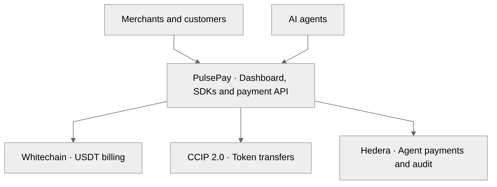
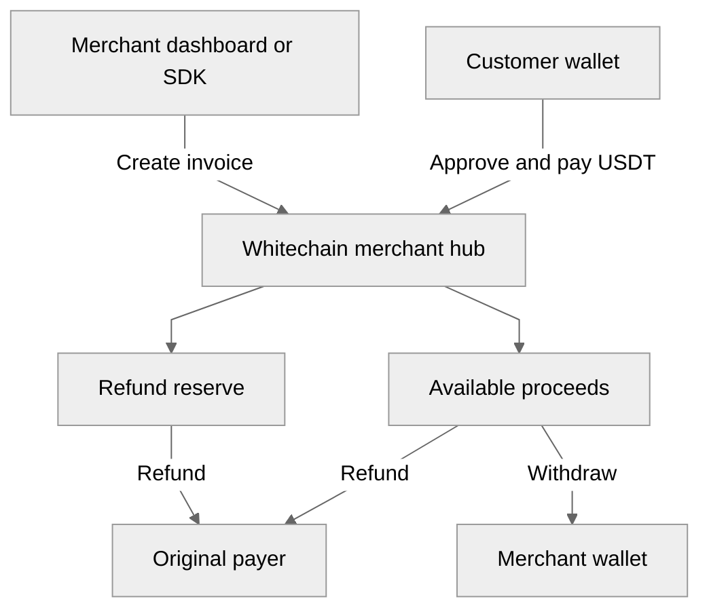
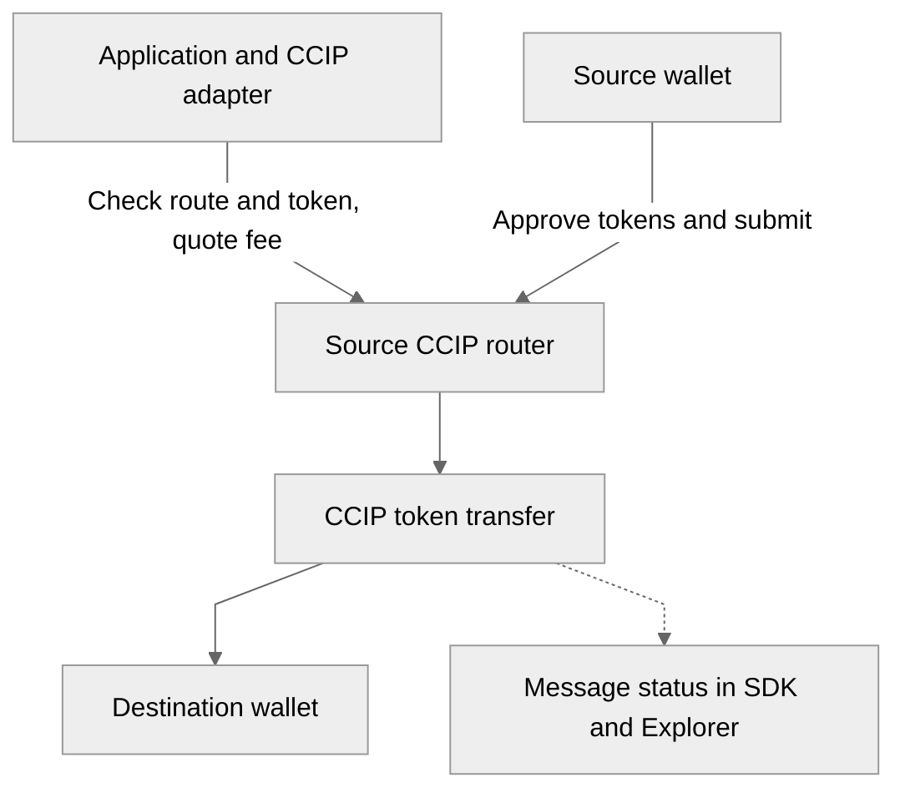
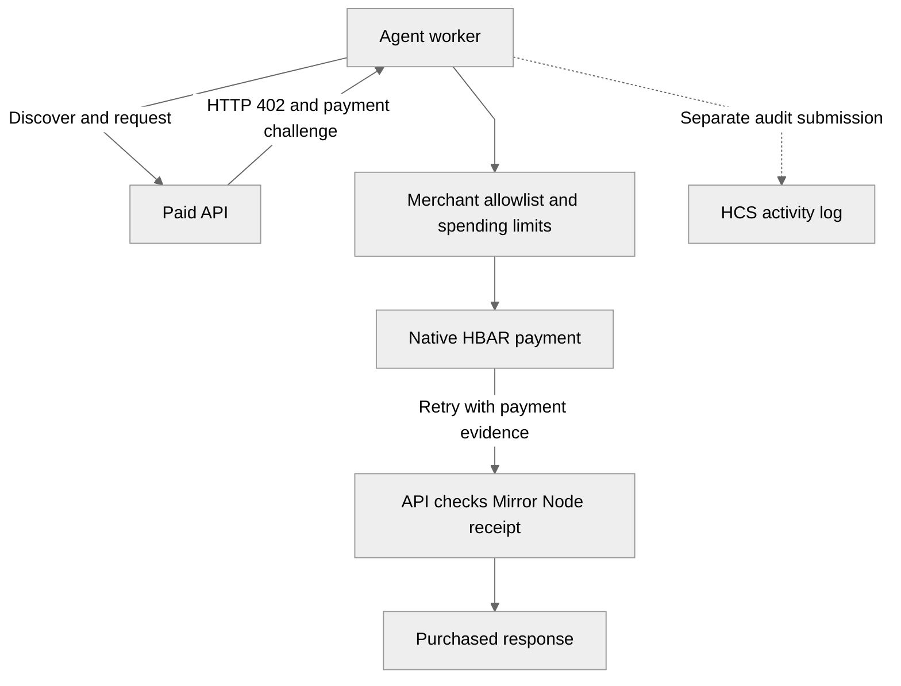

# PulsePay

**One payment gateway for merchants and AI agents.**

Collect USDT from customers, sell API access to agents, and manage billing from a merchant dashboard. SDKs handle checkout, contract calls, cross-chain transfer preparation, and HTTP 402 payment checks.

## Why Payments Break

A software business needs to know which invoice was paid, when a subscription renews, and how much it can refund. A token transfer records money moving; the merchant still has to build the billing around it.

An AI agent needs a different purchase flow. It must discover the price, check its budget, pay, and retrieve the resource through an API. It cannot rely on someone opening a checkout page for every request. When funds sit on another chain, the buyer also needs a supported transfer route and a way to track delivery.

## What PulsePay Does

PulsePay connects customer checkout and agent purchases through a shared set of billing tools. Merchants work in the dashboard; customers use payment links; agents follow a request–pay–retry flow. Developers integrate the parts they need through the SDKs.

- **USDT invoices:** Create an invoice, share its checkout link, and associate the payment with the right customer and amount.
- **Refund reserves:** Set aside a configurable share of incoming payments. Return partial or full payments to the original payer.
- **Subscriptions:** Create plans, collect subscriber authorization, charge eligible cycles, and cancel future billing.
- **Agent API payments:** Issue HTTP 402 payment challenges and release a response after checking the payment. Agents enforce merchant allowlists and spending budgets before signing.
- **Cross-chain transfers:** Check route and token support, quote fees, prepare wallet transactions, and track destination execution through Chainlink CCIP 2.0.
- **Merchant operations:** Read balances, manage invoices and refunds, view receipts and agent audit activity, and export accounting CSV.

## Architecture



## Three Rails, Three Pillars

### Whitechain

**The merchant billing rail.** `PulsePayMerchantHub` holds USDT and stores invoice, payment, subscription, and balance records on Whitechain Sepolia. Checkout and the dashboard read the same contract state.



- Checkout reads the invoice amount, due time, and status. The SDK checks the wallet network, approves USDT when needed, and confirms a matching `PaymentSettled` event.
- Each payment is split between reserve and available proceeds at the merchant's configured rate. Refunds draw from reserve first, then available balance, and cannot exceed the remaining paid amount or held liquidity.
- Subscription enrollment collects the first cycle. Later renewals check the due time, active state, cycle limit, and token allowance. Each Whitechain renewal requires a transaction; opening the dashboard does not trigger billing.
- Contract events supply receipts and payment/refund history. CSV exports cover the selected event window.

**Main contract functions**

- `createInvoice(...)`, `cancelInvoice(invoiceId)`, `payInvoice(invoiceId)` — manage the invoice lifecycle.
- `issueRefund(invoiceId, refundAmount, reasonHash)` — return funds to the original payer.
- `fundRefundReserve(amount)`, `withdrawAvailable(amount, to)` — manage merchant liquidity.
- `setMerchantReserveBps(bps)`, `getMerchantReserveBps(merchant)` — configure and read the reserve policy.
- `createPlan(...)`, `createSubscription(subscriptionId, planId)`, `chargeRenewal(subscriptionId, renewalId)`, `cancelSubscription(subscriptionId)` — manage recurring billing. Duplicate renewal IDs are rejected.
- `getInvoice`, `getPayment`, `getPlan`, `getSubscription`, `getMerchantBalances` — read billing state.

The console supports plan creation, renewal charges, and cancellation. Subscriber enrollment uses the SDK or contract. USDT amounts use six decimals; WBT pays network gas.

[Usage guide](docs/WHITECHAIN_USAGE.md) · [Contract](contracts/whitechain/src/PulsePayMerchantHub.sol) · [SDK adapter](packages/adapter-whitechain/src/client.ts)

### Chainlink CCIP 2.0

**The token-transfer rail.** The CCIP adapter prepares transfers across supported routes between Ethereum Sepolia, Arbitrum Sepolia, and Hedera Testnet. It uses existing CCIP routers and token pools.



- Before quoting, the adapter checks the source RPC's chain, destination support, active on-ramp, registered source token pool, pool destination support, and destination-token mapping.
- Fees come from the router's `getFee`. Native-asset fees are the default; a configured fee token may need a separate approval or a combined allowance when it is also the transferred token.
- Transfers use an encoded recipient address, empty `data`, and `gasLimit = 0`. There is no requested destination callback. Source gas and CCIP fees still apply.
- The SDK returns unsigned transactions. The application refreshes fees, confirms approvals, and has the wallet estimate gas and submit. It then tracks the real message ID until destination execution succeeds or fails.

**Main adapter functions**

- `checkLane(destinationSelector)` — check the route and discover its active on-ramp.
- `quoteBridgeFee(params)` — validate token support and return the live fee.
- `buildBridgeTransactions(params)` — return approval and `ccipSend` transaction payloads.
- `CCIPMessageMonitor.getStatus(messageId)` and `waitForDelivery(messageId, options)` — query or poll delivery, with cancellation and timeout support.
- `getExplorerUrl(messageId)` — open the message in CCIP Explorer.

The core SDK exposes these operations through `bridgeOps`. `/merchant/treasury` displays lane configuration; transfer preparation uses the SDK. A confirmed source transaction is not destination delivery. Bridging funds a wallet; paying a Whitechain invoice remains a separate merchant-hub transaction.

[Usage guide](docs/CHAINLINK_USAGE.md) · [Adapter](packages/adapter-ccip/src/bridge.ts) · [Message monitor](packages/adapter-ccip/src/monitor.ts)

### Hedera

**The agent payment and audit rail.** An agent discovers a service, receives an HTTP 402 challenge, checks its spending policy, and pays native HBAR. The API checks the transaction through Mirror Node before returning the purchased response.



- **Hedera Agent Kit integration:** `X402PayTool` submits a payment or prepares unsigned bytes. `PulsePaySpendLimitPolicy` checks the merchant allowlist, per-payment cap, and daily transfer budget. Transaction and audit fees have separate caps.
- **Receipt checks:** The server checks consensus success, payer, recipient, amount, network, time, and challenge binding. A transaction ID alone does not unlock the resource.
- **Recovery:** The worker journals pending purchases. The same valid proof retrieves the saved response on retry, including after a restart.
- **HCS audit:** `PulsePayHcsAuditHook` records agent activity and retains pending audit submissions. Retrying an audit does not require another purchase; an audit message is separate from payment evidence.
- **Hedera EVM billing:** A second merchant hub supports token invoices and HSS-scheduled subscriptions on chain `296`. Subscribers bound renewals by cycle count, cumulative spend, and expiry. Scheduling requires token allowance and separate HBAR execution funding.

**Main entry points**

- `generateX402Manifest(...)`, `handleX402PaymentCheck(...)` — publish services, issue native-HBAR challenges, and check receipts.
- `HederaEvmInvoicePayTool`, `handleEvmInvoicePaymentCheck(...)` — pay and redeem a challenge-bound token invoice. The server provisions the invoice before returning HTTP 402.
- Hedera EVM contract: `createSubscription(subscriptionId, planId, maxSpend, expiresAt)`, `executeScheduledRenewal(...)`, `rearmSubscription(subscriptionId)`, `cancelSubscription(subscriptionId)`, and `fundExecution()`.

Scheduled cancellations invalidate stale callbacks using a generation counter. Scheduling failures leave subscriptions available for re-arming. These HTTP 402 schemes are PulsePay receipt extensions; the demo APIs serve labelled sample content.

[Usage guide](docs/HEDERA_USAGE.md) · [Agent tools](packages/adapter-hedera/src/index.ts) · [Payment middleware](packages/sdk-server/src/x402.ts) · [Hedera EVM contract](contracts/hedera/src/PulsePayHederaMerchantHub.sol)

## Contracts and Networks

The Whitechain hub below is the recorded demo deployment. The USDT address and CCIP routers are repository defaults; applications select their hub through configuration.

| Component | Network | Address |
| --- | --- | --- |
| Whitechain merchant hub | Whitechain Sepolia · `1874` | [0xC81399e6344f9264830ecB6DF46a5e9458f4f2C3](https://explorer.testnet.whitechain.io/address/0xC81399e6344f9264830ecB6DF46a5e9458f4f2C3) |
| USDT · 6 decimals | Whitechain Sepolia · `1874` | [0xcedfB56113143d55b2358b8CFbB0dEB5Ad2f55a7](https://explorer.testnet.whitechain.io/address/0xcedfB56113143d55b2358b8CFbB0dEB5Ad2f55a7) |
| CCIP router | Ethereum Sepolia · `11155111` | [0x0BF3dE8c5D3e8A2B34D2BEeB17ABfCeBaf363A59](https://sepolia.etherscan.io/address/0x0BF3dE8c5D3e8A2B34D2BEeB17ABfCeBaf363A59) |
| CCIP router | Arbitrum Sepolia · `421614` | [0x2a9C5afB0d0e4BAb2BCdaE109EC4b0c4Be15a165](https://sepolia.arbiscan.io/address/0x2a9C5afB0d0e4BAb2BCdaE109EC4b0c4Be15a165) |
| CCIP router | Hedera Testnet · `296` | [0x802C5F84eAD128Ff36fD6a3f8a418e339f467Ce4](https://hashscan.io/testnet/contract/0x802C5F84eAD128Ff36fD6a3f8a418e339f467Ce4) |
| HCS audit topic | Hedera Testnet | [0.0.11330043](https://hashscan.io/testnet/topic/0.0.11330043) |

**Hedera EVM merchant hub:** No deployment address is recorded in the current configuration. Deploy [the contract](contracts/hedera/README.md) and set `HEDERA_EVM_MERCHANT_HUB_ADDRESS` and its settlement token. HSS (`0x16b`) and HTS (`0x167`) are system contracts, not PulsePay deployments.

CCIP selectors differ from EVM chain IDs: Sepolia uses `16015286601757825753`, Arbitrum Sepolia `3478487238524512106`, and Hedera Testnet `222782988166878823`. Confirm current routers and supported tokens in the official directories for [Sepolia](https://docs.chain.link/ccip/directory/testnet/chain/ethereum-testnet-sepolia), [Arbitrum Sepolia](https://docs.chain.link/ccip/directory/testnet/chain/ethereum-testnet-sepolia-arbitrum-1), and [Hedera Testnet](https://docs.chain.link/ccip/directory/testnet/chain/hedera-testnet). A Whitechain token address cannot be assumed valid on another network.

## End-to-End Workflows

### Invoice to Refund

1. Connect the merchant wallet in `/merchant/settings` and create a **10 USDT invoice** in `/merchant/invoices`.
2. Share `/pricing-free?invoice=<invoice-id>`. The customer approves USDT if needed and pays. The dashboard and `/receipt/<invoice-id>` show the result.
3. With an example 20% reserve policy, the hub holds 2 USDT in reserve and makes 8 USDT available. A 5 USDT refund uses the 2 USDT reserve and 3 USDT of available funds, assuming those balances are unchanged.
4. The refund returns to the original payer. The merchant can withdraw remaining available proceeds or add reserve funds from `/merchant/treasury`.

### Subscription to Renewal

1. The merchant creates a plan; the subscriber authorizes it through the SDK or contract and pays the first cycle.
2. At the next due time, a renewal collects the next payment if the subscription remains eligible. Whitechain uses an explicit renewal transaction; the Hedera EVM hub uses funded HSS schedules.
3. Billing ends on cancellation or when the subscription's limits are reached.

### Source Wallet to Destination Wallet

1. An application selects a supported source token, destination, amount, and recipient.
2. The SDK checks the route, quotes the fee, and prepares transactions. The wallet confirms approvals and submits the transfer.
3. The application tracks the message ID until destination execution succeeds or fails. Successful delivery funds the recipient wallet.

### Agent Request to Paid Response

1. The worker reads `/.well-known/x402.json` and requests a resource. The API returns HTTP 402 with the price and payment challenge.
2. The agent checks its budget and merchant allowlist, pays HBAR, and retries with payment evidence.
3. The server checks the receipt and returns the saved resource response. The audit hook records activity in HCS; interrupted purchases resume from saved state.

## Installation and Quickstart

### Integrate Checkout

```bash
npm install @pulsepay/sdk-react @pulsepay/sdk-core viem
```

Pass a deployed Whitechain hub and an existing bytes32 invoice ID:

```tsx
import { PulsePayProvider, PulsePayCheckout } from "@pulsepay/sdk-react";
import type { Address, Hex } from "viem";

export function Checkout({ hubAddress, invoiceId }: {
  hubAddress: Address;
  invoiceId: Hex;
}) {
  return (
    <PulsePayProvider config={{ whitechain: { contractAddress: hubAddress } }}>
      <PulsePayCheckout invoiceId={invoiceId} onSuccess={console.log} />
    </PulsePayProvider>
  );
}
```

Checkout reads the invoice and uses the customer's browser wallet for approval and payment. `onSuccess` receives the confirmed transaction hash.

For other integrations:

```bash
# HTTP 402 server helpers
npm install @pulsepay/sdk-server @pulsepay/shared

# Individual chain adapters
npm install @pulsepay/adapter-whitechain viem
npm install @pulsepay/adapter-ccip viem
npm install @pulsepay/adapter-hedera @hashgraph/hedera-agent-kit @hiero-ledger/sdk viem
```

| Package | Version | npm | Description |
| :--- | :--- | :--- | :--- |
| [`@pulsepay/sdk-core`](packages/sdk-core) | `1.1.0` | [](https://www.npmjs.com/package/@pulsepay/sdk-core) | Core TypeScript client, CCIP bridging, invoice/subscription lifecycle |
| [`@pulsepay/sdk-react`](packages/sdk-react) | `1.1.0` | [](https://www.npmjs.com/package/@pulsepay/sdk-react) | React checkout widget, receipt verifier, and billing components |
| [`@pulsepay/sdk-server`](packages/sdk-server) | `1.1.0` | [](https://www.npmjs.com/package/@pulsepay/sdk-server) | Server middleware, x402 resource server gateway, and webhooks |
| [`@pulsepay/shared`](packages/shared) | `1.1.0` | [](https://www.npmjs.com/package/@pulsepay/shared) | Shared schemas, Zod types, and accountant CSV formatters |
| [`@pulsepay/adapter-whitechain`](packages/adapter-whitechain) | `1.1.0` | [](https://www.npmjs.com/package/@pulsepay/adapter-whitechain) | Whitechain EVM client, ABI bindings, and indexer |
| [`@pulsepay/adapter-ccip`](packages/adapter-ccip) | `1.1.0` | [](https://www.npmjs.com/package/@pulsepay/adapter-ccip) | Chainlink CCIP 2.0 cross-chain token bridging adapter |
| [`@pulsepay/adapter-hedera`](packages/adapter-hedera) | `1.1.0` | [](https://www.npmjs.com/package/@pulsepay/adapter-hedera) | Hedera Agent Kit v4 spend policy, HCS audit hook & x402 |

`createPulsePay(config)` exposes `invoices`, `payments`, `subscriptions`, and `bridgeOps` through [the core SDK](packages/sdk-core/src/index.ts). Supply a viem wallet client for contract writes. Hedera agent tools use the dedicated adapter.

### Run Locally

Use **Node.js ≥22.13.0** and **pnpm 12.14.0**.

```bash
git clone https://github.com/lviffy/ETHGLOBAL.git
cd ETHGLOBAL
pnpm install --frozen-lockfile
cp .env.example .env
```

Configure the integrations you need in [`.env`](.env.example):

- **Payment API:** Set `PULSEPAY_API_SECRET` to a random secret of at least 32 characters and set `HEDERA_MERCHANT_ACCOUNT_ID`.
- **Whitechain:** Set `WHITECHAIN_MERCHANT_HUB_ADDRESS` and `PULSEPAY_MERCHANT_ADDRESS`. The connected wallet needs WBT for gas and USDT for payments; its token configuration must match the hub's `USDT()` getter.
- **Native HBAR agent:** Set `HEDERA_SERVICE_ID=market-data-pro`, the buyer account/key, audit topic, and spending/fee limits. The example environment selects the EVM invoice service, so change the service ID for this walkthrough. The audit writer must control the topic's submit key.
- **CCIP:** Set the source/destination chain IDs and a matching `CCIP_RPC_URL` or `SEPOLIA_RPC_URL`. The SDK demo also needs a supported `CCIP_TOKEN_ADDRESS`.
- **Hedera EVM:** Configure the deployed hub, settlement token, merchant and buyer signers, and token spending limits listed in `.env.example`. Fund HBAR execution separately for scheduled subscriptions.

```bash
pnpm build
pnpm dev
```

Open the [merchant dashboard](http://localhost:3100/merchant). The [payment API](http://localhost:3000) starts alongside it when its secret and merchant account are configured. Its [service manifest](http://localhost:3000/.well-known/x402.json) lists paid endpoints. Authenticated API reads use `x-api-key` or the [merchant login](http://localhost:3000/merchant/login).

Start the buyer separately:

```bash
pnpm --filter pulsepay-agent-worker start
```

The scripts load the root `.env` automatically. With a signing key, the native worker can execute payments; without a buyer or operator key it prepares unsigned wallet bytes. Keep signing keys in the server or worker environment and preserve `.pulsepay/` across restarts. Production requires an absolute `PULSEPAY_STATE_DIRECTORY` on persistent storage; the file store supports one server and one worker, rather than multiple replicas.

## Tech Stack

| Layer | Technology |
| --- | --- |
| Merchant dashboard | Svelte 5, SvelteKit, Tailwind CSS 4 |
| SDKs and payment API | TypeScript, Node.js, viem, React checkout components |
| Contracts | Solidity 0.8.26, OpenZeppelin, Foundry |
| Merchant billing | Whitechain Sepolia, USDT |
| Cross-chain transfers | Chainlink CCIP 2.0 routers and token pools |
| Agent payments and audit | Hedera Agent Kit v4, Hiero SDK, Mirror Node, HCS |
| Scheduled token billing | Hedera EVM, ERC-20 / HTS settlement, HSS |
| Workspace | pnpm, Turborepo |

## Source Map

- [Merchant dashboard](apps/web/src/lib/components/MerchantDashboard.svelte) and [checkout example](packages/sdk-react/examples/checkout-page.tsx).
- [Payment API](apps/demo-store/src/index.ts) and [buyer worker](apps/agent-worker/src/index.ts).
- [Whitechain contract](contracts/whitechain/src/PulsePayMerchantHub.sol) and [Hedera EVM contract](contracts/hedera/src/PulsePayHederaMerchantHub.sol).
- [Core SDK](packages/sdk-core/src/index.ts), [server SDK](packages/sdk-server/src/index.ts), and [chain adapters](packages).

MIT licensed.
