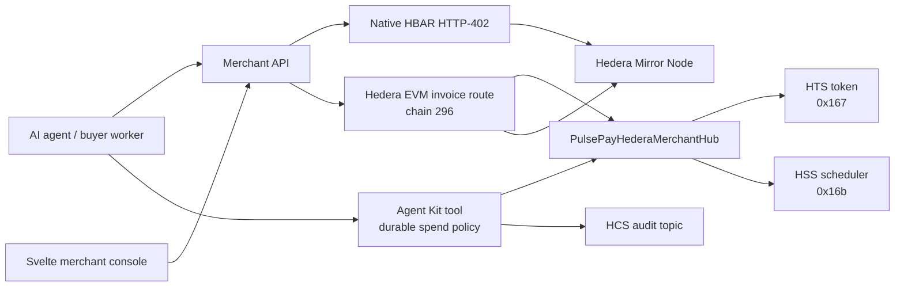
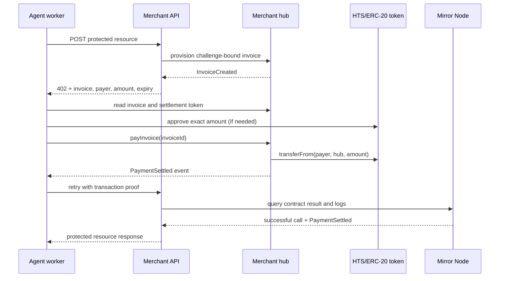
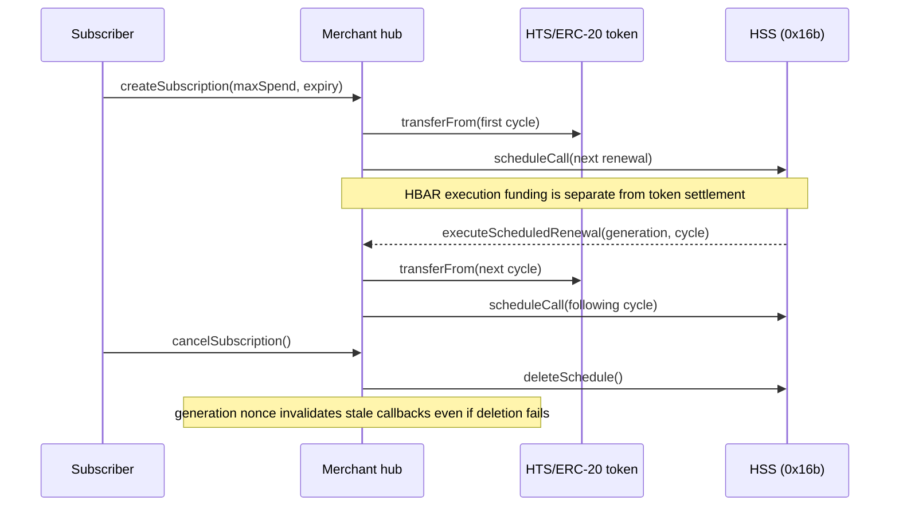

# PulsePay

PulsePay combines a Whitechain USDT merchant contract and TypeScript SDK, Chainlink CCIP 2.0 cross-chain token bridging, and a native Hedera HTTP-402 payment flow.

## Official NPM packages

All PulsePay SDKs and adapters are published to the npm registry under the `@pulsepay` scope:

```bash
# Core client & universal checkout
npm install @pulsepay/sdk-core viem

# React checkout widget & billing components
npm install @pulsepay/sdk-react @pulsepay/sdk-core viem

# Server middleware & x402 resource server gateway
npm install @pulsepay/sdk-server @pulsepay/shared

# Chain & protocol adapters
npm install @pulsepay/adapter-whitechain viem
npm install @pulsepay/adapter-ccip viem
npm install @pulsepay/adapter-hedera @hashgraph/hedera-agent-kit @hiero-ledger/sdk viem
```

| Package | Version | npm | Description |
| :--- | :--- | :--- | :--- |
| [`@pulsepay/sdk-core`](packages/sdk-core) | `1.0.0` | [](https://www.npmjs.com/package/@pulsepay/sdk-core) | Core TypeScript client, invoice/subscription lifecycle, quote routing |
| [`@pulsepay/sdk-react`](packages/sdk-react) | `1.0.0` | [](https://www.npmjs.com/package/@pulsepay/sdk-react) | React checkout widget, receipt verifier, and billing components |
| [`@pulsepay/sdk-server`](packages/sdk-server) | `1.0.0` | [](https://www.npmjs.com/package/@pulsepay/sdk-server) | Server middleware, x402 resource server gateway, and webhooks |
| [`@pulsepay/shared`](packages/shared) | `1.0.0` | [](https://www.npmjs.com/package/@pulsepay/shared) | Shared schemas, Zod types, and accountant CSV formatters |
| [`@pulsepay/adapter-whitechain`](packages/adapter-whitechain) | `1.0.0` | [](https://www.npmjs.com/package/@pulsepay/adapter-whitechain) | Whitechain EVM client, ABI bindings, and indexer |
| [`@pulsepay/adapter-ccip`](packages/adapter-ccip) | `1.0.0` | [](https://www.npmjs.com/package/@pulsepay/adapter-ccip) | Chainlink CCIP 2.0 cross-chain token bridging adapter |
| [`@pulsepay/adapter-hedera`](packages/adapter-hedera) | `1.0.0` | [](https://www.npmjs.com/package/@pulsepay/adapter-hedera) | Hedera Agent Kit v4 spend policy, HCS audit hook & x402 |

## What works

- **Whitechain:** invoices, reserve-backed refunds, subscriptions and balances in `PulsePayMerchantHub.sol`. The SDK provides transaction encoders and direct USDT wallet checkout. Checkout confirms the wallet/RPC network, reads the actual invoice, approves only its amount when needed, and reports success only after a matching settlement event.
- **Chainlink CCIP 2.0:** token-only cross-chain bridging across Ethereum Sepolia, Arbitrum Sepolia and Hedera Testnet using official CCIP Routers with zero callback gas overhead (`gasLimit = 0`, `data = ""`).
- **Hedera:** native HBAR receipt payments plus a chain-296 merchant hub with finite HSS-scheduled subscriptions and challenge-bound EVM invoice payments. The EVM agent validates the live invoice, enforces a durable token budget, approves the exact amount, and the server unlocks the resource only after decoding a matching Mirror Node `PaymentSettled` log. Both HTTP-402 schemes are PulsePay extensions, not standardized facilitator interoperability.

## Hedera hackathon quickstart

This repository is the public-source target for the PulsePay Hedera submission. It contains the setup instructions, architecture, payment flow, local tests, and reproducible testnet evidence required to review the project.

### Architecture



### Invoice payment sequence



### Autonomous subscription sequence



### Payment flow

1. An agent requests a protected resource and receives HTTP `402` with a challenge bound to the service, payer, merchant, amount, token, invoice ID, and expiry.
2. The worker validates the challenge against its trusted Hedera configuration and spend policy. For the native route it submits HBAR; for the EVM route it reads the invoice, approves only the required HTS/ERC-20 amount, and calls `payInvoice`.
3. The server queries Hedera Mirror Node, verifies success, and checks the exact payer, target contract, invoice, merchant, customer, amount, and `PaymentSettled` event.
4. The verified response is persisted. Retrying the same proof returns the saved response without another payment; an altered or replayed proof is rejected.

### Settled Hedera evidence

The native HBAR payment path has a confirmed Hedera Testnet settlement:

- Transaction ID: `0.0.11327364@1793912134.008842902`
- Settlement: `1` tinybar to `0.0.11329845`
- [View the confirmed transaction on HashScan](https://hashscan.io/testnet/transaction/0.0.11327364-1793912134-008842902)

This evidence is for the native `hedera-native-receipt` route. The custom `hedera-evm-invoice-receipt` route is implemented and locally tested, but its live contract deployment remains dependent on a healthy Hedera testnet RPC and funded deployment credentials.

### Run the demo

```bash
pnpm install --frozen-lockfile --ignore-scripts
cp .env.example .env
pnpm build
pnpm --filter pulsepay-demo-store start
```

The API serves discovery at `/.well-known/x402.json`; the Svelte merchant console runs on port `3100`. See [Hedera implementation details](docs/HEDERA.md), [the EVM deployment guide](contracts/hedera/README.md), and [the implementation plan](docs/HEDERA_EVM_IMPLEMENTATION_PLAN.md) for configuration and limitations.

The SvelteKit merchant console uses deployed contracts and browser-wallet signing. Simulation dashboards, fixture invoice pages and preview mutation endpoints have been removed. The separate payment API serves sample content behind real Hedera receipt verification; it is not a live market feed. A cross-chain swap cannot currently settle a Whitechain invoice. See [the testing guide](docs/TESTING.md) for observed results and the complete manual test flow.

## Setup

Install Node.js **22.13 or newer**, **pnpm 12.14.0**, and [Foundry](https://getfoundry.sh/). pnpm is the authoritative package manager and `pnpm-lock.yaml` is the committed dependency graph.

```bash
pnpm install --frozen-lockfile --ignore-scripts
cp .env.example .env   # only when you do not already have a .env
```

Set `PULSEPAY_API_SECRET` to a random value of at least 32 characters and `HEDERA_MERCHANT_ACCOUNT_ID` to an account you control. Set the other accounts, keys and contract addresses for the integrations you intend to use. Keep `.env` private and out of git. Existing signing keys are never generated by setup.

```bash
pnpm build
pnpm --filter pulsepay-demo-store start
```

Application scripts load the root `.env` automatically and use the repository root as their working directory. The API listens on port 3000; its `/merchant` path redirects to the real frontend console on port 3100. For API session authentication, use `http://localhost:3000/merchant/login` with the merchant access secret from `.env`. API clients can instead send `x-api-key: <PULSEPAY_API_SECRET>`. Session cookies are HTTP-only, expire after one hour, and use SameSite=Strict. Production requires an HTTPS `PULSEPAY_APP_URL`.

`npm run dev` (or `pnpm dev`) compiles the SDK packages with at most two builds at once, watches those packages, and runs the SvelteKit frontend at `http://localhost:3100`. If the root `.env` contains a valid merchant API secret and Hedera merchant account, it also starts the paid demo API on port 3000. `npm run dev:web` starts just the web development flow; `npm run dev:api` starts the configured API separately. The buyer agent is never launched automatically.

The supervisor runs the installed Node CLIs directly and excludes production web builds from its watcher. An `npx`-backed `pnpm` wrapper is rejected before any build starts, preventing recursive launcher processes. `pnpm test:dev` checks both normal startup validation and rejection of that wrapper.

The new UI lives in [apps/web](apps/web/README.md). Configure `WHITECHAIN_MERCHANT_HUB_ADDRESS`, `PULSEPAY_MERCHANT_ADDRESS`, `HEDERA_AUDIT_TOPIC_ID`, and `PULSEPAY_SERVICE_URL` for the real integrations you use. Unconfigured reads show a retryable error; the frontend has no simulated settlement fallback.

## Verification

```bash
pnpm verify
```

This runs ESLint across all nine workspaces and startup tools, builds TypeScript, runs all JavaScript and Solidity suites, and checks high/critical dependency advisories. The same command runs in `.github/workflows/verify.yml`. Contract tests use a pinned Solidity 0.8.26 compiler and Cancun EVM target. The wrapper uses standard Foundry installations; existing local `.bin/forge` and `.bin/solc` are optional fallbacks.

Useful individual checks:

```bash
pnpm lint
pnpm test:unit
pnpm test:contracts
pnpm audit
```

Tests use temporary files, mock payment submitters and local EVM execution. They do not spend testnet or mainnet funds.

## APIs

| Route | Access | Behavior |
| --- | --- | --- |
| `GET /.well-known/x402.json` | Public | Native Hedera service discovery |
| `POST /v1/services/:serviceId/query` | Payment proof | 402 challenge; a verified receipt unlocks one saved response |
| `GET /receipt/hedera/:transactionId` | Public | Verified Hedera receipt |
| `GET /api/merchant/state` | Merchant | Verified Hedera totals and activities only |
| `GET /api/export.csv` | Merchant | Verified payments only |
| `GET /api/hedera/payments` | Merchant | Verified payment records, without challenge secrets or saved response data |
| `GET /api/whitechain/invoices/:bytes32` | Merchant | Real contract invoice read using configured hub/RPC |
| `POST /api/bridge/quote` | Merchant | Real-time Chainlink CCIP 2.0 bridge fee quote |

The bridge endpoint accepts `destinationChainId` (or `destinationChainSelector`), `tokenAddress`, `amountUnits` (integer string), and `recipientAddress`. It quotes the required CCIP network fee directly from the configured CCIP Router without broadcasting transactions.

## React checkout

Create a connected viem wallet client on Whitechain Sepolia and pass it into the provider. The invoice must already exist on the configured merchant hub.

```tsx
<PulsePayProvider config={{ whitechain: { contractAddress: hubAddress, walletClient } }}>
  <PulsePayCheckout invoiceId={invoiceBytes32} onSuccess={handleConfirmedPayment} />
</PulsePayProvider>
```

`onSuccess` receives a verified transaction hash. No hardcoded invoice amount or random success hash is used. The supplied wallet must expose an authorized account on chain 1874. The simulation-only `MerchantBillingDashboard` component and export have been removed; use the SvelteKit merchant console for real billing operations.

## Hedera buyer

Running the buyer with a configured signing key can spend real HBAR and transaction fees. Without a key it prepares unsigned wallet bytes.

```bash
pnpm --filter pulsepay-agent-worker start
```

The buyer journals the payment transaction ID before submission. An unresolved saved purchase is resumed instead of purchasing again. `HEDERA_PAYMENT_TRANSACTION_ID` can select the confirmed transaction for a saved wallet-prepared purchase. A successfully redeemed proof returns the original saved response on retry, including after server restart, without executing another purchase. A different proof cannot reuse that challenge or transaction.

For the Hedera EVM path, set `HEDERA_SERVICE_ID=agent-invoice-pro` and configure the hub, settlement token, merchant signer, buyer signer/address, token-unit caps, and RPC values shown in `.env.example`. The merchant signer provisions a unique invoice before the API advertises its 402 challenge. `HEDERA_EVM_PAYMENT_TRANSACTION_HASH` resumes redemption of an already-submitted payment without paying again. See [the Hedera contract guide](contracts/hedera/README.md) for deployment and HSS funding.

Per-request and daily limits cover transfer amounts. Network and HCS fees have separate transaction caps; these settings do not provide a global wallet fee budget. See [Hedera protocol details and historical live evidence](docs/HEDERA.md).

## State and deployment

Development state defaults to `.pulsepay`. Production must set `PULSEPAY_STATE_DIRECTORY` to an **absolute path on a persistent volume**. Preserve this directory across restarts: it holds challenges/redemptions, cached purchased responses, budgets, refunds and pending audit records.

One server and one buyer worker may own their respective state files. Ownership locks reject duplicate processes. After an abnormal crash, verify that the named process/host has stopped before removing a stale `server-owner.lock` or `worker-owner.lock` directory. Multiple servers or buyer replicas require a transactional shared store; this file-backed deployment deliberately rejects them. Atomic file replacement is not a substitute for a database or backup.

Unused challenges expire and are pruned; active challenges are capped at 1,000 and total retained records at 10,000. Saved resource responses are limited to 64 KiB. Capacity exhaustion fails closed and requires merchant maintenance/migration; redeemed identifiers are never silently dropped. HTTP requests and sign-in/challenge creation are rate-limited, and request bodies are bounded.

## Integration review


No deployments or onchain transactions are part of the local repair/verification workflow.

[Original audit and remediation status](docs/CONFIGURATION_AUDIT.md) · [Whitechain feedback](WHITECHAIN_FEEDBACK.md) · [Integration audit](docs/CCIP_REVIEW.md)
