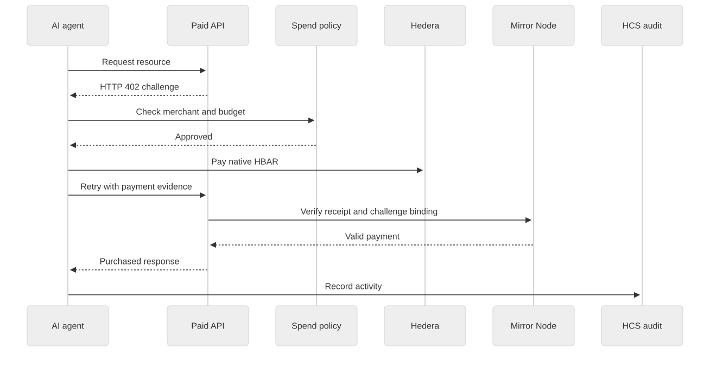

# PulsePay


**A payment gateway for merchants, customers, and AI agents.**

PulsePay brings USDT checkout, subscription billing, refunds, and paid API access into one developer toolkit and merchant dashboard. Whitechain handles merchant billing, Hedera supports agent payments and audit records, and Chainlink CCIP enables transfers between supported networks.

[Problem](#the-problem) · [Solution](#the-solution) · [Architecture](#architecture) · [Whitechain](#whitechain) · [Qualification Evidence](#whitechain-qualification-evidence) · [Hedera](#hedera) · [Chainlink](#chainlink) · [Quickstart](#quickstart)

## The Problem

A token transfer moves money, but a business still needs to connect it to an invoice, manage recurring charges, reserve funds for refunds, and produce receipts. Those operations often require separate tools and custom accounting logic.

AI agents introduce another requirement: they need to discover a price, check a budget, pay, and retrieve a resource through an API. Customers and agents may also hold funds on a different network, making route validation and delivery tracking part of the payment experience.

## The Solution

PulsePay provides a shared billing toolkit with dedicated flows for customers and agents:

- **Merchant billing:** Create USDT invoices and subscription plans, track payments, manage refund reserves, and export accounting records.
- **Customer checkout:** Share payment links, accept wallet-authorized payments, and provide receipts tied to contract events.
- **Agent purchases:** Return HTTP 402 payment challenges, apply spending policies, verify payment evidence, and release the purchased response.
- **Cross-chain funding:** Validate supported routes, quote fees, prepare wallet transactions, and track token delivery through Chainlink CCIP.

Merchants operate through the dashboard; developers integrate through TypeScript SDKs, React checkout components, and server middleware.

## Architecture



| Component | Responsibility |
| --- | --- |
| Dashboard and checkout | Merchant operations, customer payment links, receipts, and wallet authorization |
| Core SDK and adapters | Billing contract calls, network validation, CCIP quotes, and unsigned transfer preparation |
| Payment API | Service discovery, payment challenges, receipt verification, and response redemption |
| Agent worker | Purchase execution, merchant allowlists, spending limits, and interrupted-purchase recovery |
| Contracts and network services | Billing state, token delivery, payment evidence, and audit consensus |

Customer checkout follows **invoice → token approval → payment → receipt**. Agent purchases follow **request → HTTP 402 → policy check → payment → verified response**, with HCS audit submissions tracked separately.

Each integration has a distinct role. CCIP delivery funds a destination wallet; settling an invoice requires a separate billing transaction. The API and worker persist their own state, currently supporting one server and one worker per file-backed deployment.

## Whitechain

**USDT billing and merchant settlement.**

`PulsePayMerchantHub` stores invoices, payments, subscriptions, and merchant balances on Whitechain Sepolia. The dashboard and checkout read the same contract state.



- **Invoices and checkout:** Create or cancel invoices, approve USDT, and confirm payment through a matching `PaymentSettled` event.
- **Refunds and balances:** Split incoming funds between a configurable refund reserve and available proceeds. Partial or full refunds return to the original payer, drawing from reserve first and then available funds.
- **Subscriptions:** Create plans, collect subscriber authorization, and charge eligible renewals subject to due time, allowance, and cycle limits.
- **Receipts and reporting:** Read payment and refund events, view receipts, and export records for the selected event window.

**Payment flow:** Merchant creates an invoice → customer pays USDT → hub allocates reserve and proceeds → merchant withdraws or refunds.

Whitechain uses chain ID `1874`, USDT with six decimals, and WBT for gas. Each renewal requires a transaction. The console supports plan creation, renewal charges, and cancellation; subscriber enrollment uses the SDK or contract.

[Integration guide](docs/WHITECHAIN_USAGE.md) · [Merchant hub](contracts/whitechain/src/PulsePayMerchantHub.sol) · [Whitechain adapter](packages/adapter-whitechain)

## Whitechain Qualification Evidence

- Network: Whitechain Sepolia — Chain ID 1874
- Verified merchant hub: https://explorer.testnet.whitechain.io/address/0xC81399e6344f9264830ecB6DF46a5e9458f4f2C3
- Official USDT: https://explorer.testnet.whitechain.io/address/0xcedfB56113143d55b2358b8CFbB0dEB5Ad2f55a7
- Successful USDT payment: https://explorer.testnet.whitechain.io/tx/0xfd1e2c2af8bb8e3c192cfab6f252667bb37c4c77f89840dc77a5d2d2081cb10e
- Demo video: REPLACE_WITH_VIDEO_URL

PulsePay needs on-chain settlement because it provides merchants and
customers with independently verifiable payment receipts, programmable
refund reserves, and transparent billing state without relying on a
central payment processor or custodial database.

## Hedera

**Agent payments, spending controls, and audit records.**

An agent discovers a paid service, receives an HTTP 402 challenge, checks its policy, and pays native HBAR. The API verifies the transaction through Mirror Node before returning the purchased response.



- **Agent Kit tools:** `X402PayTool` submits payments or prepares unsigned bytes. `PulsePaySpendLimitPolicy` enforces merchant allowlists, per-payment caps, and daily budgets, with separate transaction and audit fee caps.
- **Receipt verification:** The server checks consensus success, payer, recipient, amount, network, time, and challenge binding.
- **Purchase recovery:** The worker journals pending purchases. Reusing valid payment proof retrieves the saved response, including after a restart.
- **HCS audit:** `PulsePayHcsAuditHook` records agent activity and retries pending submissions independently of the purchase.

**Payment flow:** Discover service → request resource → receive HTTP 402 → check budget → pay HBAR → retry with proof → receive verified response.

A separate **Hedera EVM merchant hub** supports token invoices and HSS-scheduled subscriptions on testnet chain `296`. Renewals are bounded by cycle count, cumulative spend, and expiry, and require token allowance plus separate HBAR execution funding. Its deployment address must be configured.

Payment receipts and HCS audit messages are separate evidence. The HTTP 402 schemes are PulsePay receipt extensions; the demo APIs serve labelled sample content.

[Integration guide](docs/HEDERA_USAGE.md) · [Hedera adapter](packages/adapter-hedera) · [Payment middleware](packages/sdk-server/src/x402.ts) · [Hedera EVM hub](contracts/hedera)

## Chainlink

**Cross-chain token transfers through CCIP 2.0.**

`CCIPBridgeAdapter` validates routes and token pools, quotes live fees, and prepares unsigned transactions. The user's source-chain wallet authorizes approvals and `ccipSend`; the adapter tracks the resulting message through destination execution.


- **Route validation:** Check the source RPC, destination support, active on-ramp, source token pool, and destination-token mapping before quoting.
- **Transfer preparation:** Build token approval and send payloads with native or configured ERC-20 fee payment. Transfers use empty message data, no destination callback, and full source finality.
- **Delivery tracking:** Follow the real message ID through the CCIP API and Explorer. Source confirmation alone does not prove delivery; destination execution must succeed.

**Transfer flow:** Select supported token and route → validate and quote → wallet approves and sends → track message → confirm destination delivery.

The development configuration uses **Ethereum Sepolia → Hedera Testnet**. Built-in network maps also include Arbitrum Sepolia; each route and token requires live validation. The merchant treasury page provides read-only lane visibility.

**Current scope:** Whitechain-to-Sepolia bridging is disabled. CCIP transfers do not settle Whitechain invoices, update refund reserves, or trigger renewals. A complete signed token-transfer acceptance run remains outstanding; see the [integration review](docs/CCIP_REVIEW.md).

[Integration guide](docs/CHAINLINK_USAGE.md) · [CCIP adapter](packages/adapter-ccip) · [Message monitor](packages/adapter-ccip/src/monitor.ts)

## Quickstart

Use **Node.js ≥22.13.0** and **pnpm 12.14.0**.

```bash
git clone https://github.com/lviffy/PulsePay.git
cd PulsePay
pnpm install --frozen-lockfile
cp .env.example .env
```

Configure the integrations you need in [`.env.example`](.env.example):

| Integration | Required configuration |
| --- | --- |
| Whitechain | `WHITECHAIN_MERCHANT_HUB_ADDRESS`, `PULSEPAY_MERCHANT_ADDRESS`, and a wallet funded with WBT and USDT; the token must match the hub's `USDT()` getter |
| Payment API | `PULSEPAY_API_SECRET` of at least 32 characters and `HEDERA_MERCHANT_ACCOUNT_ID` |
| Native HBAR agent | `HEDERA_SERVICE_ID=market-data-pro`, buyer account/key, audit topic, and spending/fee limits; the audit writer must control the topic submit key |
| CCIP | Source/destination chain IDs, matching `CCIP_RPC_URL` or `SEPOLIA_RPC_URL`, and a supported source token for the SDK demo |
| Hedera EVM | Deployed hub, settlement token, merchant/buyer signers, token spending limits, and HBAR execution funding for schedules |

```bash
pnpm build
pnpm dev
```

Open the [merchant dashboard](http://localhost:3100/merchant). The [payment API](http://localhost:3000) starts alongside it when its secret and merchant account are configured. Discover paid endpoints through its [service manifest](http://localhost:3000/.well-known/x402.json).

Start the agent buyer separately:

```bash
pnpm --filter pulsepay-agent-worker start
```

Scripts load the root `.env`. Keep signing keys in the server or worker environment and preserve `.pulsepay/` across restarts. Production requires an absolute `PULSEPAY_STATE_DIRECTORY` on persistent storage; multiple replicas need a shared transactional store.

### Add Checkout to an Application

```bash
npm install @pulsepay/sdk-react @pulsepay/sdk-core viem
```

Pass a deployed Whitechain hub and an existing bytes32 invoice ID:

```tsx
import { PulsePayProvider, PulsePayCheckout } from "@pulsepay/sdk-react";
import type { Address, Hex } from "viem";

export function Checkout({ hubAddress, invoiceId }: {
  hubAddress: Address;
  invoiceId: Hex;
}) {
  return (
    <PulsePayProvider config={{ whitechain: { contractAddress: hubAddress } }}>
      <PulsePayCheckout invoiceId={invoiceId} onSuccess={console.log} />
    </PulsePayProvider>
  );
}
```

Checkout reads the invoice and uses the customer's browser wallet for approval and payment. `onSuccess` receives the confirmed transaction hash.

## SDKs and Repository

| Package | Purpose |
| --- | --- |
| [`@pulsepay/sdk-core`](packages/sdk-core) | Unified invoice, payment, subscription, and CCIP operations |
| [`@pulsepay/sdk-react`](packages/sdk-react) | Checkout, receipt, and billing components |
| [`@pulsepay/sdk-server`](packages/sdk-server) | HTTP 402 middleware, receipt verification, and webhooks |
| [`@pulsepay/shared`](packages/shared) | Shared schemas, types, and accounting CSV formatters |
| [`@pulsepay/adapter-whitechain`](packages/adapter-whitechain) | Whitechain contract client and event indexing |
| [`@pulsepay/adapter-hedera`](packages/adapter-hedera) | Agent Kit tools, spending policy, and HCS audit hook |
| [`@pulsepay/adapter-ccip`](packages/adapter-ccip) | CCIP route validation, transfer preparation, and monitoring |

The core SDK exposes `invoices`, `payments`, `subscriptions`, and `bridgeOps` through `createPulsePay(config)`. Contract writes require a viem wallet client; Hedera agent tools use the dedicated adapter.

Application entry points: [merchant dashboard](apps/web), [payment API](apps/demo-store), [agent worker](apps/agent-worker), and [SDK demo](apps/sdk-demo).

Built with Svelte 5, SvelteKit, Tailwind CSS 4, TypeScript, React, viem, Solidity, OpenZeppelin, Foundry, Hedera Agent Kit v4, and the Hiero SDK. The workspace uses pnpm and Turborepo.

## Demo Deployment

These are recorded testnet values. Configure applications for the deployment you intend to use.

| Component | Network | Address |
| --- | --- | --- |
| Merchant hub | Whitechain Sepolia · `1874` | [0xC81399e6344f9264830ecB6DF46a5e9458f4f2C3](https://explorer.testnet.whitechain.io/address/0xC81399e6344f9264830ecB6DF46a5e9458f4f2C3) |
| USDT | Whitechain Sepolia · `1874` | [0xcedfB56113143d55b2358b8CFbB0dEB5Ad2f55a7](https://explorer.testnet.whitechain.io/address/0xcedfB56113143d55b2358b8CFbB0dEB5Ad2f55a7) |
| HCS audit topic | Hedera Testnet | [0.0.11330043](https://hashscan.io/testnet/topic/0.0.11330043) |

For CCIP router configuration and verification details, see the [Chainlink guide](docs/CHAINLINK_USAGE.md). For Hedera EVM deployment, see the [contract guide](contracts/hedera/README.md).

MIT licensed.
